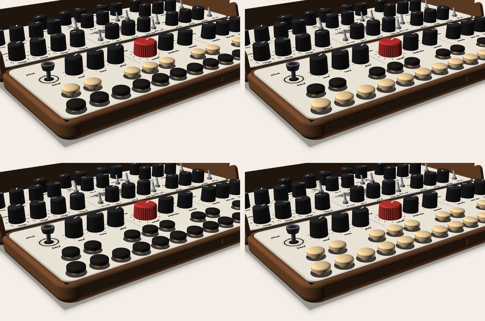
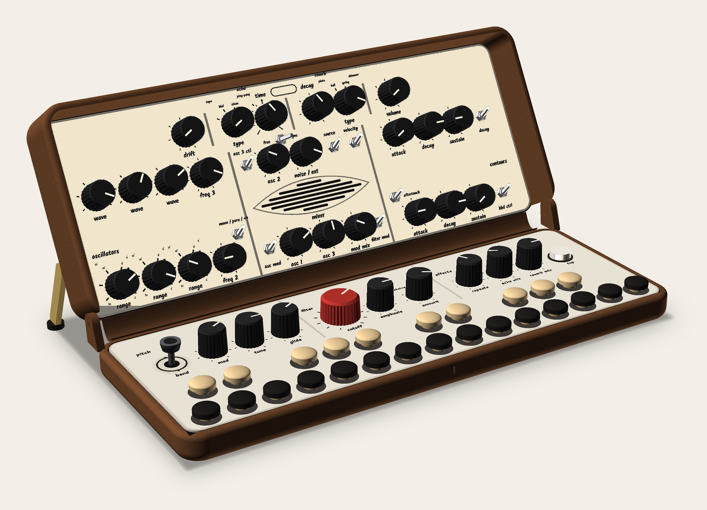
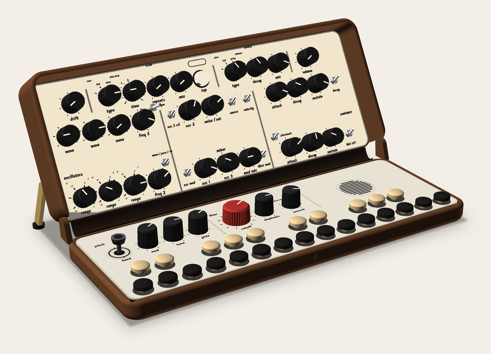
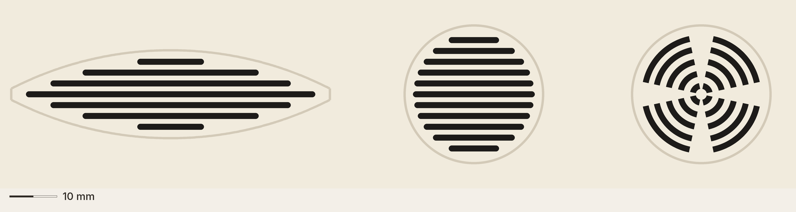
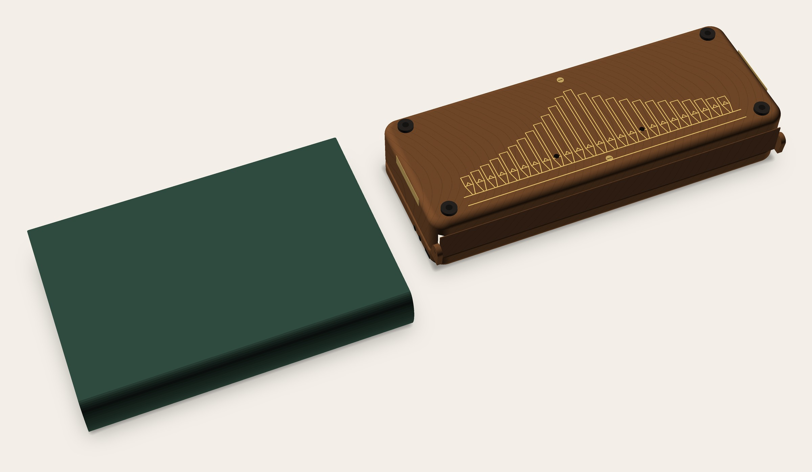
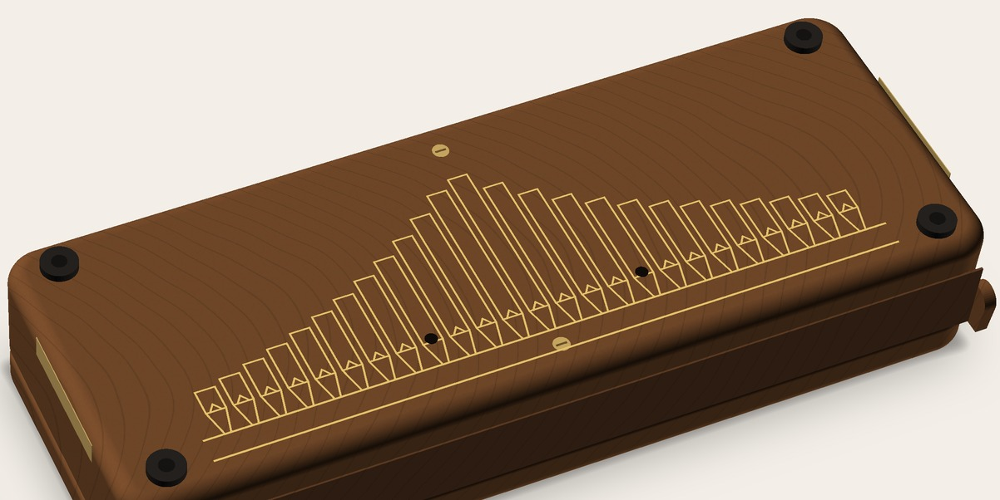

# CATHEDRAL: how it looks and feels (visual, turn 1)

Seed: CHAMBER rev 2 (`../chamber/`) + FOLD-105 v1.1. Owner, 14:12–14:18 (`design/owner.md`): lock in on these two, find the middle ground, call the point of view **CATHEDRAL**. Read with `how-it-works.md` (systems turn 1), which owns hinges, feet, plate radii, the slot and options A / B.

**Rev 1, 2026-11-13.**
- Images are in `img/`, made by `design/concepts/_mock-src/rb.py` (class `Cathedral`) and composed by a short script. I rendered only what's needed to judge (owner, 13:13).
- Every render already carries systems' changes: R 7.7 on all plate corners, hidden side pivots instead of knuckles, feet that are the corner screws, the 8.75-pitch façade with its two speaking mouths.

## What CATHEDRAL does to the ideas
**One sentence: a small cathedral, an organ front for the listener, a nave for the hands, and the wood's own arches.** It's a bigger idea than CHAMBER's "case and console", and it answers several of his notes at once:

| His note | What CATHEDRAL makes of it |
|---|---|
| "the screen" should have more rounding | **The grille becomes a window.** In A, a vesica (the pointed lens of church windows) fits the band's real room. In B, a round rose window. Both use his tapered lines: shortest at the top and bottom, longest through the middle. |
| engraving "more woody", but subtle, not straight woodgrain | **Cathedral grain**: woodworkers' name for the nested arches in flat-sawn wood. The case's line texture becomes arches at about the same sparse line count. The material is already the point of view. |
| too many colours, the brown is out of place | **The organ's own convention:** ebony naturals and light sharps, as on a historic organ console. The keys take the knobs' black and the plate's light tone, and the brown goes. |
| faceplate rounding inconsistent | **Every corner arched** (R 7.7, concentric with the walnut block): the two plates read as two rounded leaves meeting at the seam. |
| hidden hinges; feet one with the screws | **A case with no visible hardware** except the brass that means something: the stays, two axis screws on the façade's plinth, the pipe line work. The knuckles are gone (side pivots), and the feet are the screws. |
| the oxblood spine feels unnecessary | **The spine stays but stops being an accent:** walnut-matched leather that closes the back like a hymnal's spine. |

**Costume watch** (the director's CHAMBER rule, stricter now that the word is "cathedral"): no gothic tracery, no pointed arches as ornament, no stained-glass colour. The vesica appears only because it's the shape that fits the band. Every curve does a job: plate corners, window, grain, pipe mouths.

---

## 1. Peg and button colours (fewer colours, no brown)
Today's palette on the playing side has six colours: walnut body, cream plate, black knobs, red CUTOFF, walnut pegs, maple pegs (plus brass). Every option below removes the brown pegs, so the playing side drops to **five, with no new colour**: walnut, cream / maple, black, red, brass. TAP stays a cream cap in a black bezel, which goes with all four.

<figure>

<figcaption>Peg colours, the same view four times. <b>Top left:</b> ebony naturals, maple sharps (the organ's convention; recommended). <b>Top right:</b> maple naturals, ebony sharps (a piano's light / dark). <b>Bottom left:</b> all ebony (the keys join the knobs). <b>Bottom right:</b> all maple (the keys join the plate and TAP). CHAMBER rev 2's walnut / maple, for comparison, is <code>../chamber/img/chamber-reverse-pegs.jpg</code>.</figcaption>
</figure>

- **My pick: ebony naturals, maple sharps.**
  - It's CATHEDRAL's own keyboard (historic organs are reversed) without the brown. The black matches the 30 knobs, so the keys and controls read as one family; the maple sits next to the cream plate and TAP.
  - It keeps the light / dark split a player reads by. The cost is the one owner question we already have: reversed reading.
- **If reversed is a no:** maple naturals, ebony sharps (top right). It's the same two colours, so it's equally calm.
- **One colour (bottom row):** the calmest graphics, but the two rows differ only by position and height. All ebony gets heavy on a cream deck. All maple is the softest, and I'd hold it in reserve.
- **Parts:**
  - maple button plugs are stock (as CHAMBER rev 2);
  - black "ebony" button plugs aren't a common stock item (UNVERIFIED). The honest route is **maple plugs ebonised** (India ink or an ebonising dye) at ≈ $0 extra;
  - the shank fit on HUSH's arm still needs one sample (rev 2).

## 2. A vs B (the speaker and "effects & out")
Layout is systems' (option B moves controls, so it needs the director, then the owner). These are just the two looks, standing at 120°.

<figure>

<figcaption><b>Option A:</b> nothing moves. The band between the voice rows carries one vesica window of tapered slots, centred on the axis. The base row's heading is corrected to "effects", because VOLUME left that section in rev 7.2. Echo and reverb stay split between the lid's back row and the base.</figcaption>
</figure>

<figure>

<figcaption><b>Option B:</b> the lid's top row holds every effect in one line, read as the choir: drift | echo (type, time, repeats, mix, tap) | reverb (type, decay, mix) | volume. The speaker moves to the base's right end as a round rose window on the PLAY row's own line. The lid's band is left as a quiet rest.</figcaption>
</figure>

**How each looks, my read:**
- **A** fixes the "odd gap" as a picture: the band now has one centred figure instead of a grille island. It doesn't fix the split, which is his other complaint.
- **B** looks the most resolved: each half has one job (hands' row in front, the whole sound chain behind). The rose window fills the place the FX amounts left, and the band reads as intended rest, not leftover space. Visually, B is the better CATHEDRAL. The reach cost (FX amounts ≈ 126 mm further away) is systems' and the owner's to weigh, not a look question.
- **B label notes (no checker model existed for B; there is one now: `Cathedral("B")` in `rb.py`):**
  - FREE / SYNC at (96, d 69) sat on "osc 3 ctl". In B the band below is empty, so **the V2 row's three toggle legends (osc 3 ctl, source, velocity) move under their toggles.**
  - The left voice rule ends at dV2 + 5.5 so it stops short of "sync".
  - Still tight, **to check:** "free" ≈ 1 mm from FREQ 3's MIDI dot.
- **A, a correction to systems' §2 / §5:** a Ø 34 round window fits the band's depth but overlaps the NOISE / EXT legend and the "mixer" heading. **The band's real clear depth between those labels is ≈ 22 mm.** Hence the vesica: **66 × 16, centred at (143, d 37.6)**, ring clear of both labels. Open area ≈ 700 mm² vs v1.1's 900 (−22 %, acoustics UNVERIFIED).

## 3. The grille ("the screen")
<figure>

<figcaption>Grille patterns, 20 px per mm. <b>Left:</b> the vesica, 66 × 16 (option A). <b>Middle:</b> tapered slots in a Ø 27 circle (option B). <b>Right:</b> concentric arcs in a Ø 27 circle, his "circular" alternative. All slots are 1.25 wide at 2.3 pitch.</figcaption>
</figure>

- **My pick: tapered slots (left / middle), his first option.**
  - They keep the v1.1 grille's language (horizontal bars) and simply round its silhouette.
  - Outside, the façade is a tower of vertical pipes whose lengths rise toward the middle. Inside, the window is a stack of horizontal lines whose lengths rise toward the middle. Same rule, turned 90°.
- **Concentric arcs** read more like a speaker cone and need bridges (four drawn) to hold the centre. They're more "hi-fi" than "cathedral".
- A thin warm-grey ring (the plate's rule colour) frames each window, so it reads as a window, not a hole pattern.

## 4. A woodier engraving, same subtlety
**My reading of his words** (please confirm): "the engraving texture in the case" means the fine line texture on the walnut body in the renders, the faint straight streaks. He liked how few they were; he wants them to read as wood.

<figure>

<figcaption>Closed, seen from behind, in real walnut: cathedral grain at about the old line count, the façade, four screw-feet at the corners (the case screws), two flush brass axis screws, and the spine in walnut-matched leather.</figcaption>
</figure>

<figure>

<figcaption>Detail: the arches are low-contrast and spaced about as widely as the straight streaks were, so the façade stays the figure and the grain stays ground.</figcaption>
</figure>

- **Real walnut:**
  - cathedral figure is how flat-sawn boards look, so it costs nothing: **pick flat-sawn stock and orient the arches along the case's length**, apex toward the hinge;
  - quarter-sawn (straight) grain is what to avoid. That's his "straight woodgrain would be too detailed".
- **The first print (walnut-tone wood-fill)** can't honestly carry figure. Two choices:
  - leave it plain (speckle only), so the figure arrives with the real wood;
  - model the arches as a 0.2 mm relief on the lid back and base underside (UNVERIFIED that it reads; it would also compete with the façade on the lid back).
  - I'd leave the print plain.
- **If he meant the façade lines themselves:** making the pipes "woody" (grain inside each pipe) would add detail he said he doesn't want. I'd keep the pipes as clean line work and let the wood around them carry the woodiness.

## 5. The spine
- **Recommend: keep it, walnut-matched (#5a3923, leather or bookcloth).**
  - Without it, the closed back shows a 21.9 × 266 mm slot with the knobs 7 mm inside (systems §6).
  - In the render a near-black spine read as the opening itself, so the colour has to be the body's.
  - Walnut-matched, it reads as the case's back panel, like the spine of a leather-bound hymnal.
  - The oxblood is retired, as he asked.
- **"None"** is a real option (v1.1 accepted the slot). The closed render would then show the slot as in CHAMBER rev 1.

## 6. Small things in every render
- **Hinges:** systems' side pivots. A round "ear" at each rear corner inside the wall's thickness, with a flush walnut plug over the blind pin. The knuckles are gone.
  - Honest: the axis sits 1 mm behind the base's back face, so each ear still shows as a small round boss at the rear corners when closed, quieter than a knuckle.
  - With no knuckles, the spine runs wall to wall (x 4.1–281.9).
- **Feet:** four screw-feet (Ø 12, black rubber, cap plug) at the corner screws; two flush brass screws on the axis at the façade's plinth.
- **Plates:** R 7.7 on all eight corners.
- **Headings:** A reads "effects" (not "effects & out"); B drops the base heading over the speaker. The lid's back row in B carries "echo" and "reverb" over their groups.

## Open
1. **Owner:** which of the four peg colourings (or reversed at all)?
2. **Owner:** did "the engraving texture in the case" mean the wood texture (my reading) or the façade lines?
3. **Owner:** spine walnut-matched or none?
4. **⚑ Director → owner:** A or B (looks: B; cost: reach, systems).
5. **Systems:**
   - run `branch_check.py` on `Cathedral("B")` (labels), especially "free" vs FREQ 3's MIDI dot;
   - A's vesica replaces the Ø 34 circle (it didn't fit the labels);
   - B's base rose (Ø 27) vs the Daisy's position (eng).
6. **Maker:** ebonised maple plugs (one test); the vesica's open area (acoustics); side-pivot boss strength (systems).
