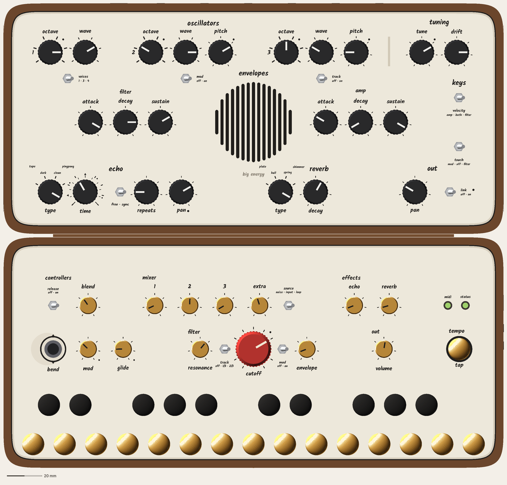
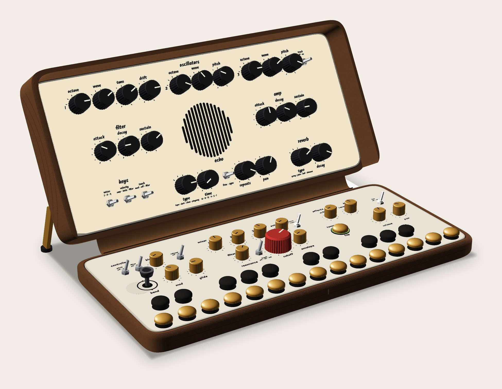
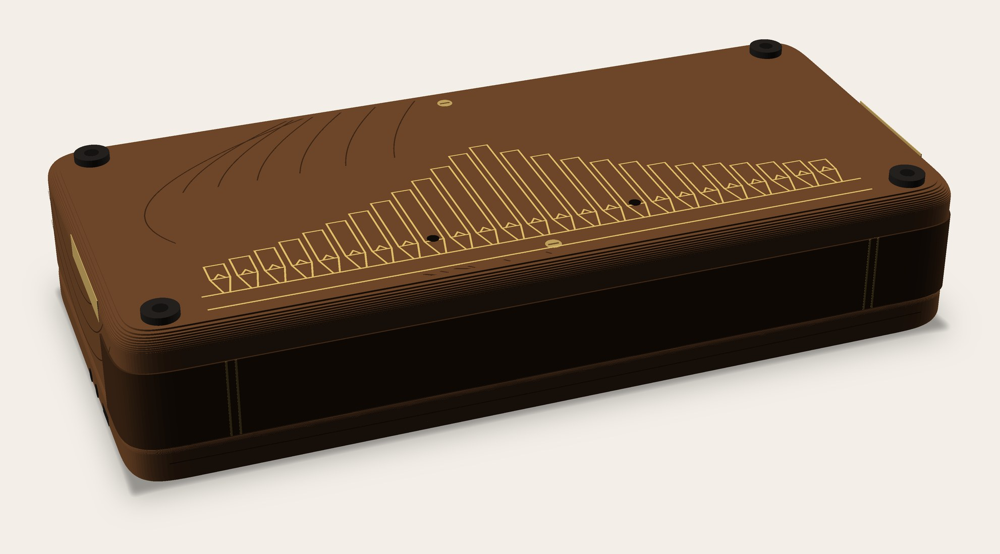
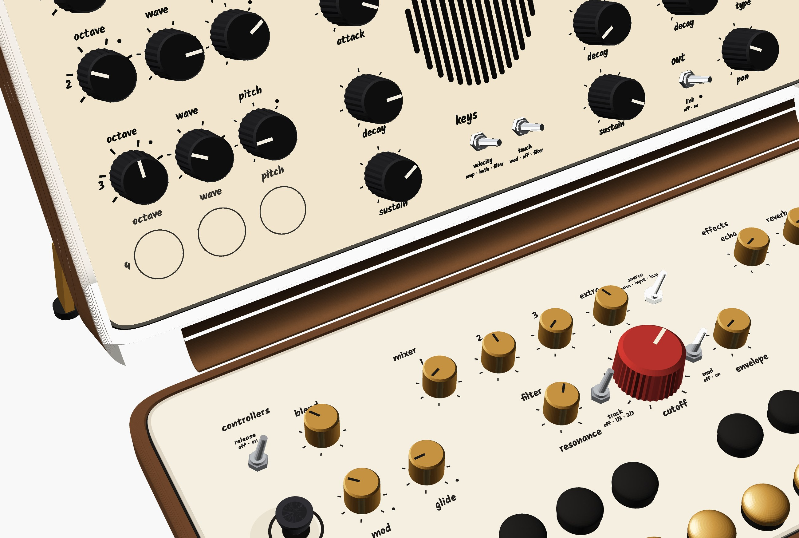
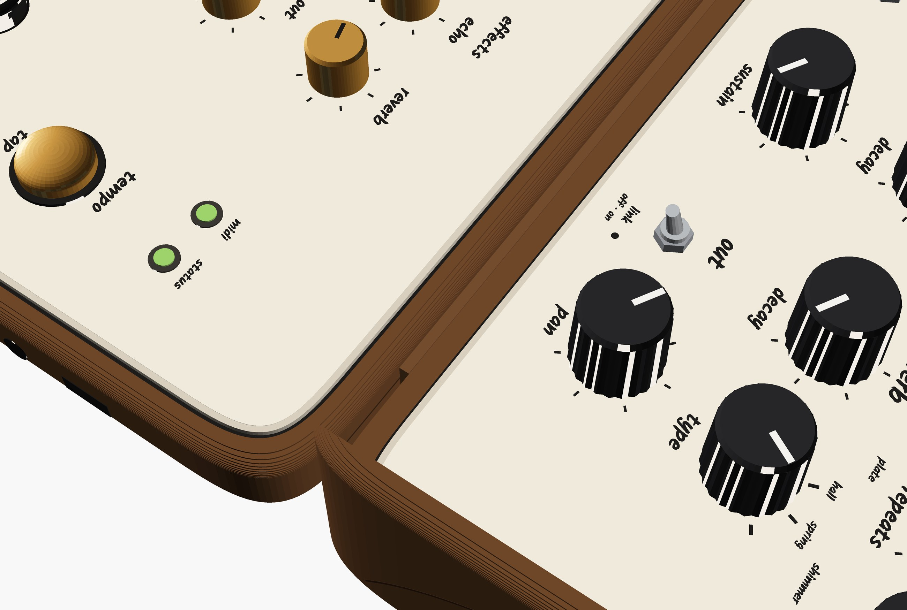
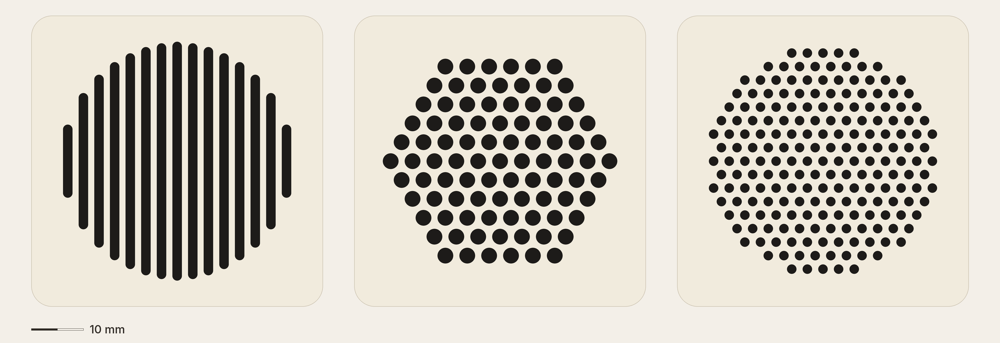
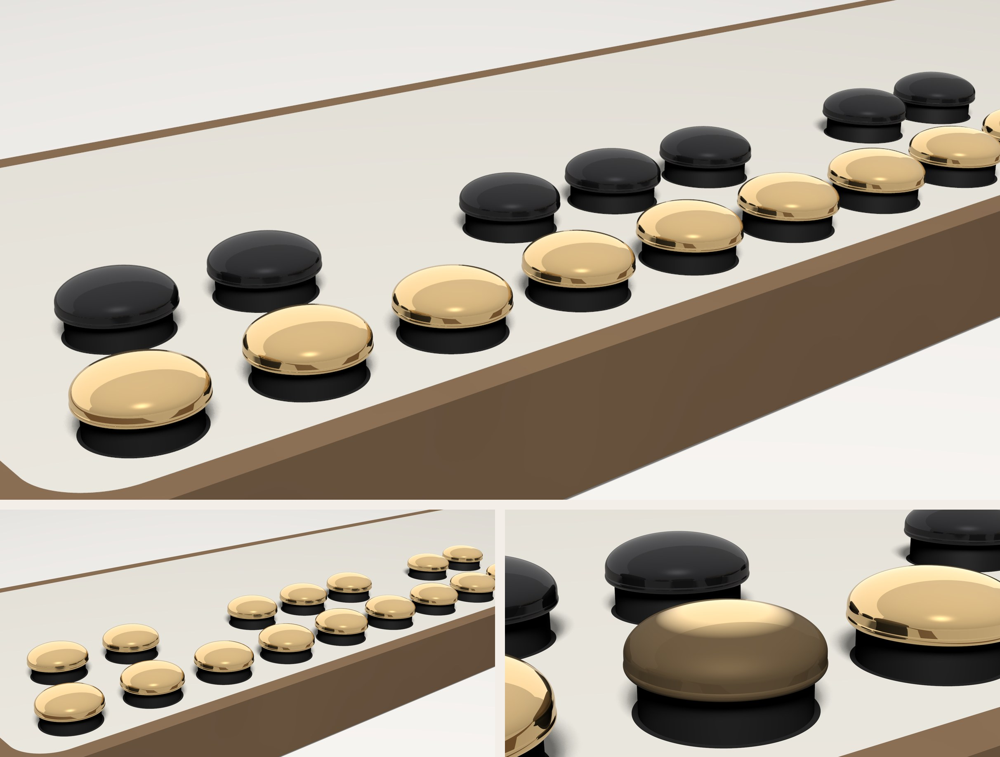
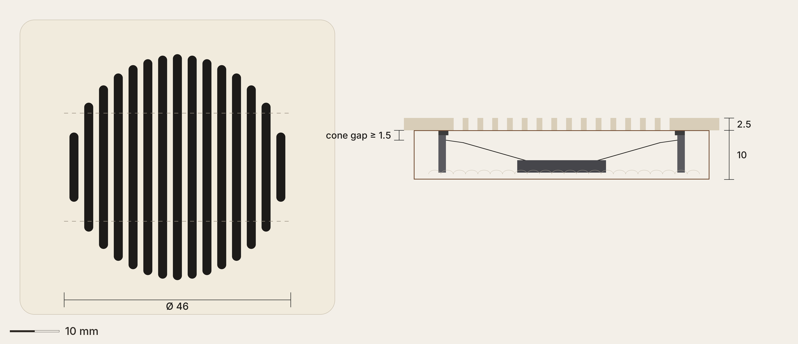

# CATHEDRAL: how it looks and feels (visual, rev 9.1: steer 5 fixes 2, both options side by side)

Seed: CHAMBER rev 2 + FOLD-105 v1.1. Owner record: `design/owner.md` (14:12 onwards). Read with `how-it-works.md`, where systems owns the geometry; **§19** is this revision's layout (commit a80d7c: equal-gutter base, P5O as columns with a VCO 4 slot, P5R with out at the end of its bottom row, pivots inboard, the gap rule). The director's steer-5 scores (P5R 8, P5O 6, base 7) are in `design/notes/director.md`; then P5R 9, P5O 8. Rev 9.1 lays out systems' fixes for the 10 (f8ba494): P5R's oscillator switches on one line under the VCOs; P5O's headings top-left, every VCO reading octave · wave · pitch, tune · drift as a headed "tuning" pair after VCO 1, and out in R4's right slot.

## Steer 5: both halves, by one rule

**The rule:** the lid sets what the sound is and where it sits; the base sets how much of it you hear and what your hands ride. Both read left to right in signal order. One 5 mm module spaces both halves: 20 mm between knobs in a group, at least 15 mm clear between groups, and the same 15 mm from every control to the plate edge.

### His four new points, answered
- **"Don't stop the other exploration tho I wanna see what they came up with too."** Both are drawn below, side by side, on the same base and at the same scale. **P5O** is his layout. **P5R** is the team's rule laid out in rows.
- **"I think we can bring the spine back if we can make it look good."** It's back, drawn closed, standing and flat. It's walnut bookcloth in the case's own tone, and it wraps the soft back corners. Its two brass lines carry the façade's impost and plinth lines over the back edge (see *The spine*).
- **"I kinda want the corners to be softer and to be more architectural like how Apple does theirs."** Every corner is a continuous-curvature corner (a superellipse, n = 5): 24 mm on the plates and 28.3 mm on the case, concentric. The closed view shows them best.
- **"See if we can fit a fourth oscillator."** It fits in P5O, in a slot kept for it on the oscillator block's fourth row. It's drawn as a ghost (light outlines and words) so you can judge it in place. It doesn't fit in P5R without moving tuning away from the oscillators or making the case 32 mm wider (systems §19.5).

### The two lids, side by side

<figure>

<figcaption><b>P5O, his lid</b> (exact, scale bar 20 mm). Left to right in columns: oscillators (with tuning after VCO 1) → filter → (window) → amp → echo, reverb, out. <b>Every heading starts at the top left of its group.</b> The hairline from "oscillators" stops at "tuning" and resumes over the oscillator switches. The pale fourth row is <b>VCO 4's slot, drawn as a ghost</b>: built without it, that area is plain plate. <b>VCO 4</b> (optional, his call): ≈ +$20–30, ≈ −0.5 h of battery, the Daisy's last pin, and no closing cost. <b>P5O's column layout</b>, with or without VCO 4, needs the bend stick lowered to 9.0 mm to close at 55.2 mm (as is: 58.8).</figcaption>
</figure>
<figure>

<figcaption><b>P5R, the rule in rows</b> (exact, scale bar 20 mm). Top to bottom: oscillators ‖ tuning, with each VCO's switch (voices, mod, track) on one line under it; filter · (window) · amp · keys; echo → reverb → out. The envelopes sit 5.9 mm off the axis: filter is alone on one side, amp and keys on the other (systems' stated compromise). Headings here are still centred (see Open).</figcaption>
</figure>

<figure>

<figcaption><b>P5R, standing.</b> In use, the lid's rows read top to bottom like a page. The base's two rows sit under the hands: the levels behind, what you ride in front.</figcaption>
</figure>

**The two, by eye:**
- **P5R reads first time,** one heading line per row, in signal order down the page. Each oscillator's switch now sits under its own VCO, so the oscillator group reads as one band. The envelopes sit 5.9 mm off the window's axis. At arm's length the window still reads as centred between them, because the keys column balances the amp side.
- **P5O now reads as one order,** left to right by columns. Every heading starts top left, so the eye finds every group in the same place. Every VCO reads octave · wave · pitch, and VCO 1 is followed by its own "tuning" pair (tune is VCO 1's pitch, as on a Model D). **P5O is the only option with room for a 4th analog oscillator.** Its layout cost is the lowered bend stick, which is drawn lowered.
- **My view:** the two are now close. P5R is the calmer page; P5O has the Model D block and the room for VCO 4.

### The fourth oscillator (P5O only)
- **Drawn as a ghost:** three 0.3 mm outlines at the knobs' real size (Ø 14.9) at octave · wave · pitch, with their words and the numeral "4" in the light ink. They sit exactly where the fitted knobs would go (`CATHEDRAL_VCO4=1`: checker 0, real-font 0). Nothing else on the lid moves.
- **On the base:** mixer 4 joins the rear row between 3 and extra. The rear gutters tighten from 24.1 to 17.4 mm (still ≥ 15). That isn't drawn: the base as shown is the one without VCO 4.
- **Cost, stated right:** VCO 4 adds ≈ +$20–30, ≈ −0.5 h of battery and uses the Daisy's last pin. It adds **no closing cost**: the lowered bend stick is P5O's column layout, and it applies with or without VCO 4.
- **The look:** fitted, the oscillator block becomes a full 4 × 3 grid. It's squarer and calmer than three rows with a hole under them, so it improves the lid's look as well as its sound. The cost is systems' (≈ +$20–30, ≈ −0.5 h of battery, the last Daisy pin).

### The spine, made to belong
<figure>

<figcaption><b>Closed, from behind.</b> The spine fills the back between the halves in walnut bookcloth, in the case's own tone, and wraps round both soft back corners. <b>Two brass foil lines run along it, x 30–256 and 8 mm apart, the same run and spacing as the façade's impost and plinth lines</b>, so the façade's base appears to fold over the back edge. The corners here are the superellipse ones: the curve leaves the straight edge with no visible kink.</figcaption>
</figure>

<figure>

<figcaption><b>Standing.</b> About 9 mm of slack drapes in the joint behind the base's rear row, like a book's hinge. The brass lines are on the cloth's outside, which now faces down, so from the player's side the spine shows as a plain walnut fold.</figcaption>
</figure>
<figure>

<figcaption><b>Flat.</b> The plate edges are 2.1 mm apart, so the cloth tucks down into the seam as a fold, its outside and brass lines turned in. Nothing stands above the plates. Here the two soft corners meet at the seam.</figcaption>
</figure>

- **Why lines along it, not bands across it:** a line parallel to the hinge never bends along its length. It just rides round with the cloth. Stamped foil bands across the spine would crease at every opening and crack in a year. Lining the spine up with the façade's impost makes it read as part of the case. Bands at its ends read as a book's spine stuck onto it.
- **Colour:** at the previous deep walnut the spine rendered near-black and read as the slot it closes. It's now the case's own tone, so the back reads as one surface.
- **Only the straight run between the inboard pivots flexes** (x 28.3–257.7). The corner pieces are glued to each half and part at the seam when it opens, like a book's headcaps. **Eng, UNVERIFIED:** the fold's thickness, ≈ 2 × (cloth 0.4 + TPU 0.5) ≈ 1.8 in the 2.1 seam (ESTIMATE), and the corner pieces' joint.

### Softer, architectural corners
- **The corners are superellipses, n = 5:** curvature runs to zero where the corner meets the straight edge, so the eye sees no point where the corner "starts" (an arc has a kink in curvature there). The same corner, concentric, is used on the case in plan (28.3) and both plates (24). The window keeps its circle, because it's the driver's shape.
- **24 mm, within systems' limit of 25.5:** the corner knobs sit on the margin lines, so a bigger corner would eat their 15 mm margin.

### The grille: lines (accepted by the director)
<figure>

<figcaption><b>The window, both ways, exact</b> (20 px per mm). <b>Left:</b> vertical lines, 15 slots 1.8 wide at 3.0 (≈ 945 mm² open, ≈ 75 % of the cone). <b>Middle:</b> dots, hex grid, Ø 3.0 at 4.2 (≈ 640 mm², ≈ 51 %). <b>Right:</b> dots, hex grid, Ø 1.8 at 3.0 (≈ 510 mm², ≈ 40 %).</figcaption>
</figure>

**Lines** sound better (more open area, slower air: systems §19.7). They also look better here: vertical lancets in a round window are the cathedral reading, and they rhyme with the façade's pipes. Dots are the generic speaker look, and at Ø 46 the hex grid's outline turns hexagonal.

### The name
"big energy" is now the word alone, in the light ink, on the axis under the window. The lozenge outline is gone. In P5R the reverb fan's "plate" ran through it. In P5O it sat 1.5 mm over the "keys" heading and read as "big energy keys". In the light ink it reads as a maker's mark, not one more heading.

### The first-time walk (both options; same words)
- **Lid, the sound:** oscillators 1 · 2 · 3 [· 4] (octave, pitch, wave; tune and drift by them; voices, mod, track); envelopes, filter and amp (attack, decay, sustain); keys (velocity, touch); echo (type, time with free · sync, repeats, pan); reverb (type, decay); out (pan, link).
- **Base, the hands and the levels:** rear row: controllers (release, blend), mixer 1 · 2 · 3 · extra with source (noise · input · loop), effects (echo, reverb), the midi and status lights. Front row: controllers (bend, mod, glide), filter (resonance, track, **cutoff**, mod, envelope), out (volume), tempo (tap).

### Checks (rev 9.1)
- **Systems' rules run on the visual's positions** (the moved headings, numerals, name, the leader and the new leading): **0** for P5O, P5O with VCO 4, and P5R. `layout_check.py` as committed: 0 for both.
- **Real Kalam** (measured on the rendered model's text, with the ghost knobs as controls and the leader as a line): **0** for P5O, P5O with VCO 4, and P5R.
- Rev 9's fits are in `layout_check.py` (d56403f). **New visual fits for rev 9.1, for systems to fold:**
  - P5O headings (from SECTIONS_LEFT): "filter" / "amp" +0.8 ("amp"'s descender sat 0.24 from the attack knob's top tick), "keys" +0.7 (0.89 from velocity's nut), "echo" +0.5 x (1.17 from "tape"), "reverb" +0.3 (1.35 from "plate"), "out" 3.8 left into the gutter (0.82 over reverb's "type");
  - P5O name +0.3 (to d 37.6), so "keys" keeps 1.5 under it;
  - P5O "oscillators hairline b" starts at voices' nut (x BX − 4.6), not just after "tuning". Drawn from "tuning", it read as tuning's leader and claimed the switches for tuning;
  - P5R "keys" +0.7 (0.89 from velocity's nut);
  - the ghost legends' box: + BEHIND_EXTRA, as for the fitted knobs (the checker's GHOST box lacks it).
- **Checks, rev 9.1:** systems' rules on these positions 0, real Kalam 0 (P5O, P5O with VCO 4, P5R).

### Open
1. **P5R headings top-left (director's brief):** not drawn. Left-aligned on systems' lines, "echo" and "reverb" land on their type knobs' fan names (gaps −1.0 to 0.42) and "envelopes" lands on voices (6 rule violations). It needs systems to move row C's headings above the fans and "envelopes" off the switch line first. Until then, P5R keeps centred headings.
2. **P5O:** "out" hangs 3.8 mm into the gutter to clear reverb's "type": the one heading not exactly on its group's left edge.
3. **Eng:** the spine's fold in the 2.1 seam, and the corner pieces' joint at the seam.
4. **Owner:** P5O or P5R; the 4th analog oscillator (P5O only); D 132.

## What CATHEDRAL does to the ideas
**One sentence: a small cathedral, an organ front for the listener, a nave for the hands, and the wood's own arches.** It answers several of his notes at once:

| His note | What CATHEDRAL makes of it |
|---|---|
| "the screen" should have more rounding; the speaker unresolved | **The grille becomes a rose window:** one round opening on the axis, sized by the driver, filled with vertical lancets (slots) whose lengths follow the circle (§3). The evenly spaced rows around it are the nave. |
| fine line texture "more woody", but subtle, not straight woodgrain | **Cathedral grain**: woodworkers' name for the nested arches in flat-sawn wood. The case's line texture becomes arches at about the same sparse line count. The material is already the point of view. |
| too many colours, the brown is out of place; "brass … reminds me of a cathedral"; "more brass than black" | **Brass and black, an organ console's fittings and stop knobs.** What the hands play is brass-toned (keys, TAP, the played row's low knobs); what you set on the lid is black. No colour is added, and the brown goes. |
| faceplate rounding inconsistent | **Every corner arched** (R 7.7, concentric with the walnut block): the two plates read as two rounded leaves meeting at the seam. |
| hidden hinges; feet one with the screws; no spine | **A case with no visible hardware** except the brass that means something: the keys, the stays, two axis screws. Knuckles gone (side pivots), feet are the screws, no spine. |

**Costume watch** (the director's rule, stricter now that the word is "cathedral"): no gothic tracery, no pointed arches as ornament, no stained-glass colour. The window is round because the driver is. Every curve does a job: plate corners, window, grain, key domes.

---

## 1. Key and button colours (fewer colours, no brown, real parts)
**Every option is made from parts that exist** (systems §10). The owner is choosing between A, B and C (brass); D, E and F (birch and printed) stay as alternatives on the same carrier, described in words only. All of them share one interface: a **printed carrier** whose top cup (Ø 9.6 × 3.3) takes a **9.53 × 3.2 tenon**, the tenon of the Cherry Tree Toys 3/8" mushroom plug. So a bought birch plug, a cast brass head and a printed head are interchangeable on the same switches, and the choice can change after the build.

**What shows under each head:** the carrier's 2.8 mm neck (Ø 11.2) and a thin dark ring of deck hole (Ø 12.0). **Print the carriers in matte black.** The neck then reads as the hole's shadow and every head seems to float a little above the deck, like a drawknob on its stem. (A one-piece printed peg has a neck in its own colour; see option F.) The felt washers on the deck are gone: the stop moved under the deck (systems §10.2).

<figure>

<figcaption>Keys in real metal, ray-traced (POV-Ray). The base's control row is left out because it's being redesigned with low knobs. <b>Top (A, the lead):</b> brass naturals, black sharps: normal keyboard reading, and more brass than black, as he asked (16:52). The sharps are drawn as black-rhodium-plated brass, so every key has the same weight and coldness; printed black sharps are the other route (systems' call). <b>Bottom left (C, the alternate):</b> all brass. <b>Bottom right:</b> close up. A black sharp between two naturals; the left natural is unlacquered after handling (dark gold-brown, bright where fingers rub), the right one freshly polished. Head drawn 4.0 tall until the plug's real height is measured.</figcaption>
</figure>

### Lead: A, brass naturals and black sharps (owner 16:52: "more brass than black"; director steer 2)
- **Why A over B now:** he asked for more brass. A gives 15 brass keys to 10 black, and it keeps a normal keyboard's reading (light naturals, dark sharps), so the reversed-reading question goes away.
- **How it sits with the rest:** the brass field in front is the warmest, brightest thing on the instrument, a row of organ-console fittings under the hands. The black sharps tie back to the black knobs. The red CUTOFF stays the one colour accent, because the base's row is being redesigned around it as the hero on the axis (steer 2), so it has to hold its own against the brass. Visually, the brass row and the red dial will compete less if the low-profile knobs are black and the dial sits on the axis directly above the keys' centre.
- **C (all brass)** is the alternate: the most "cathedral", one material for every key. The two rows then differ only by height and position, and 25 reflections read as a single shining field. Better for an object to look at than for a keyboard to read at a glance.
- **B (black naturals, brass sharps)**, my rev 2 pick, is now the fallback if A's brass field turns out too loud in real metal.
- **Black sharps' material:** black-rhodium-plated cast brass (same weight and coldness as the naturals; 1 µm plating wears through to brass on the crowns over time) or printed matte black (lighter, so a per-group velocity curve may be needed: systems' call).
- **D / E (birch)** are the cheapest real route: one pack of 50 covers both rows. Birch is pale, close to the plate's cream: under a **water-based, non-ambering clear** it stays near it, and an oil finish would turn it yellow. D's black dye covers birch's blotchiness only at full black. **Honest wear note:** dye sits in the surface, so the crown of the most-played naturals will wear pale over time. A hardwax-oil topcoat slows it down.
- **F (printed)** gives exact colours: black to match the knobs, the plate's own cream filament. It feels the least like an instrument (systems §10.3: cooler, slicker, lighter, faint terraces on the dome unless it's resin-printed).

### Brass, two ways to make it (neither is machining)
| | **Cast brass** (3D-printed wax, lost-wax cast by a service) | **Brass-filled filament** (printed by him) |
|---|---|---|
| What it is | Real brass. Sculpteo prints the model in wax and casts it in 80/15/5 copper/zinc/tin; finishes include raw, mirror polish and gold or black rhodium plating; min wall 0.8 mm; max 125 × 125 × 100 mm; 7–9 business days; priced on upload (not checked). | PLA with brass powder (e.g. colorFabb brassFill; product UNVERIFIED this session). Prints dull, polishes to a soft gold with sandpaper and metal polish by hand. |
| In the hand | **Cold at first touch**, then warms. **Heavy**: a solid head ≈ 5 g [CALC: ≈ 620 mm³ × 8.5 g/cm³]; with an open cup underneath, ≈ 2.5–3 g (ESTIMATE). A printed peg is ≈ 0.8 g. | Cool, not cold; warms fast. Heavier than plastic but well short of metal (density UNVERIFIED). Softer edges, a satin glow, not a mirror. |
| Over time | **Worn shine:** unlacquered brass tarnishes to a dark gold-brown everywhere except where fingers rub, so the crowns stay bright, like a church door handle. Lacquered, it stays bright until the lacquer wears off the crowns. Note: an all-tarnished key reads brown, the thing he called out. Keep it handled or polish it now and then. | Dulls slowly; re-polish by hand. Can't take a real shine back once scratched deep. |
| Cost | Per-piece service price, ×15 (A naturals), ×25 (A with plated sharps, or C): UNVERIFIED; quote by upload. | Pennies of filament. |

- **Recommendation:** **cast brass for the naturals in A** (15 pieces; the real metal is the point), mirror-polished and left unlacquered so the crowns earn their shine. The black sharps: black-rhodium-plated cast brass (matched feel) or printed matte black heads on the same carriers.
- **If he wants both rows to feel the same in the hand:** cast all 25 in brass and have the naturals **black rhodium plated** (1 µm). Same weight and coldness on every key. 1 µm will wear through at the crowns with play, and brass will show through the black, slowly. That's either the best thing about it or a fault: his call.
- **⚑ Eng / systems: key mass.** A 2.5–5 g brass head sits on a Choc V2 silent switch. Whether that spring still returns the key briskly, and whether the extra mass changes the velocity fit, is **UNVERIFIED**. Test one cast head on one switch before ordering 10–25. The hollow-cup head (≈ 2.5–3 g) is the one to try first.

### TAP
TAP keeps the rule that it's made of the key material, because it's played in rhythm like a key. With A or C, **TAP is a brass dome** (the naturals' cast head, on a printed cap that fits TAP's switch; part UNVERIFIED) in its black bezel: more brass, and it's played like a key. In steer 2 it moves to the base row's right end, mirroring the bend stick. With D / E, it's a birch plug; with F, printed cream.

## 2. The played row: low, gold, symmetric
- **Low knobs:** Tayda aluminium Ø 10 × 8 (6 mm 18T), bought, on a 1.0 seat (systems §16.3). **Gold** (a Tayda colour) for MOD, TUNE, GLIDE, EMPHASIS, AMOUNT, MOD MIX and DRIFT. They're smaller under the fingers than today's Ø 14.9; R-TALL keeps the big knobs at +4.5 mm closed.
- **The row, anchored on CUTOFF (steer 4, systems §18.3):** BEND 25 · MOD 47 · MOD MIX 67 · GLIDE 87 | EMPHASIS 112.5 · KBD (toggle) 126.4 · CUTOFF 143 · FILT MOD (toggle) 159.6 · AMOUNT 173.5 | TUNE 199 · DRIFT 230 · TAP ("echo tap") 261. The stick no longer needs lowering (nothing on the lid lands over it).
  - **Why gold:** a rule the eye can read. **What the hands play is brass-toned** (keys, TAP, the played row's knobs). **What you set on the lid is black.** CUTOFF stays the one red hero. Black low knobs are the quieter alternative, also a Tayda colour.
  - **Honest risk:** anodised gold aluminium is usually yellower and more even than polished cast brass. **Order one of each and put them beside a cast key** before committing; if the gold reads as a different metal, go black.
- **CUTOFF** keeps its tall red hero dial, because no low, wide hero exists as a bought part. Closed, it sits under the window.
- **Bend stick** at the left end, its cap lowered to plate + 9 (systems: module seated deeper). **TAP** at the right end: a brass dome in a black bezel, the mirror of the stick.
- **Two lights** either side of CUTOFF (x 131 / 155), symmetric about the axis.
- **Section names:** base: controllers | filter | tune. Lid: one heading per group (see steer 4 at the top).

## 3. The speaker window: sized for sound, then drawn
One round opening, concentric with the 50 mm CDS-5076-class driver, centred on the axis at lid (143, d 32), above CUTOFF (systems §16.4).

<figure>

<figcaption><b>The window, exact (20 px per mm).</b> Left: front view. Ø 46, 15 vertical slots 1.8 wide at 3.0 pitch (webs 1.2), each slot's length following the circle; the dashed lines are the two hidden ribs behind the plate. Right: section. Plate 2.5, foam gasket on the driver frame, cone gap ≥ 1.5, and a sealed back box 10 deep, lightly stuffed (systems' sizes).</figcaption>
</figure>

| | Value | Why |
|---|---|---|
| Opening | **Ø 46** (systems §16.4) | the cone plus its surround: the radiating area, no more |
| Slots | **15 × 1.8 wide at 3.0 pitch**, web **1.2** | his "lines going up and down". Odd count, so one slot sits on the axis and the window is symmetric. 1.8 reads as a line at arm's length. A 1.2 web is 3 perimeters with a 0.4 nozzle |
| Open area | **≈ 945 mm²** [CALC], 57 % of the opening, **≈ 75 % of Sd** (12.6 cm², systems ESTIMATE) | between systems' 1.5 / 2.7 (≈ 73 %) and 2.0 / 3.2 (≈ 83 %); the director's target is ≥ 50 %, ideally ~60 % |
| Rear ties | two hidden ribs, 1.2 × 1.5, behind the plate at ±11 mm | 1.2 webs over 40 mm long are flimsy on their own. The ribs stiffen them without a line on the front. They cost ≈ 65 mm² → **≈ 880 net (≈ 70 % of Sd)** |
| Ring | none | the slots' own outline is the edge; a printed ring would add a line beside CUTOFF's scale |
| Behind | foam gasket; sealed, stuffed PETG back box ≈ 60 × 60 × 10 | systems §16.4: the box matters most |

**Loudness, honestly** (systems): clear mids and modest level, roughly +3–6 dB in 1–5 kHz over today's choked grilles (ESTIMATE; bench it). It's a monitor, not a PA.
**Code:** `window_slots()` and `speaker_window()` in `rb.py` drive both the render and the area figure.

## 4. A woodier fine line texture, same subtlety
**Confirmed** (owner 14:40: "Engraving texture I meant fine line texture"): it's the faint line texture on the walnut body. He liked how few lines there were; he wants them to read as wood. **The pipe façade is a placeholder:** he'll design the pipe lines himself, so nothing below judges the façade.

**Built (director ruling 4), not deferred:** real walnut would mean machining, so the printed walnut-tone body is the build, and the texture goes into the print.

- **What it is:** sparse **cathedral-grain arches**, the nested arches of flat-sawn wood, as **U-grooves 0.4 wide × 0.25 deep** in the printed body, at about the old line count.
  - **Base underside and lid back:** 7 nested arches whose axis runs along the case's length. Their spacing opens out a little toward the outside, and the outer ones run off the edges as long, nearly straight lines, as on a real board.
  - **The lid back leaves his façade field empty** (x 30–256, d 8–86). The first arch's apex peeks into the right margin (x ≈ 262), and the arches' tails run out through the bands above and below the field. The grain frames his design without entering it.
  - **Long sides:** the arches' tails, one gentle line across the base's flat band (z 6.2–12.4), two on the lid's far wall above the I/O (z ≥ 13).
  - **End faces:** end grain, so two or three growth-ring arcs. The base's right end keeps its arcs at y < 58, clear of USB-C and MIDI.
- **Printing it:** grooves on the underside and lid back print face-down as clean first-layer channels. On the vertical sides they're cut across layer lines; at 0.25 deep they'll read softly, which is what he asked for (subtle). **UNVERIFIED** that 0.25 reads at arm's length: add a 60 × 40 groove patch to the next coupon print. If it's too faint, go to 0.35.
- **In the model:** `Cathedral(grain=True)` draws them from the same polylines the body CAD will use (`arch_lines`, `side_lines`, `ring_arcs` in `rb.py`). The closed side elevation above shows the lid's end arcs. The base's end faces are left plain: their flat band is only ≈ 6 mm tall, and clipped arcs read as stray marks.
- **Real walnut, if it ever happens:** cathedral figure is how flat-sawn boards look, so it costs nothing. **Pick flat-sawn stock and run the arches along the case's length**, apex toward the hinge. Quarter-sawn (straight) grain is what to avoid: that's his "straight woodgrain would be too detailed".
- **For his façade design:** the lid back's free field is x 34.8–251.2 (systems §3), clear of the four corner feet; the two axis screws sit on x 143 at d 12 / 96; the two Ø 4 push-out holes (x 108 / 178, d 28.3) are fixed by the construction (CHAMBER rev 2 drew them as two pipe mouths). His design has to keep them, or tell systems if it moves them.

## 5. No spine (superseded: the spine is back, see steer 5)
- **Owner 14:40: "I don't want a spine."** It's gone from CATHEDRAL. The walnut-matched spine of rev 1 is withdrawn.
- What it was solving: closed, a 21.9 × 266 mm slot along the back shows the lid's V1 knobs 7 mm inside it (systems §6). **Systems is answering that, and whether cables can run through the hinge.** Visually, the slot is the one thing that would read as unfinished on an otherwise closed walnut block. If it stays open (the director's recommendation S1), finish it dark inside so it reads as a shadow line, not a hole. The black knobs inside then disappear into it.

## 6. Small things in every render (all ruled, all in the model)
- **Hinges:** systems' side pivots. A round "ear" at each rear corner inside the wall's thickness, with a flush walnut plug over the blind pin. The knuckles are gone. The leaves are hidden inside the walls, so their material doesn't show (see §7).
  - **Director fix 4 asked for the ear inside the outline. It can't go fully inside, and here's why:** for the lid to lie flat open with the seam closed, the axis has to sit at or behind the back face. A lid point at y maps to 2·Ay − y, so the lid's back face lands at 2·Ay − 108, which must be ≥ 108: Ay ≥ 108 (109 with the 2 mm seam). Any ear around a pin at y 109 sticks out past y 108. The R 12 plan corners also cut the end walls back to y ≈ 102 at the very corner.
  - **What I did:** the ear is now the smallest that holds a Ø 3 pin (r 3.0, a 1.5 wall). It's a 6 mm round nub ≈ 4 mm past the back at mid-height, down from a 5.2 radius hulled to the base top (≈ 6 mm and a lobe). Its web runs inside the wall.
  - **To remove it entirely (⚑ systems / director):** an offset pivot with a rabbeted seam (the halves overlap when open, so the axis can move inboard; kinematics UNVERIFIED), or back to v1.1 knuckles across the back, the owner's "if not these are fine".
- **Feet:** four screw-through rubber feet (Ø 12, black, cap plug) at the corner screws; the two axis screws stay flush brass (no impost clash).
- **Plates:** R 7.7 on all eight corners.
- **The name, "Big Energy"** (owner: "name to come -- we're calling it big energy"): it goes **in the lozenge under the window, lowercase, in the panel's hand (Kalam 2.0, "big energy")**, the same voice as every legend on the instrument. It's ≈ 9 mm wide in a 15 mm field, with the descenders inside. Nothing louder: on a cathedral the foundation stone is small and sits on the axis. It's in the model (`Nave.NAME`) and appears from the next render pass, after his CATHEDRAL answer. **Later option:** a cast-brass name plate from the keys' service, letters raised 0.5 (Sculpteo's minimum embossed detail), if he wants the name in metal.
- **Headings:** one per group on the lid (oscillators, mixer, keys, filter contour, loudness contour, echo, reverb, out) and on the base (controllers, filter, tune).

## 7. Metal: what "brass" is now that nothing is machined (ruled: brass is the only visible metal)
Rev 1's brass was cut from bar. Systems §11 made the visible metal **printed 316L stainless** (JLC3DP binder jet) or thicker PETG. Here's what that looks like, and the ruling (director 5, as recommended in rev 2).

- **Printed 316L reads as steel, not brass:** a matte, slightly grainy mid-grey, like sintered metal, polishable to a satin silver. Beside brass keys and brass axis screws, two grey stays would be a second metal. **Two metals is a palette change I'd avoid:** with A or C keys, brass is now the instrument's one metal.
- **So, by part:**

| Part | Seen? | Recommend | Looks like |
|---|---|---|---|
| Keys (A: naturals; C: all) | always | cast brass (§1) | polished brass, worn shine on the crowns |
| Lid stays (2, 3 × 8 × 44.4) | standing; as lines on the lid end faces when stowed | **cast brass** from the same service as the keys (fits 125 mm; strength of the cast part at 3 × 8: systems / eng, UNVERIFIED) | brass, matching the keys |
| …fallback | | **printed PETG 5 × 8 in matte black** (systems' option b) | black, part of the knob / foot family. Not grey. |
| Hinge leaves (4) | no, inside the walls | **printed 316L** (systems' option a) | invisible, so steel is fine |
| Axis screws (2) | lid back | bought brass screws | brass |
| Feet | lid back, base | bought black rubber screw-feet | black |
| Façade fill | lid back | his design; brass-tone if he keeps line work | — |

- **If he'd rather go steel everywhere** (316L stays, stainless screws, birch or printed keys): it works and suits CATHEDRAL too, since real organ façade pipes are tin, a silver-grey metal. But it doesn't go with his brass keys, so it's a fallback, not a parallel option.
- **The palette (director 6):** walnut, cream, black, red CUTOFF, brass. No other colour. TAP is made of the key material.
- **The brass on the stays doesn't need plating or paint** if it's cast. Plating printed 316L to look like brass is possible but it's a finish that wears off a part you handle every time you stand the lid up.

## Open
1. **⚑ Director, then owner:** the steer 2–3 moves (the lid in signal order, CUTOFF ↔ EMPHASIS, MOD MIX and DRIFT to the base); R-LOW (≈ 55.2 closed with snap-in pots and the lowered stick, else 56.7–58.8; Ø 10 knobs) vs R-TALL (≈ 59.7, today's knobs).
2. **Director:** the hinge ear: accept the 4 mm nub, or ask systems for the offset pivot / knuckles (§6).
3. **Owner:** keys A (lead) or C; lacquered or unlacquered brass; gold or black low knobs.
4. **Systems / eng:**
   - brass head mass on the Choc V2 silent switch; one cast head first;
   - R-LOW's dependencies (seat, shaft length, stick depth);
   - cast-brass stays at 3 × 8;
   - fold visual's legend changes into `layout_check.py` (switch legends beside at 1.55; behind-legends +1.0; section-name line at d 67.5; lozenge at d 2.2–7.2 on the axis). With them, my run of its rules: 0; real Kalam metrics with ticks: 0.
5. **Maker / to buy:** one Cherry Tree Toys birch pack (measure head height H); one Sculpteo quote (hollow brass head, a stay); one Tayda gold and one black 3010 knob, beside a cast key; a groove patch (0.25 / 0.35); bench the window + back box against today's grille.
