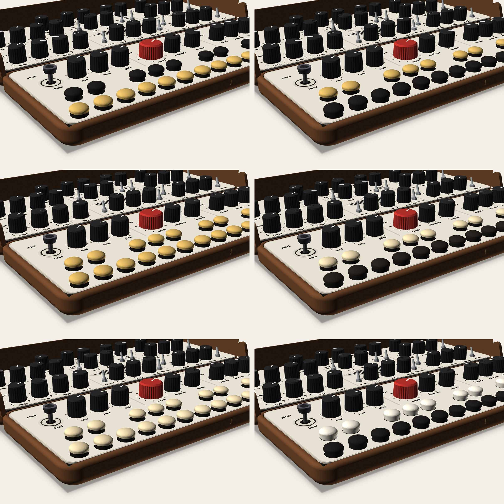

# CATHEDRAL: how it looks and feels (visual, turn 2)

Seed: CHAMBER rev 2 (`../chamber/`) + FOLD-105 v1.1. Owner, 14:12–14:18, 14:30–14:34 and 14:40 (`design/owner.md`). Read with `how-it-works.md` (systems), which owns hinges, feet, plate radii, the slot, options A / B, and the key carrier and no-machining parts in §10–11.

**Rev 2, 2026-11-13 (new visual designer).** What changed since rev 1:
- **Keys use real parts only** (systems §10, owner 14:30–14:34): bought Cherry Tree Toys birch plugs on a printed carrier, printed pegs, or brass heads (owner 14:40: "brass and black keys? Or all brass?"). Rev 1's ebonised-maple recommendation is withdrawn: the maple plugs weren't a real stock part at the right size.
- **The spine is gone** (owner 14:40: "I don't want a spine"). Systems is answering the back slot and cables through the hinge.
- **"Engraving texture" is confirmed** as the fine line texture on the case body (owner 14:40). The pipe façade is now a placeholder; he'll design it himself.
- **Metal:** no machined brass. What each "brass" part becomes, and what it looks like, is in §7.
- One image re-rendered (the key colours). The others are unchanged and carry rev 1 notes in their captions where something moved.

## What CATHEDRAL does to the ideas
**One sentence: a small cathedral, an organ front for the listener, a nave for the hands, and the wood's own arches.** It answers several of his notes at once:

| His note | What CATHEDRAL makes of it |
|---|---|
| "the screen" should have more rounding | **The grille becomes a window.** In A, a vesica (the pointed lens of church windows) fits the band's real room. In B, a round rose window. Both use his tapered lines: shortest at the top and bottom, longest through the middle. |
| fine line texture "more woody", but subtle, not straight woodgrain | **Cathedral grain**: woodworkers' name for the nested arches in flat-sawn wood. The case's line texture becomes arches at about the same sparse line count. The material is already the point of view. |
| too many colours, the brown is out of place; "brass … reminds me of a cathedral" | **Black and brass, the colours of an organ console's stop knobs and its brass fittings.** Black keys join the 30 black knobs; brass joins the brass already on the case. The keys add no colour of their own, and the brown goes. |
| faceplate rounding inconsistent | **Every corner arched** (R 7.7, concentric with the walnut block): the two plates read as two rounded leaves meeting at the seam. |
| hidden hinges; feet one with the screws; no spine | **A case with no visible hardware** except the brass that means something: the keys, the stays, two axis screws. Knuckles gone (side pivots), feet are the screws, no spine. |

**Costume watch** (the director's rule, stricter now that the word is "cathedral"): no gothic tracery, no pointed arches as ornament, no stained-glass colour. The vesica appears only because it's the shape that fits the band. Every curve does a job: plate corners, window, grain, key domes.

---

## 1. Key and button colours (fewer colours, no brown, real parts)
**Every option is made from parts that exist** (systems §10). All of them share one interface: a **printed carrier** whose top cup (Ø 9.6 × 3.3) takes a **9.53 × 3.2 tenon**, the tenon of the Cherry Tree Toys 3/8" mushroom plug. So a bought birch plug, a cast brass head and a printed head are interchangeable on the same switches, and the choice can change after the build.

**What shows under each head:** the carrier's 2.8 mm neck (Ø 11.2) and a thin dark ring of deck hole (Ø 12.0). **Print the carriers in matte black.** The neck then reads as the hole's shadow and every head seems to float a little above the deck, like a drawknob on its stem. (A one-piece printed peg has a neck in its own colour; see option F.) The felt washers on the deck are gone: the stop moved under the deck (systems §10.2).

<figure>

<figcaption>The same view six times; the head is drawn 4.0 tall (top at deck + 6.8) because the plug's head height isn't published yet. <b>Row 1, left (A):</b> brass naturals, black sharps. <b>Row 1, right (B):</b> black naturals, brass sharps (recommended). <b>Row 2, left (C):</b> all brass. <b>Row 2, right (D):</b> bought birch plugs, naturals dyed black, sharps natural. <b>Row 3, left (E):</b> all natural birch, one pack, no finishing. <b>Row 3, right (F):</b> one-piece printed pegs, matte black and the plate's cream. The renderer has no metal sheen, so brass shows as a flat yellow; real polished brass is deeper and catches highlights on each dome.</figcaption>
</figure>

### My pick: B, black naturals and brass sharps
- **Why:** the 15 naturals are the big field, and in black they join the knobs, so the playing side reads as one black family on cream. The 10 brass sharps become the accent, the way brass fittings sit on a dark organ console, and they repeat the case's other brass (stays, axis screws). The palette stays at **walnut, cream, black, red, brass**: five, nothing new, no brown.
- **It keeps the light / dark split** a player reads by, reversed like an organ. The reversed-reading question from rev 1 stays open for him.
- **A (brass naturals)** puts the loudest material in the biggest field. In the render the bright row in front pulls the eye away from CUTOFF. I'd only pick it if he wants the keyboard to be the hero.
- **C (all brass)** is the most "cathedral" and the most jewellery-like. The two rows then differ only by position and height, and 25 brass domes compete with the red CUTOFF. It's the one to see in real brass before deciding, because sheen changes everything.
- **D / E (birch)** are the cheapest real route: one pack of 50 covers both rows. Birch is pale, close to the plate's cream: under a **water-based, non-ambering clear** it stays near it, and an oil finish would turn it yellow. D's black dye covers birch's blotchiness only at full black. **Honest wear note:** dye sits in the surface, so the crown of the most-played naturals will wear pale over time. A hardwax-oil topcoat slows it down.
- **F (printed)** gives exact colours: black to match the knobs, the plate's own cream filament. It feels the least like an instrument (systems §10.3: cooler, slicker, lighter, faint terraces on the dome unless it's resin-printed).

### Brass, two ways to make it (neither is machining)
| | **Cast brass** (3D-printed wax, lost-wax cast by a service) | **Brass-filled filament** (printed by him) |
|---|---|---|
| What it is | Real brass. Sculpteo prints the model in wax and casts it in 80/15/5 copper/zinc/tin; finishes include raw, mirror polish and gold or black rhodium plating; min wall 0.8 mm; max 125 × 125 × 100 mm; 7–9 business days; priced on upload (not checked). | PLA with brass powder (e.g. colorFabb brassFill; product UNVERIFIED this session). Prints dull, polishes to a soft gold with sandpaper and metal polish by hand. |
| In the hand | **Cold at first touch**, then warms. **Heavy**: a solid head ≈ 5 g [CALC: ≈ 620 mm³ × 8.5 g/cm³]; with an open cup underneath, ≈ 2.5–3 g (ESTIMATE). A printed peg is ≈ 0.8 g. | Cool, not cold; warms fast. Heavier than plastic but well short of metal (density UNVERIFIED). Softer edges, a satin glow, not a mirror. |
| Over time | **Worn shine:** unlacquered brass tarnishes to a dark gold-brown everywhere except where fingers rub, so the crowns stay bright, like a church door handle. Lacquered, it stays bright until the lacquer wears off the crowns. Note: an all-tarnished key reads brown, the thing he called out. Keep it handled or polish it now and then. | Dulls slowly; re-polish by hand. Can't take a real shine back once scratched deep. |
| Cost | Per-piece service price, ×10 (B) or ×25 (C): UNVERIFIED; quote by upload. | Pennies of filament. |

- **Recommendation:** **cast brass for the sharps in B** (10 pieces; the real metal is the point), mirror-polished and left unlacquered so the crowns earn their shine. The black naturals: printed matte black heads on the same carriers, or D's black-dyed birch plugs.
- **If he wants both rows to feel the same in the hand:** cast all 25 in brass and have the naturals **black rhodium plated** (1 µm). Same weight and coldness on every key. 1 µm will wear through at the crowns with play, and brass will show through the black, slowly. That's either the best thing about it or a fault: his call.
- **⚑ Eng / systems: key mass.** A 2.5–5 g brass head sits on a Choc V2 silent switch. Whether that spring still returns the key briskly, and whether the extra mass changes the velocity fit, is **UNVERIFIED**. Test one cast head on one switch before ordering 10–25. The hollow-cup head (≈ 2.5–3 g) is the one to try first.

### TAP
TAP keeps the rule that it's made of the key material, because it's played in rhythm like a key. With B, **TAP is a brass dome** (the same cast head, on a printed cap that fits TAP's switch; part UNVERIFIED) in its black bezel. With D / E, it's a birch plug; with F, printed cream.

## 2. A vs B (the speaker and "effects & out")
Layout is systems' (option B moves controls, so it needs the director, then the owner). These are just the two looks, standing at 120°.

<figure>

<figcaption><b>Option A:</b> nothing moves. The band between the voice rows carries one vesica window of tapered slots, centred on the axis. The base row's heading is corrected to "effects", because VOLUME left that section in rev 7.2. Echo and reverb stay split between the lid's back row and the base. <i>Rendered in rev 1: it still shows the retired spine in the joint and rev 1's keys; the stays are brass, as recommended in §7.</i></figcaption>
</figure>

<figure>

<figcaption><b>Option B:</b> the lid's top row holds every effect in one line, read as the choir: drift | echo (type, time, repeats, mix, tap) | reverb (type, decay, mix) | volume. The speaker moves to the base's right end as a round rose window on the PLAY row's own line. The lid's band is left as a quiet rest. <i>Rendered in rev 1: retired spine and rev 1's keys, as in A.</i></figcaption>
</figure>

**How each looks, my read:**
- **A** fixes the "odd gap" as a picture: the band now has one centred figure instead of a grille island. It doesn't fix the split, which is his other complaint.
- **B** looks the most resolved: each half has one job (hands' row in front, the whole sound chain behind). The rose window fills the place the FX amounts left, and the band reads as intended rest, not leftover space. Visually, B is the better CATHEDRAL. The reach cost (FX amounts ≈ 126 mm further away) is systems' and the owner's to weigh, not a look question.
- **B label notes (no checker model existed for B; there is one now: `Cathedral("B")` in `rb.py`):**
  - FREE / SYNC at (96, d 69) sat on "osc 3 ctl". In B the band below is empty, so **the V2 row's three toggle legends (osc 3 ctl, source, velocity) move under their toggles.**
  - The left voice rule ends at dV2 + 5.5 so it stops short of "sync".
  - Still tight, **to check:** "free" ≈ 1 mm from FREQ 3's MIDI dot.
- **A, a correction to systems' §2 / §5:** a Ø 34 round window fits the band's depth but overlaps the NOISE / EXT legend and the "mixer" heading. **The band's real clear depth between those labels is ≈ 22 mm.** Hence the vesica: **66 × 16, centred at (143, d 37.6)**, ring clear of both labels. Open area ≈ 700 mm² vs v1.1's 900 (−22 %, acoustics UNVERIFIED).

## 3. The grille ("the screen")
<figure>

<figcaption>Grille patterns, 20 px per mm. <b>Left:</b> the vesica, 66 × 16 (option A). <b>Middle:</b> tapered slots in a Ø 27 circle (option B). <b>Right:</b> concentric arcs in a Ø 27 circle, his "circular" alternative. All slots are 1.25 wide at 2.3 pitch.</figcaption>
</figure>

- **My pick: tapered slots (left / middle), his first option.**
  - They keep the v1.1 grille's language (horizontal bars) and simply round its silhouette.
  - Outside, the façade is a tower of vertical pipes whose lengths rise toward the middle. Inside, the window is a stack of horizontal lines whose lengths rise toward the middle. Same rule, turned 90°. (That rhyme holds only if his own façade keeps vertical pipes; the slots stand on their own if it doesn't.)
- **Concentric arcs** read more like a speaker cone and need bridges (four drawn) to hold the centre. They're more "hi-fi" than "cathedral".
- A thin warm-grey ring (the plate's rule colour) frames each window, so it reads as a window, not a hole pattern.

## 4. A woodier fine line texture, same subtlety
**Confirmed** (owner 14:40: "Engraving texture I meant fine line texture"): it's the faint line texture on the walnut body. He liked how few lines there were; he wants them to read as wood. **The pipe façade is a placeholder:** he'll design the pipe lines himself, so nothing below judges the façade.

<figure>

<figcaption>Closed, seen from behind, in real walnut: cathedral grain at about the old line count, four screw-feet at the corners (the case screws), two flush brass axis screws. <i>Rendered in rev 1:</i> the pipe façade is a placeholder for his own design, and <b>the spine shown is retired</b>; the back slot is waiting on systems' answer.</figcaption>
</figure>

<figure>

<figcaption>Detail: the arches are low-contrast and spaced about as widely as the straight streaks were, so the grain stays ground under whatever figure goes on the lid back.</figcaption>
</figure>

- **Real walnut:** cathedral figure is how flat-sawn boards look, so it costs nothing. **Pick flat-sawn stock and run the arches along the case's length**, apex toward the hinge. Quarter-sawn (straight) grain is what to avoid: that's his "straight woodgrain would be too detailed".
- **The first print (walnut-tone wood-fill)** can't honestly carry figure. Two choices:
  - leave it plain (speckle only), so the figure arrives with the real wood; **my pick**;
  - model the arches as a 0.2 mm relief on the lid back and base underside (UNVERIFIED that it reads at that depth). It would also sit under his façade, so if he wants it, it should be drawn with the façade, not before.
- **For his façade design:** the lid back's free field is x 34.8–251.2 (systems §3), clear of the four corner feet; the two axis screws sit on x 143 at d 12 / 96; the two Ø 4 push-out holes (x 108 / 178, d 28.3) are fixed by the construction (CHAMBER rev 2 drew them as two pipe mouths). His design has to keep them, or tell systems if it moves them.

## 5. No spine
- **Owner 14:40: "I don't want a spine."** It's gone from CATHEDRAL. The walnut-matched spine of rev 1 is withdrawn.
- What it was solving: closed, a 21.9 × 266 mm slot along the back shows the lid's V1 knobs 7 mm inside it (systems §6). **Systems is answering that, and whether cables can run through the hinge.** Visually, the slot is the one thing that would read as unfinished on an otherwise closed walnut block. If it stays open, I'd want its inner faces (the lid and base walls you see through it) printed in the walnut tone, not left as raw support marks, and the knobs inside it are fine: black on a dark gap reads as shadow.

## 6. Small things in every render
- **Hinges:** systems' side pivots. A round "ear" at each rear corner inside the wall's thickness, with a flush walnut plug over the blind pin. The knuckles are gone. The leaves are hidden inside the walls, so their material doesn't show (see §7).
  - Honest: the axis sits 1 mm behind the base's back face, so each ear still shows as a small round boss at the rear corners when closed, quieter than a knuckle.
- **Feet:** four screw-feet (Ø 12, black rubber, cap plug) at the corner screws; two flush brass screws on the axis.
- **Plates:** R 7.7 on all eight corners.
- **Headings:** A reads "effects" (not "effects & out"); B drops the base heading over the speaker. The lid's back row in B carries "echo" and "reverb" over their groups.

## 7. Metal: what "brass" is now that nothing is machined
Rev 1's brass was cut from bar. Systems §11 made the visible metal **printed 316L stainless** (JLC3DP binder jet) or thicker PETG. Here's what that looks like, and my recommendation.

- **Printed 316L reads as steel, not brass:** a matte, slightly grainy mid-grey, like sintered metal, polishable to a satin silver. Beside brass keys and brass axis screws, two grey stays would be a second metal. **Two metals is a palette change I'd avoid:** with B or C keys, brass is now the instrument's one metal.
- **So, by part:**

| Part | Seen? | Recommend | Looks like |
|---|---|---|---|
| Keys (B: sharps; C: all) | always | cast brass (§1) | polished brass, worn shine on the crowns |
| Lid stays (2, 3 × 8 × 44.4) | standing; as lines on the lid end faces when stowed | **cast brass** from the same service as the keys (fits 125 mm; strength of the cast part at 3 × 8: systems / eng, UNVERIFIED) | brass, matching the keys |
| …fallback | | **printed PETG 5 × 8 in matte black** (systems' option b) | black, part of the knob / foot family. Not grey. |
| Hinge leaves (4) | no, inside the walls | **printed 316L** (systems' option a) | invisible, so steel is fine |
| Axis screws (2) | lid back | bought brass screws | brass |
| Feet | lid back, base | bought black rubber screw-feet | black |
| Façade fill | lid back | his design; brass-tone if he keeps line work | — |

- **If he'd rather go steel everywhere** (316L stays, stainless screws, birch or printed keys): it works and suits CATHEDRAL too, since real organ façade pipes are tin, a silver-grey metal. But it doesn't go with his brass keys, so it's a fallback, not a parallel option.
- **The brass on the stays doesn't need plating or paint** if it's cast. Plating printed 316L to look like brass is possible but it's a finish that wears off a part you handle every time you stand the lid up.

## Open
1. **Owner:** keys A–F (my pick: B, black naturals + cast brass sharps). Reversed (organ) reading or not.
2. **Owner:** if brass, unlacquered (crowns stay bright, the rest darkens) or lacquered (bright until it wears)?
3. **⚑ Director → owner:** A or B layout (looks: B; cost: reach, systems).
4. **Systems / eng:**
   - brass head mass (2.5–5 g) on the Choc V2 silent switch: return and velocity fit; test one;
   - cast-brass stays: strength at 3 × 8 (or go to the black PETG 5 × 8 fallback);
   - the back slot without a spine, and cables through the hinge;
   - `branch_check.py` on `Cathedral("B")` (labels), especially "free" vs FREQ 3's MIDI dot; A's vesica replaces the Ø 34 circle;
   - B's base rose (Ø 27) vs the Daisy (eng).
5. **Maker / to buy:** one pack of Cherry Tree Toys 3/8" birch plugs (measure the head height: it fixes the key height); one Sculpteo quote by upload for a hollow-cup brass head and a stay; the vesica's open area (acoustics).
6. **Renders to redo once systems answers the slot:** the closed view and the two standing views (spine removed, new keys). Not before: they'd change again.
