# CHAMBER: how it looks and feels (visual)

Seed: FOLD-105 (v1.1). Kind: an instrument case. **Point of view: closed, it's an organ case; open, it's a console.** Emotion: joy. Read with `how-it-works.md` (systems rev 2) and `../common-how-it-works.md` (rev 2).

**Rev 2, 2026-11-13 (round 1 scored 8; the director's six fixes).** Supersedes rev 1. Images are in `img/`, made by `design/concepts/_mock-src/rb.py` (models) and `figs_rb.py` (web figures). All type is now **Kalam** (installed by systems), not the stand-in. Only images the fixes needed were re-rendered (owner: "dont render a bunch of images unnecessarily").

## What changed in rev 2 (the director's fixes)
1. **The standing lid face reads cream.** OpenSCAD's fixed light renders a face turned away from it as grey. The standing renders now lift the lid plate's median back to the intended cream, as v1.1's sheet E did. It's a render correction, not a design change: the real plate is cream (#f1ebdd).
2. **The hinge-side slot is closed: a bookcloth spine** (systems R2.1).
   - Taut when closed, it becomes the case's back panel.
   - Open flat, it folds into the seam gap (nothing above the plates).
   - Standing, it shows as a soft drape in the opened joint behind the PLAY row.
   - **Colour: oxblood bookcloth (#6b2c23).** That's the cloth an organ case shows behind its façade pipes, and it's the one warm note between the walnut and the brass.
3. **Fallback key colours drawn** (maple naturals, walnut sharps), so his answer on reversed keys can't sink the concept. The geometry is identical; only the bought plugs swap.
4. **Push-outs become pipe mouths** (systems R2.2):
   - façade pitch 10 → **8.75**;
   - pipes at x 108 and 178 stand on the board bridges, and their mouths are real Ø 4 holes at d 28.3;
   - two pipes really speak, so the decoration does a job.

   Also: PARA "mono / para / +4" above its toggle (accepted); Kalam everywhere.
5. **Artefacts fixed:**
   - the white streak on the walnut pegs was a hairline crack between two touching meshes; each head is now one hull;
   - the pale band on the base front was OpenSCAD's near clipping plane cutting the base in the close-up. The camera moved back; there was never geometry there.
6. **Walnut button plugs: sourced** (below), with the stained-maple fallback priced.

**Legend and tick collisions: 0** in `branch_check.py` §7 (Kalam, measured on the render model), including the v1.1-inherited ones. Branch-only fixes, with the locks untouched:
- "free" / "sync" sit 0.5 behind the toggle centre;
- any knob tick that ran under a toggle nut (spec nut, 9.2 across corners) is dropped;
- type-name rows: inner 3.4 → 3.8, outer 6.5 → 7.2;
- RANGE "lo" / "2'" sit at ±138°, r 10.4 (clear of "range");
- "velocity" sits 7.7 above its toggle;
- the STATUS legend moves *beside* its hood, not above.

## The three states, in the order you use them
Closed, you carry the façade. Flat, it's just a console and the façade is face down. Standing, the façade faces the listener and the console faces you.

<figure>
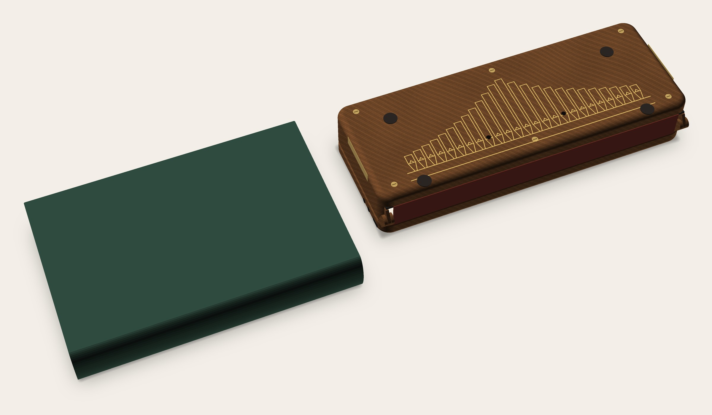
<figcaption>Closed, beside a 400-page hardback: real walnut, seen from behind so the pipes stand upright. The oxblood bookcloth spine now closes the hinge side.</figcaption>
</figure>

<figure>
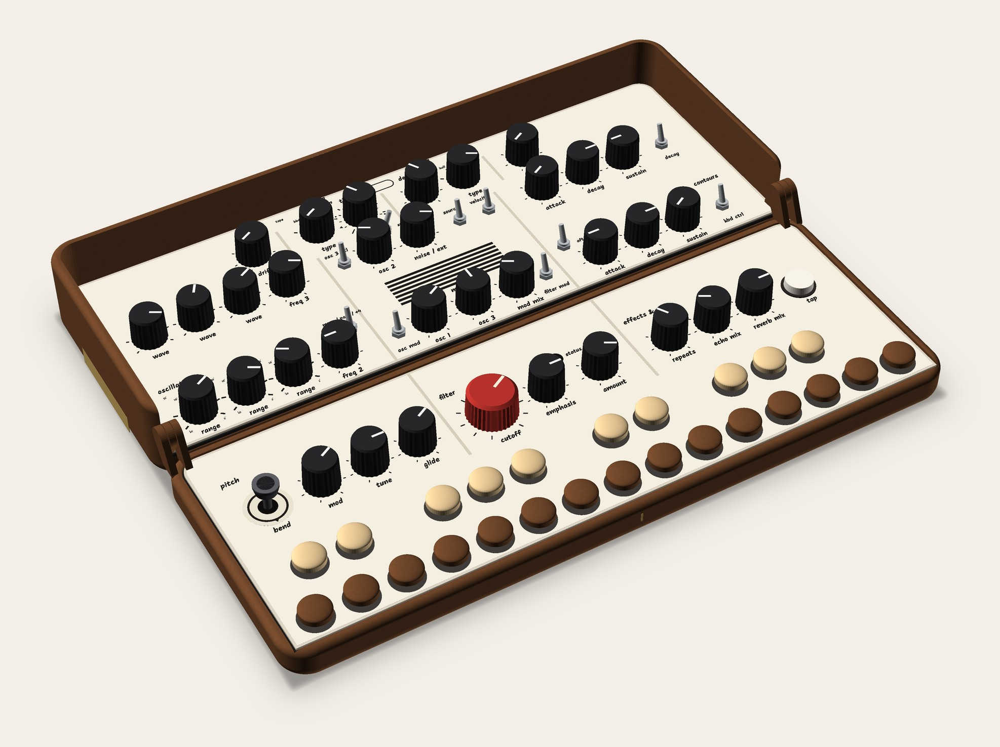
<figcaption>Open flat: the console. Reverse peg keys (walnut naturals, maple sharps), RANGE in feet, FREE / SYNC in front of TIME.</figcaption>
</figure>

<figure>
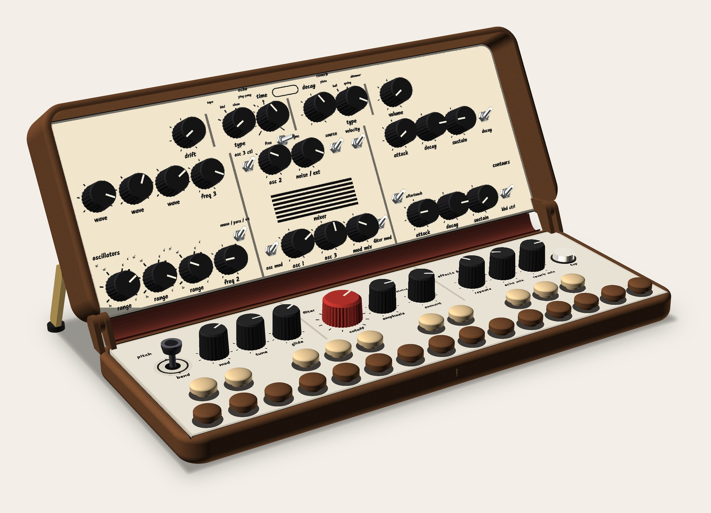
<figcaption>Standing at 120° on v1.1's brass stays, the lid face corrected to cream. The spine shows as a soft oxblood drape in the opened joint.</figcaption>
</figure>

<figure>
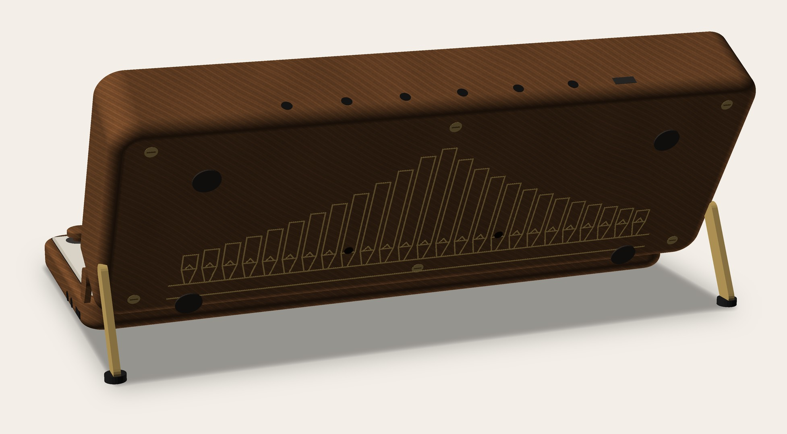
<figcaption>Standing, from behind: what the friend on the bench sees. 25 pipes at 8.75 pitch; the two dark mouths at x 108 / 178 are the push-out holes.</figcaption>
</figure>

## Keys
<figure>
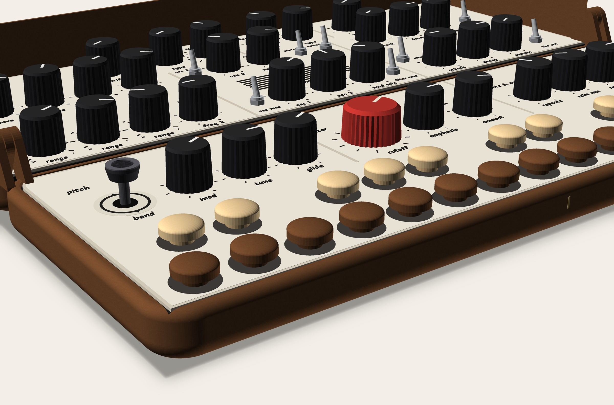
<figcaption>The reverse pegs (the proposal): walnut naturals from the body's own walnut, maple sharps, each on a 14 mm felt washer.</figcaption>
</figure>

<figure>
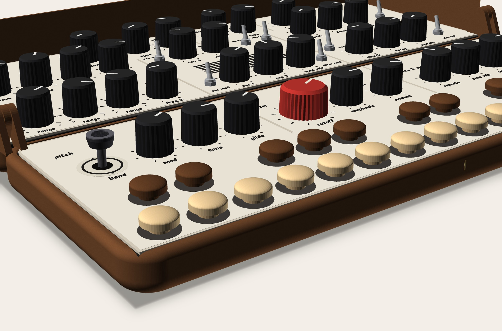
<figcaption>The fallback, if reversed keys bother him: maple naturals, walnut sharps. Same parts, same geometry, a normal keyboard's light / dark.</figcaption>
</figure>

<figure>
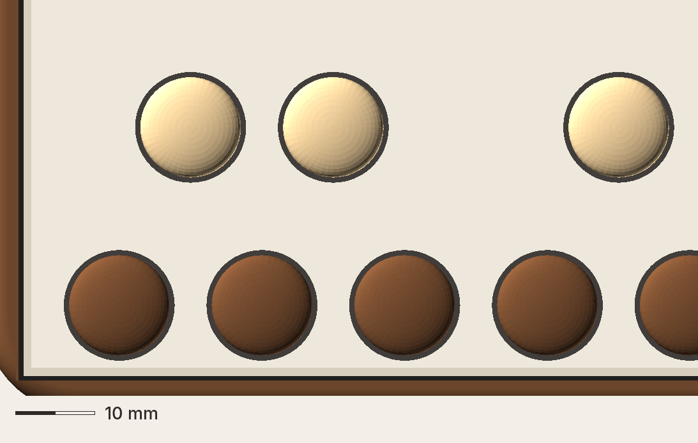
<figcaption>Pegs from above at native resolution (12.41 px per mm).</figcaption>
</figure>

## Details
<figure>
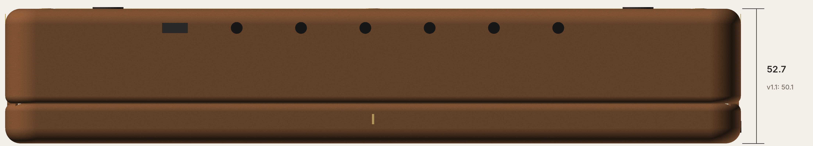
<figcaption>Closed, exact front elevation: 52.7 mm with the pegs inside (v1.1 FOLD: 50.1).</figcaption>
</figure>

<figure>
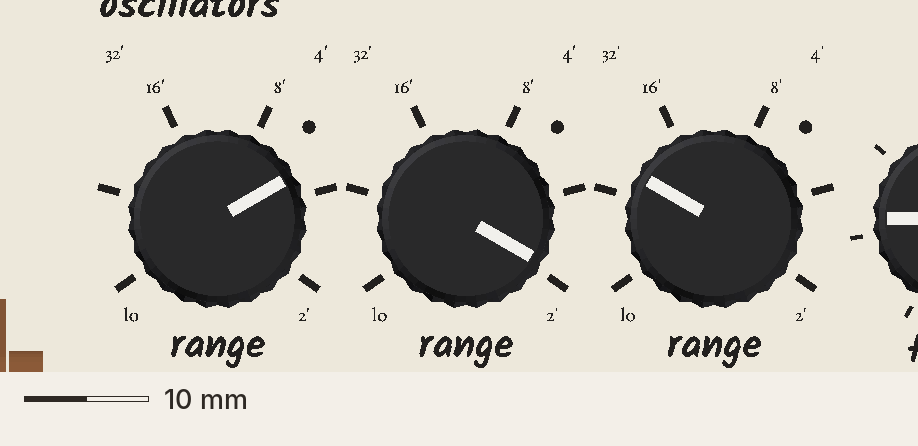
<figcaption>RANGE in feet, the one serif on the panel: 16' and 8' low, 32' and 4' higher, lo and 2' beside the end ticks.</figcaption>
</figure>

<figure>
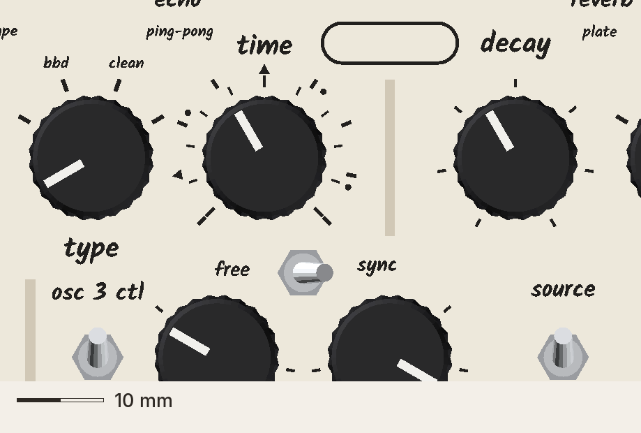
<figcaption>TIME's two scales (inner milliseconds, outer note divisions as marks) and the FREE / SYNC toggle in front, in his FOLD hand.</figcaption>
</figure>

<figure>
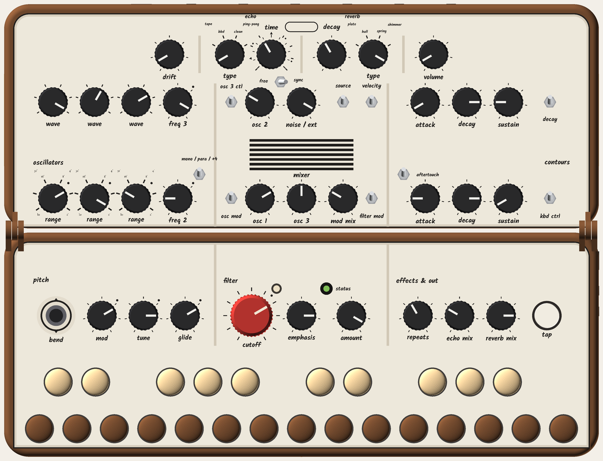
<figcaption>Open, exact top view, 12.41 px per mm: a reference for measuring, not "real size" on a screen.</figcaption>
</figure>

## Principles (each follows from the idea)
1. **The façade is the instrument's own scale.**
   - 25 pipes, one per key, C to C: lengths 66 × 2^(−n/12) mm, the longest four times the shortest.
   - The organ builders' tower: the tallest on the axis, then alternating outward.
   - Two of them speak (their mouths are the push-out holes).
   - *Because* decoration that comes from the keyboard's numbers is information, not costume.
2. **Line, not picture.**
   - Single 0.6 mm engraved lines with a brass-tone fill: conical foot, mouth, body, flat top. No shading, no fake 3D, no tracery.
   - *Because* brass on dark walnut turns steampunk the moment it's drawn as an object.
3. **Outside dark, inside light; the keys rhyme with both.** Dark walnut with light lines outside; a light plate with dark knobs inside. The keys sit between.
4. **Brass is the case hardware; cloth is its back.** Brass stays, pins and screws (the d 12 screws sit on the façade's plinth band as rivets). The oxblood spine closes the case like a book's.
5. **Serif only where the organ speaks.** RANGE in feet and the nameplate; everything else in his FOLD hand (Kalam).

## Look (spec for the build)
- **Body:**
  - walnut-tone wood-fill PETG first (#6b4429, matte); his planed walnut later, oiled;
  - halves 286 × 108; closed 52.7 (lid walls +2.6).
- **Façade (lid back):**
  - 25 pipes, pitch 8.75, field x 34.8–251.2;
  - feet on an impost line at d 18, a plinth line at d 10, tops up to d 84;
  - lines 0.6 wide, brass-tone fill; impost and plinth lines run x 30–256;
  - **the mouths of the pipes at x 108 and 178 are through-holes, Ø 4, at d 28.3** (the push-outs);
  - feet: dark rubber, front pair at d 6, rear pair at d 78;
  - first build: a printed relief (0.4 proud) with brass-tone wax fill; real-walnut version: engraved and filled.
- **Spine:** oxblood bookcloth on a 0.8 TPU core, x 10.5–275.5, glued to the base's rear-top edge and the lid's hinge edge, up over the lid plate's edge so no white line shows when closed. Flex life UNVERIFIED (systems).
- **Pickguards:** v1.1 cream (#f1ebdd), 45° bevel, black Kalam legends, warm-grey rules.
- **Keys:**
  - proposal: walnut naturals, maple sharps;
  - fallback: maple naturals, walnut sharps;
  - 12.7 button plugs on HUSH's arms, 14 mm felt washers, tops 6.5 above the plate;
  - the key window closes into a deck.
- **RANGE feet:** EB Garamond 1.2 (positions above).
- **Section names:** oscillators and contours at dV1 + 17.5 (clear of the feet labels); mixer stays at + 11.3, under the grille.
- **FREE / SYNC:** black FOLD toggle at lid (133, d 70.6); "free" / "sync" beside it, 0.5 behind its centre.
- **TIME:** inner ms ticks, outer division marks (tick / dot = dotted / triangle = triplet), over ±135°, no numbers. DIPTYCH's numbered red/black dial is a donor if the director wants numbers.
- **Name:** a blank 16 × 5 lozenge on the axis at d 94.6.
- **Status:** hooded LED; legend beside it.

## Walnut button plugs (fix 6)
- **1/2" walnut button plugs** are a stock part:
  - [Woodpeckers](https://woodpeckerscrafts.com/products/1-2-walnut-button-plug): $0.35 each, $0.32 at 25+;
  - [Midwest Fastener via Zoro](https://www.zoro.com/midwest-fastener-12-walnut-wood-round-head-screw-hole-buttons-100pk-08944/i/G102512583/): $43.55 per 100, mushroom / round head.
  - CHAMBER needs 15 walnut + 10 maple; with spares, ≈ $8–10 for the walnut at the 25+ price.
  - **UNVERIFIED:** neither page states shank diameter or length, so fit on HUSH's arm needs one sample in hand.
- **Fallback:** maple plugs stained dark. Same plug as the sharps, plus a walnut-tone oil stain ($0–10). It reads less like the body's walnut, and the stain wears at the touch point.

## Motion and feedback
- Pegs: ≈ 2.5 mm onto felt, silent. Both colourings feel the same.
- Lid: v1.1 brass stays (a firm click at the stop). The spine gives a soft cloth sound when it pulls taut closed.
- Echo tempo: v1.1's tempo flash on the one status light (H7), with echo-clock.md's lock / loss flashes.

## Still open
- **Owner:** reversed keys, or the fallback (both drawn).
- **Eng / maker:**
  - spine flex life;
  - the ribbon's loop sharing the seam gap (systems);
  - engraved / relief fill on wood-fill PETG (coupon);
  - plug shank fit.
- **Closed from the front**, the pipes point toward you (their feet are at the hinge so they stand upright when it stands). Accepted as the price of facing the listener.
