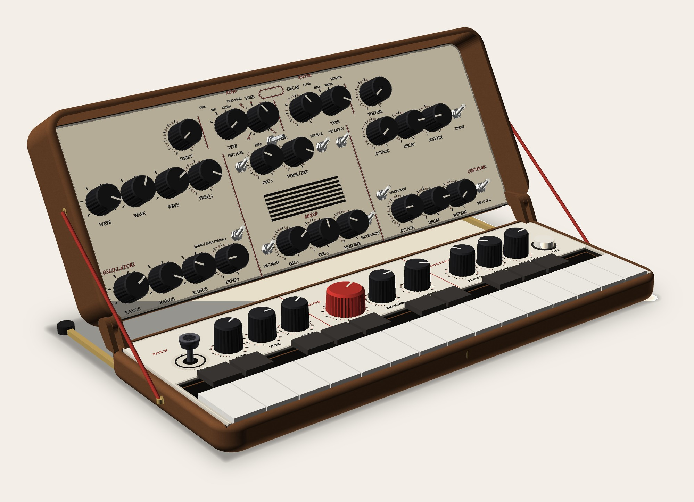
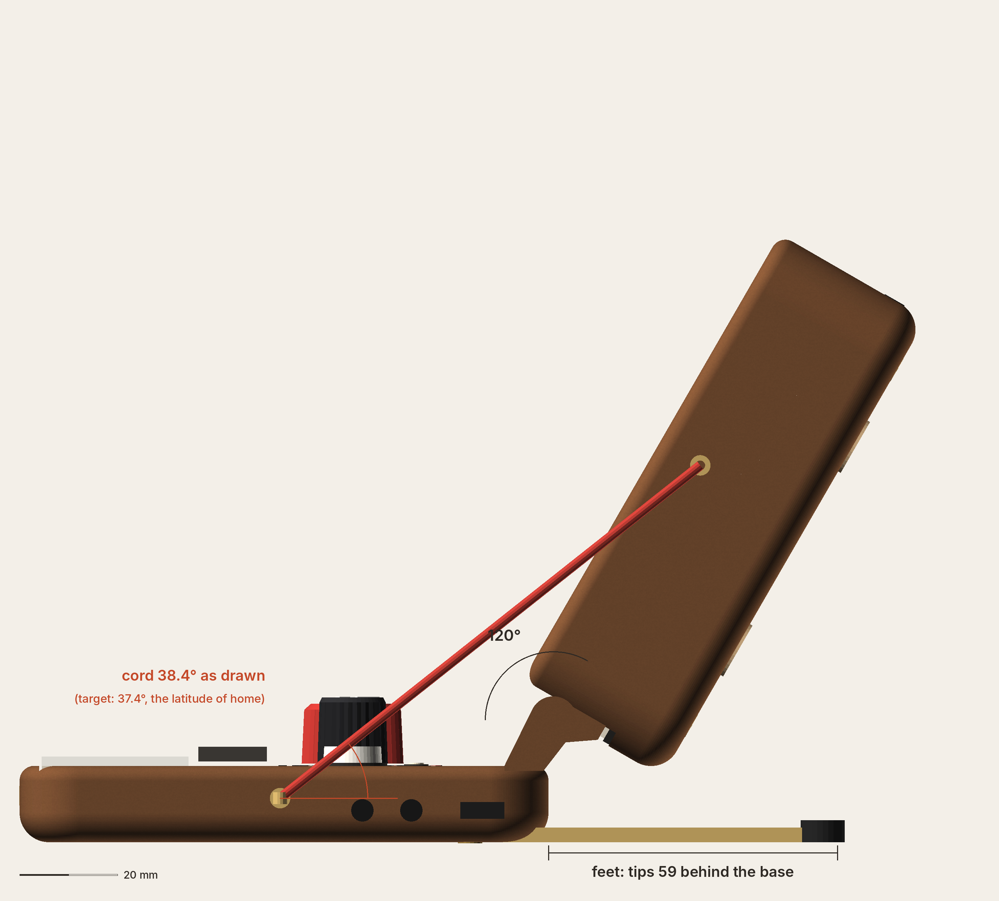
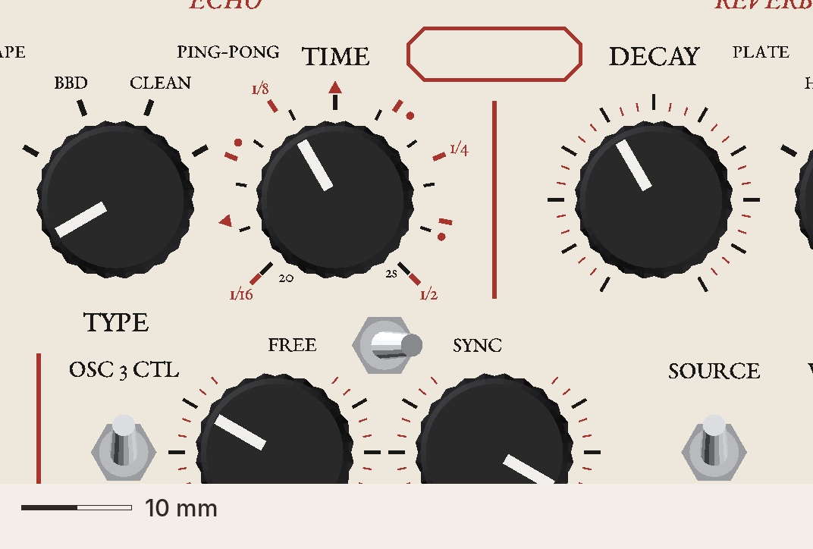
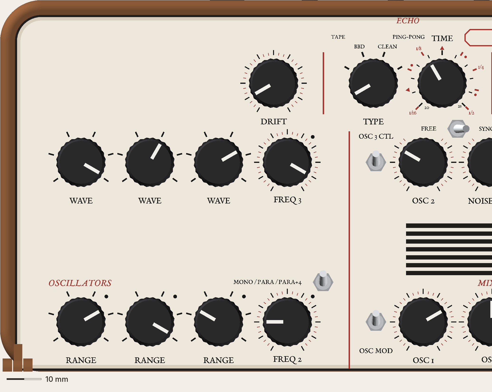
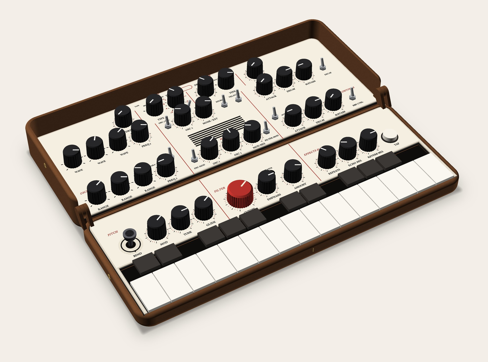
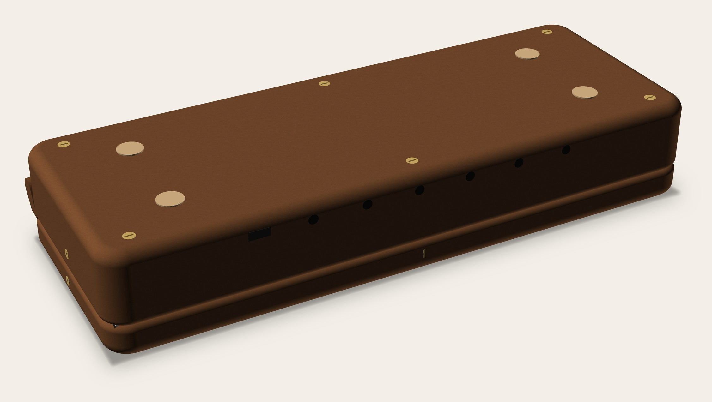
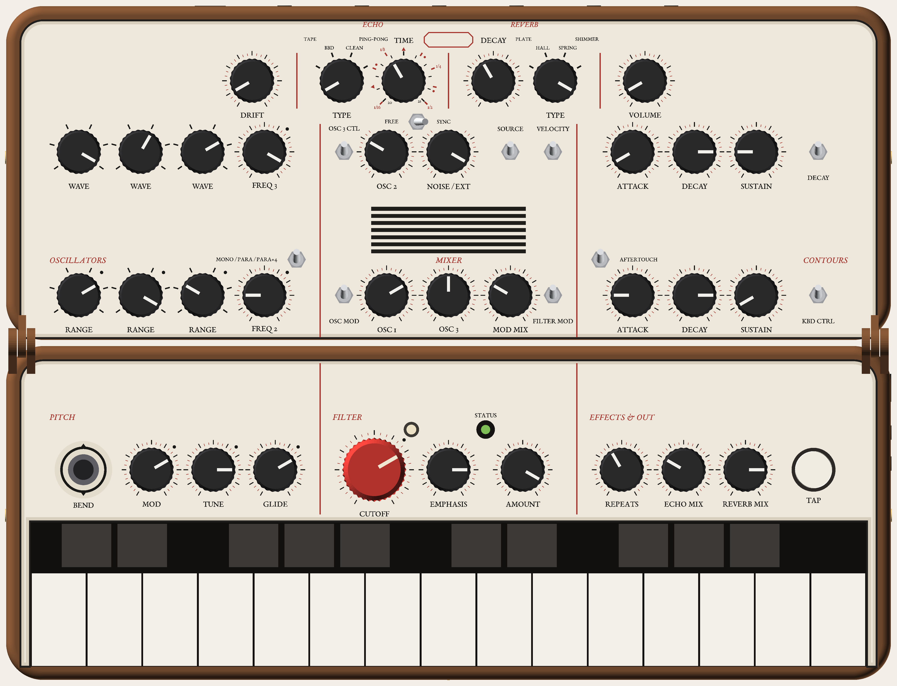

# DIPTYCH: how it looks and feels (visual)

Seed: FOLD-105 (v1.1). Kind: a field instrument. **Point of view (director): a pocket instrument for reading the day outdoors.** It opens, stands on its cords, and its TIME dial tells time two ways. Emotion: wonder. Flat keys (v1.1). Read with `how-it-works.md` (systems rev 1) and `../common-how-it-works.md`.

**Rev 1, 2026-11-13, concept turn 1 (visual).** Images in `img/` (from `_mock-src/rb.py` + `figs_rb.py`).

## Images

## Systems' change (fold-out feet): accepted, with a pushback on what it costs the idea
- **Physics wins:** cords alone tip at 0.8 N, and a knob turn pushes 1–3 N. The feet (brass bar, tips 59 behind the base, 6.9 N) are drawn.
- **The cost, plainly:** v1.1 stood on 2 stays that did both jobs. DIPTYCH stands on 2 cords + 2 feet + 4 eyes and must be set up in order (feet first). That's the weakest part of the concept. In the standing render the cords at the end faces read as "strings", but the feet are just a mechanism.
- **The alternative to weigh (director's call):** keep v1.1's brass stays and drop the cords. DIPTYCH then stands on its faces alone (the dial, the graduations, red and black on white) and loses the latitude story. My view: **the faces carry DIPTYCH; the cords are a charming fact, not its spine.**
- **Numbers don't match yet:**
  - drawn as systems describe it (lid eye on the hinge-axis line at s 60, base eye at y 53.2, z 9), the cord sits at **38.4°, not 37.4°**;
  - the elevation says so rather than fudging it;
  - systems to reconcile (≈ 1°: a small move of the base eye, ≈ +2 mm forward [rough]).

## Principles
1. **Two hour systems, one dial.**
   - TIME carries the ms scale in black and the note divisions in red.
   - The FREE / SYNC toggle in front picks which one you're reading, as a diptych carried common and Italian hours on one face.
2. **Every scale is engraved.** Every knob gets a fine graduation:
   - 31 red hairlines at 10°;
   - 11 black majors at 30°;
   - RANGE and WAVE keep only their black position ticks.
   - *Because* "be extravagant" costs nothing in a face-down print, and the fine rings are what makes it an instrument for reading.
3. **Red names the parts; black is what you read.**
   - Section names and the rules in red. Legends and major ticks in black, in an engraved roman (EB Garamond caps).
   - *Because* that's the diptych's own colour code, and it keeps the two FOLD branches apart (below).
4. **The string is the stay.** Two red braided cords from the lid end faces to the base end faces, at the latitude of home. The feet stop the tip (above).
5. **The maker's cartouche.** A small notched red cartouche on the axis, blank until he names it.

## How it stays apart from CHAMBER (director's cut condition)
| | CHAMBER | DIPTYCH |
|---|---|---|
| Where the ornament is | outside (the lid back) | the inside faces |
| Type | his FOLD hand (Kalam), serif only on RANGE | engraved roman caps everywhere |
| Colour | dark walnut + brass lines | red + black on white |
| Keys | reversed pegs | v1.1 flat keys |
| Stand | v1.1 brass stays | red cords + brass feet |
| Emotion | joy | wonder |

Side by side (`chamber-open.jpg` vs `diptych-open.jpg`), they read as two different instruments: one is a handwritten console in a dark case, the other an engraved field instrument. **My read: they separate.**

## Look
- **Body:** v1.1 FOLD walnut-tone; real walnut later.
- **Pickguards:** v1.1 cream with the 45° bevel.
- **Rules:** thin red (0.44 wide), not v1.1's 1.2 warm grey.
- **Type:**
  - legends: EB Garamond Medium caps 2.0;
  - section names: EB Garamond Italic, red, 1.9–2.1 (PITCH, FILTER, EFFECTS & OUT; OSCILLATORS, MIXER, CONTOURS; ECHO, REVERB);
  - type names: Garamond caps 1.3.
- **TIME's dial (the hero), over ±135° (common §2):**
  - inner: 11 black ms ticks, with "20" and "2s" at the ends;
  - outer: 9 red division marks (tick, dot for dotted, triangle for triplet), with **1/16, 1/8, 1/4, 1/2** written at r + 5.
  - Smallest type 1.1 mm ("20", "2s"), division numbers 1.25. Legible at 1:1 in the crop; whether 1.1 mm roman figures survive a 0.4 nozzle face-down print is UNVERIFIED (coupon).
- **FREE / SYNC:** black-bat toggle at lid (133, d 70.6), FREE left and SYNC right, Garamond caps.
  - The graduations on OSC 2 and NOISE / EXT stop 35° either side of the top, so the words never sit on hairlines.
- **Cords:** 2 mm braid in deep red (#a8322a), the dial's red. **Not** white or blue (that's rigging).
  - Flush brass eyes; a brass snap at the base eye.
  - Stowed: in the end-seam groove (systems).
- **Feet:** 3 × 8 brass bar, pivoting from the base underside near each end; black rubber tips at y 167.
- **Cartouche:** a red notched outline, 16 × 5, on the axis at d 94.6 (v1.1's lozenge no longer fits between the moved TIME and DECAY legends).
- **Status light:** hooded.
- **Two filament swaps** (red, black), not v1.1's one: print time, not money (systems).

## Motion and feedback
- Standing: feet out (they swing back and click into a detent; UNVERIFIED part), then the cords clip.
- The red cord drawn taut at the latitude is the "opening the dial" moment.
- The light: as v1.1 (H7 tempo flash), with echo-clock.md's lock / loss flashes.

## What it had to prove (director)
| Must prove | Where | Status, my honest read |
|---|---|---|
| (a) standing with cords reads "field instrument", not "boat rigging" | `diptych-standing.jpg` | Red cords + red engraving + roman caps: it reads as one instrument, not a boat. The brass feet sticking out behind are the least graceful part. |
| (b) TIME dial, both scales legible at ≥ 1.05 | `diptych-time-dial-14.48px-per-mm.png` | Legible on screen at native resolution. Print legibility at 1.1 mm: coupon. |
| (c) cord geometry, tension, tip | `diptych-standing-side-exact.png` | Feet 59 behind, 120°, cord as drawn 38.4° (see above). Tension and tip: systems' numbers. |
| (d) the whole panel with graduations stays calm at arm's length | `diptych-open.jpg`, `diptych-standing.jpg` | Calm: the hairlines are fine and red, so at arm's length they read as a tint round each knob, not as lines. Up close they're the point. |

## Open
- Stays vs cords + feet (director).
- Reconcile 38.4° vs 37.4° (systems).
- A print coupon of the TIME dial at 1:1.
