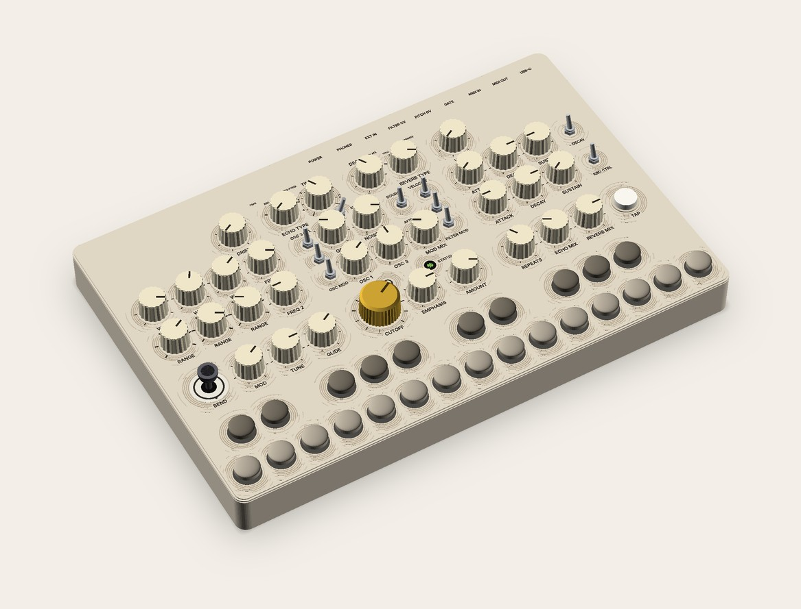
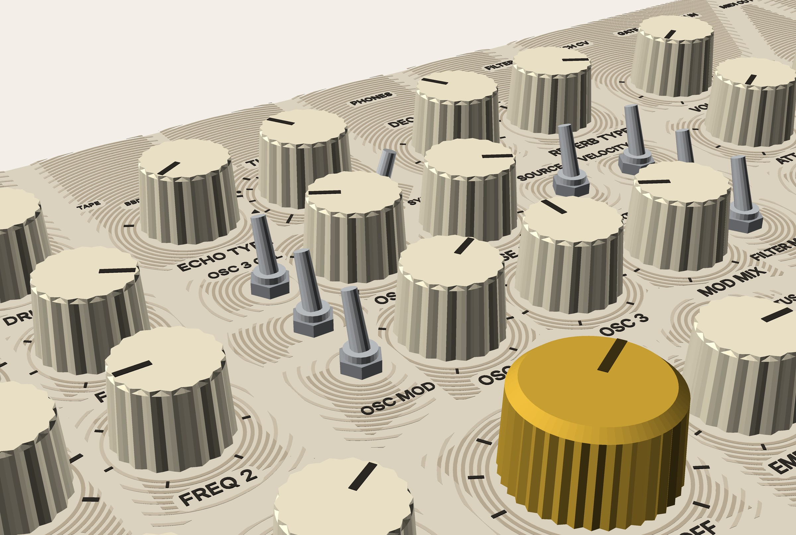
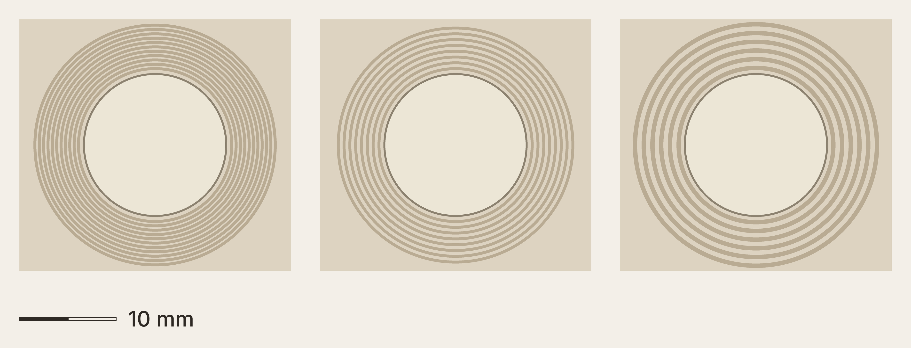
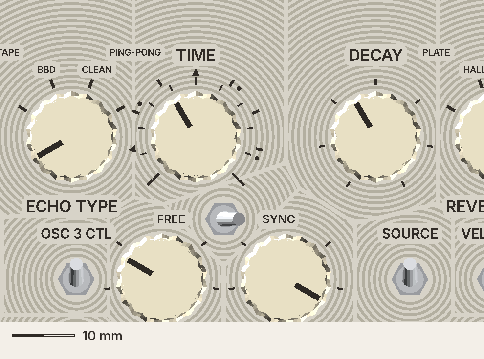
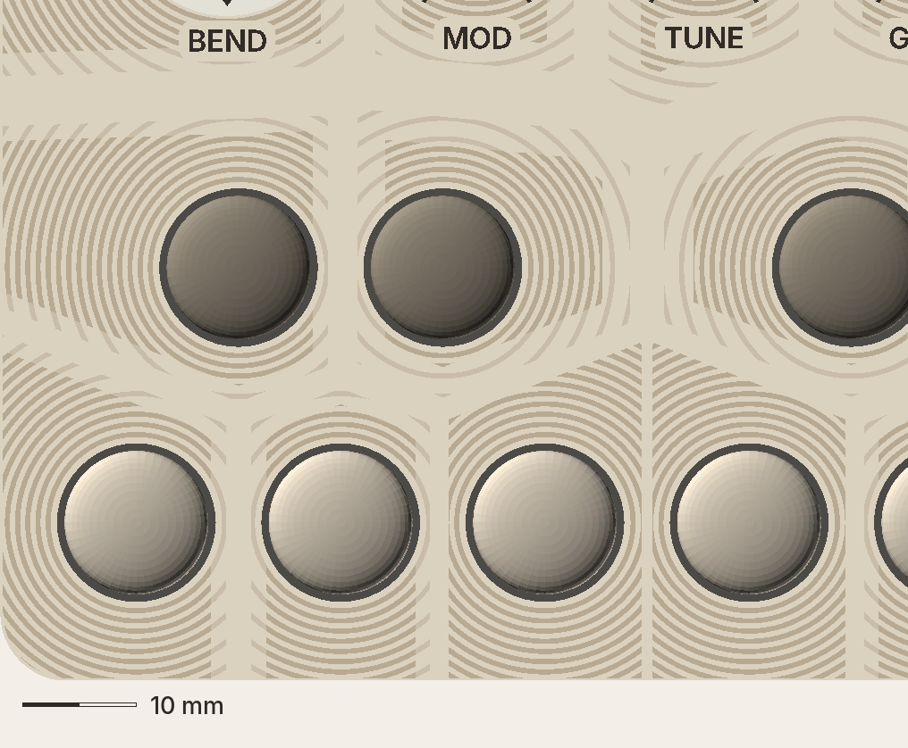
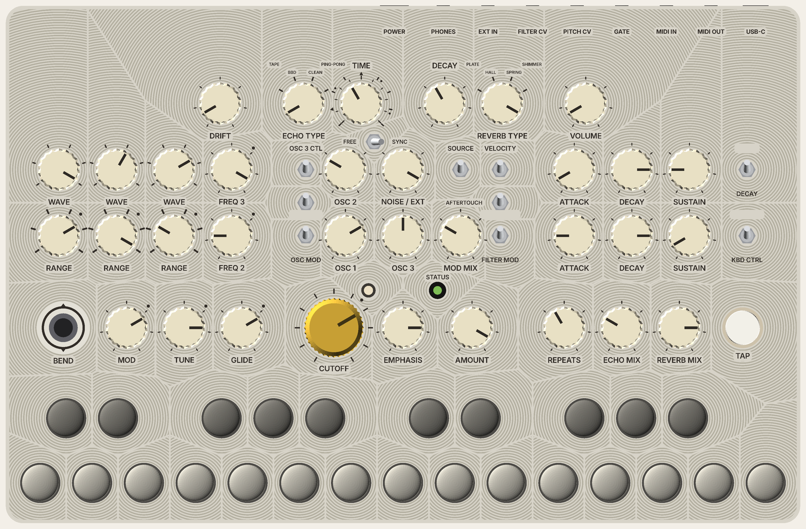

# RAIN: how it looks and feels (visual)

Seed: ONE SHEET (v1.1, 276 × 180). Kind: a landscape. **Point of view: every control is a drop on still water; its rings spread and fade, and the still water between them draws the panel's map.** Rule: *everything that breaks the surface ripples.* Emotion: calm. Read with `how-it-works.md` (systems rev 2) and `../common-how-it-works.md` (rev 2).

**Rev 2.2, 2026-11-13 (R1 as the director meant it: every element's rings die out about 7 mm from its skirt, leaving still pools beyond; the outline is also still).** Supersedes rev 1. Images in `img/` (from `_mock-src/rb.py` + `figs_rb.py`). The ring field is computed from the real layout. Only the images the fixes needed were re-rendered.

## What changed in rev 2 (the director's fixes)
1. **The ripples decay.** Built the way a face-down print can make it (systems R2.2):
   - near each stone, **deep rings (0.4) at 0.9 pitch**, at least 2–3 hugging every element;
   - further out, **shallow rings (0.2) at 1.8 pitch**;
   - then smooth water up to the band.
   - The depth step and the opening spacing *are* the decay. Still two finishes (smooth, rings).
2. **Sections are wider still bands:**
   - **1.0 mm inside a section, 3.0 between sections.** Each cell's edges are pulled back by half the band toward that neighbour.
   - Sections are the v1.1 map: keys; PLAY pitch / filter / fx; VOICE oscillators / mixer / contours; back row drift / echo / reverb / volume. FREE / SYNC belongs to echo.
   - The wide bands now read as lanes of still water between the sections. The seams draw the map.
3. **Warm palette, off concrete:**
   - shell pale warm stone #ddd3c1;
   - deep rings #b9ab93, shallow rings #cbbfaa;
   - pegs two warm stone greys (#aaa192 / #6e675b);
   - the one mustard leaf (CUTOFF) kept, no second accent.
   - **R1 (director): no exception at the edge.** The fade finishes everywhere: the panel's outline is a 1.5 mm still band, like the 3.0 seams between sections (half of it each side). The rings die out before the chamfer, so the shell's edge reads as the pond's still margin.
   - **The vertical walls can't carry modelled rings:** printed face down, their surface is layer lines. They're the warm stone, and their own fine horizontal ripple is the layer lines.
4. **Legends: 0 collisions** in `branch_check.py` §7, inherited v1.1 ones included. Branch-only fixes:
   - type-name rows raised (inner 3.8, outer 6.6);
   - ticks under toggle nuts dropped;
   - "FREE" / "SYNC" 0.5 behind the toggle centre;
   - STATUS beside its hood;
   - the back row says ECHO TYPE / REVERB TYPE in front, TIME / DECAY behind (no headings in RAIN).
5. **Pitch compare, three ways:** the drawing below. The words are here, not in it.
6. **Re-rendered at arm's length and close.**

<figure>

<figcaption>Arm's length (the director's test: calm or not?). Every element's rings die out about 7 mm from its skirt, leaving still pools in the big rear and corner areas; the wide lanes between sections draw the map. Warm stone, two stone-grey key rows, one mustard leaf.</figcaption>
</figure>

<figure>

<figcaption>Close (rendered before R1, which changed only the outer edge, out of this frame): deep rings hug every knob and toggle, then open out and go shallow before the still band. Words sit on smooth lily pads.</figcaption>
</figure>

<figure>

<figcaption>Ring pitch, left to right: 0.45 (v1.1's first-layer rings, the ones he loved: slicer fill, impossible per cell); 0.6 (modelled grooves, needs a 0.25–0.3 nozzle: systems R2.2); 0.9 (modelled grooves on the standard 0.4 nozzle, as drawn).</figcaption>
</figure>

<figure>

<figcaption>TIME, FREE / SYNC and the lily pads from above at native resolution (12.70 px per mm): the 1.0 band inside the echo section, the 3.0 band to its neighbours.</figcaption>
</figure>

<figure>

<figcaption>The stepping stones: pegs on felt washers in two warm stone greys, rippled like everything else (12.70 px per mm). Rendered before R1: here the rings still reach the front edge; they now fade into a 1.5 mm still margin.</figcaption>
</figure>

<figure>

<figcaption>Exact top view, 12.70 px per mm: a reference for measuring, not "real size" on a screen. Rendered before R1 (the edge is now a still margin; only the arm's-length view was re-rendered, as asked).</figcaption>
</figure>

## Principles
1. **Everything that breaks the surface ripples.** Knobs, CUTOFF, the TYPE switches, toggles, the stick, TAP, the status hood, the 25 pegs and FREE / SYNC.
2. **Ripples lose amplitude.** Deep and close near the stone, shallow and open further out, then still. *Because* real water does, and because a uniform field read as crazed stone at arm's length (round 1).
3. **The still water is the map.** A narrow still band between two controls of one section, a wide one between sections. No grooves, no headings.
4. **Words float on lily pads:** smooth rounded pads (0.85 margin, R 1.2) cut out of the field.
5. **One leaf.** CUTOFF in mustard is the only colour.

## Look (spec for the build)
- **Shell:** warm stone PETG (#ddd3c1 drawn), face down on smooth PEI. One filament, one swap (legends dark #2e2924, Inter SemiBold caps 1.9).
- **Rings:** modelled grooves 0.45 wide.
  - **Deep zone:** 0.4 deep at 0.9 pitch. It reaches at least 2.4 mm past the ring start, or half the way to the band, whichever is larger.
  - **Shallow zone:** 0.2 deep at 1.8 pitch, ending short of the band by 14 % of the span.
  - **Reach (R1):** deep rings stop 3.5 mm past the ring start, shallow rings 7.0 mm past it. Beyond that, whatever the cell size, it's a still pool. No long straight hatching in the big rear and corner cells.
  - Ring starts:
    - knobs 7.75;
    - CUTOFF 10.9;
    - toggles and hood 3.7;
    - stick 9.3;
    - TAP 7.6;
    - pegs 7.3.
- **Bands:** 1.0 inside a section, 3.0 between, 1.5 at the panel's outline (power diagram weighted by ring start, each edge pulled back by half its band; the outline counts as an edge, R1).
- **Knobs:** cream KN1250; CUTOFF mustard 1083 (#c9a032).
- **Pegs:** HUSH's 12.7 button plugs in two warm stone greys on 14 mm felt washers; whites y 14, sharps y 36.5; width stays 276.
- **FREE / SYNC:** one more stone; "FREE" / "SYNC" beside it on pads.
- **TIME:** two scales over ±135° (ticks inner, division marks outer). No numbers. DIPTYCH's numbered dial is available as a donor.
- **Status:** hooded LED, legend beside it.
- **Sound (optional):** a soft "drop" at power-on (firmware, $0; power-off is impossible on the hard switch).

## Honest read of the round-2 renders
- **Arm's length:** the crazed-stone look is gone. What reads now is soft rings round each control and pale lanes between the sections. It's calmer, and the map is visible. It's still the busiest of the concepts: the rear band (type names, jack pads, the back row) carries the most texture. Renders flatten sheen, so the coupon under a tree is still the real test.
- **Close:** the best it has looked; the rings now "land" on each control.
- **0.9 vs 0.45:** coarser, shown honestly side by side. 0.6 needs a finer nozzle.

## Open
- **The coupon:** deep + shallow rings, a 1.0 and a 3.0 band, a lily pad, at 0.9 pitch, seen under a tree. Does a 0.2-deep ring read at all (systems: UNVERIFIED)?
- A 0.25–0.3 nozzle at Vector Space for 0.6 pitch (systems: UNVERIFIED).
- One-piece print on a 350 bed (the field must be unbroken).
