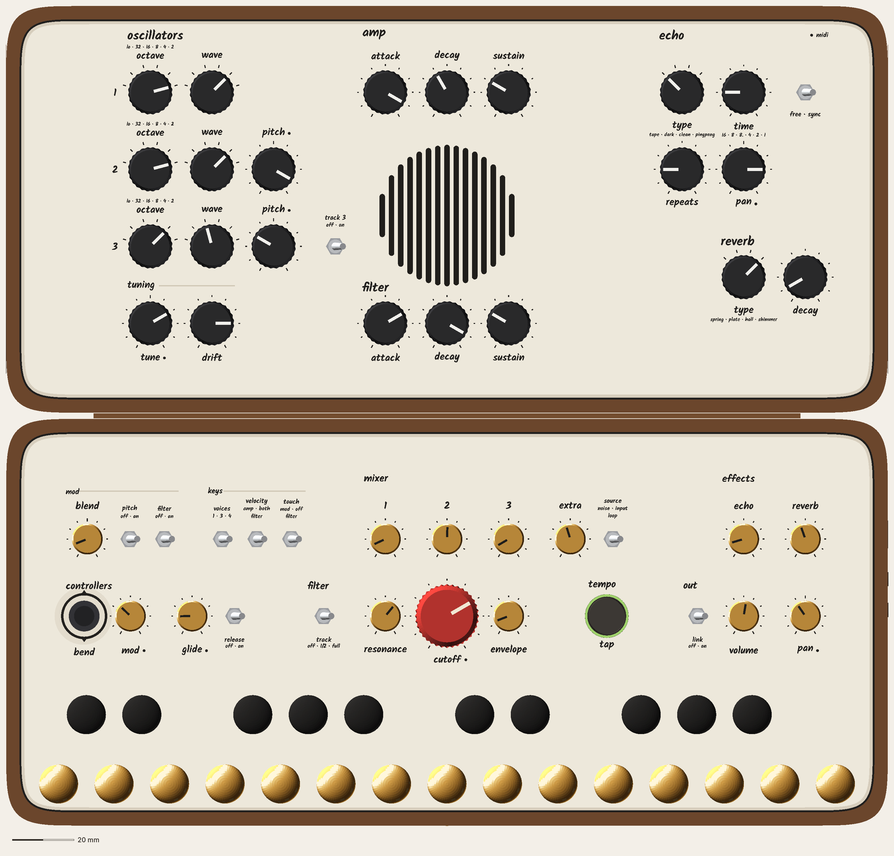
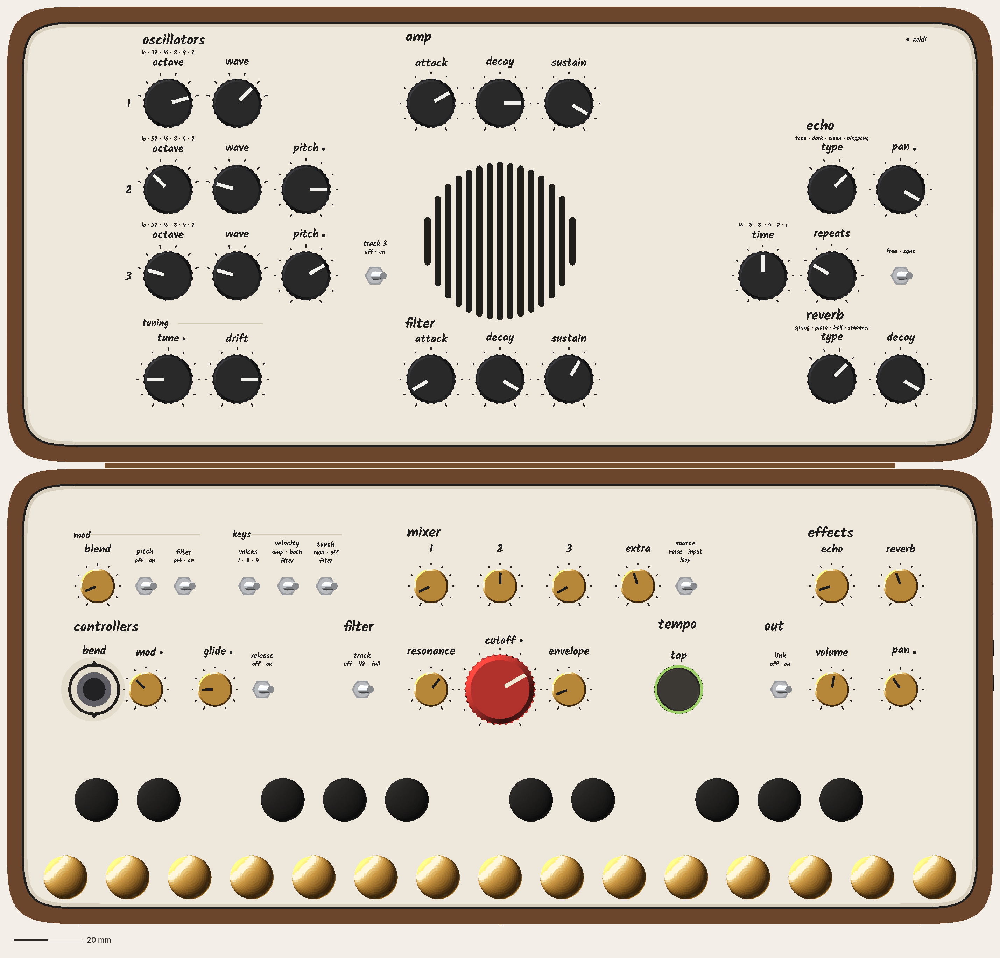
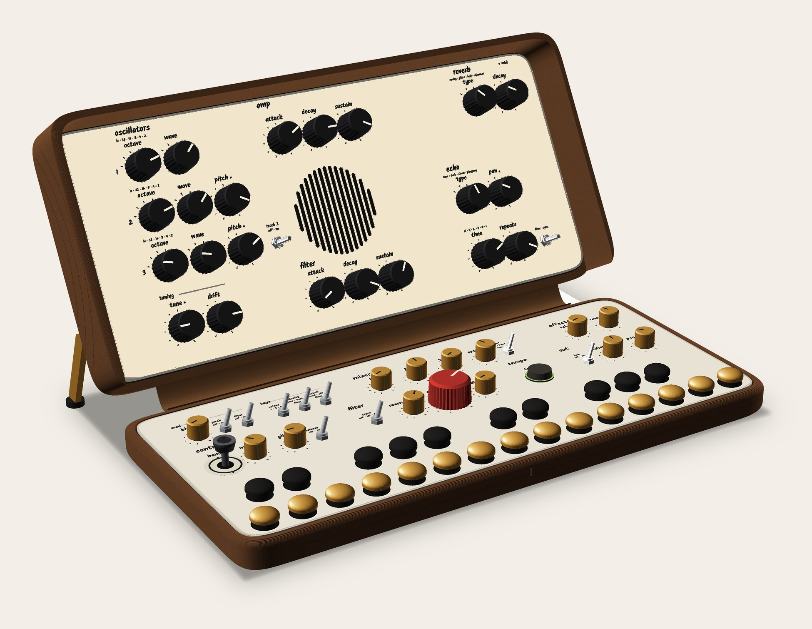
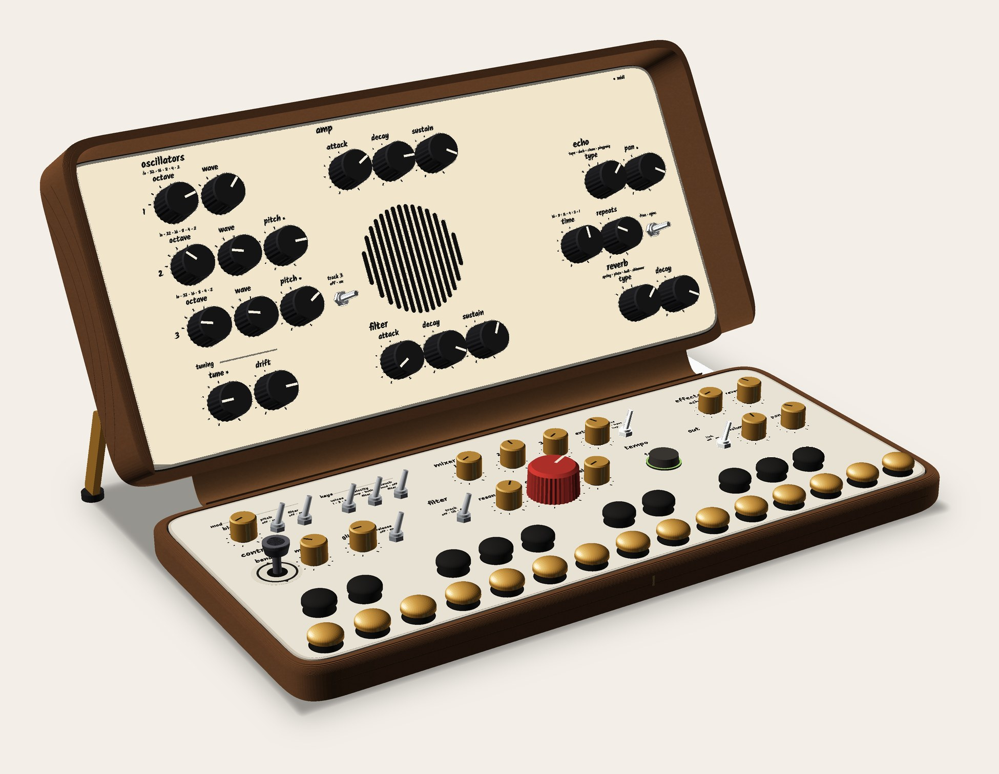
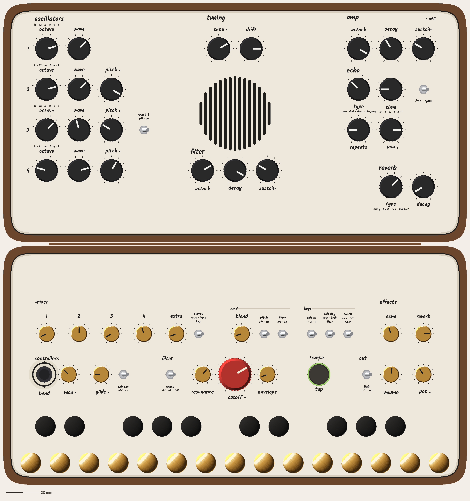
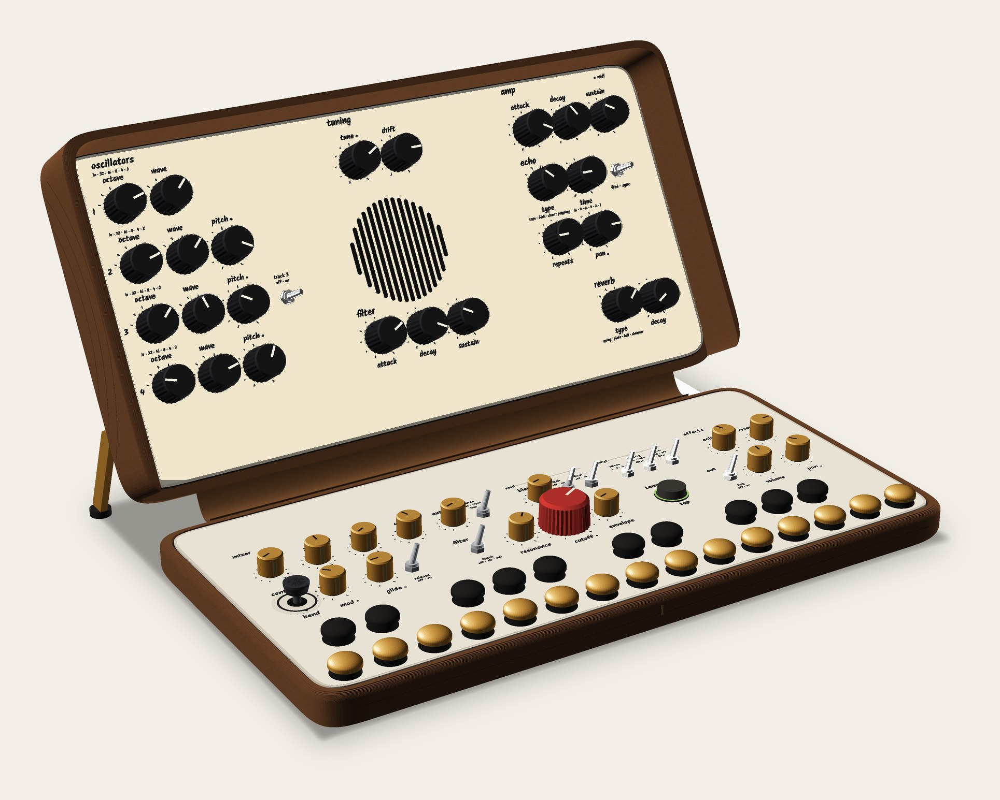

# Waiting on you

Decisions only you can make, newest first. The team keeps working around them; each answer unblocks the part named. When you answer in chat, the orchestrator records it in the owner record and removes it from here.

---

## 1. CATHEDRAL layout, laid out from your approved control categories
Every category is one block, in the tree's order. Wherever a category is split across the hinge, its two halves line up: oscillators over the mixer, filter envelope over cutoff, effects over their levels. One heading style, every label above its control, and the echo and reverb levels stay on the base.

**Question 1: in the effects column, which goes on top?**
- **T4 (three oscillators).** Reverb sits top right, and echo time and repeats are on the row nearest your hands. Synth-player critic **10**: "I'd play it and defend every control." Director **8**: top to bottom it reads reverb, then echo, the reverse of the signal.
- **T4-sig.** It's the same as T4, except echo sits above reverb in signal order. This leaves the top row open to the right of amp.

**Question 2 (after that): three oscillators or four?**
- **T2: four oscillators, half height 147.3.** Director **9**, critic **7**. The panel fills. The catch: with four oscillators, the pitch and filter mod switches end up about 110 mm from the mod knob, and fixing that would mean moving the echo and reverb levels. It also needs the bend stick lowered to 9 mm to keep today's closed thickness. The 4th oscillator adds roughly $20–30 and costs about half an hour of battery.

The earlier options (P5R, P5RS, P5OB-D and the case ratios) are in the history.

---

## 2. CATHEDRAL back opening, now there's no spine
Closed, there's a 22 × 266 mm opening along the back where the knobs inside show.

- **Leave it open, inside finished dark,** so the knob tops read as shadow. *Team recommends.*
- **Deal with it later** with a sleeve or case.

---

## 3. Buy-and-test (cheap, before building)
- **T1:** one pack of [Cherry Tree Toys 3/8" plugs](https://cherrytreetoys.com/3-8-mushroom-plugs/): measure head height and tenon on 5.
- **T2:** one hollow cast-brass key head on one switch: 20 presses slow and fast next to a wood plug; pass = no clack, wobble or sticking.

---

## 4. Line-out jacks (from the expert review)
**Unblocks:** the output circuit.
The mono-cable detection on LINE OUT can't work as drawn.

- **Two jacks, L/MONO and R:** the standard synth answer. A mono cable in L/MONO gets the full mix automatically, with no firmware. Adds one hole.
- **Keep one stereo jack and rework the detection circuit:** fewer holes, more parts, and it needs a bench test. A stereo cable into an audio interface can still go quiet.

Two jacks also give back a Daisy pin (pins are now at 30–31 of 31). *Team recommends two jacks.*

**Also:** should plugging into line out turn the speaker off? Most players expect it to, so the speaker doesn't feed back through a PA.

---

## 5. MIDI (see Features → MIDI for the full page)
- Should the dry pan stay on CC 10? DAWs send "pan = centre" on CC 10 every time a project opens, so the pan would jump to centre on its own. The team recommends moving it to an unused number.
- Should a DAW be able to automate the echo and reverb amounts? Those two knobs would get the MIDI dot and the "held by MIDI" light.
- Channel 1, or respond on any channel (omni)?
- Should the knobs ever send MIDI (off by default), or receive only?

---

## 6. Aftertouch switch label
**Unblocks:** the panel legend.
The pressure switch adds modulation amount: vibrato when OSC MOD is on, a filter wobble when FILTER MOD is on, or a brighter filter on FILT.

- **MOD / OFF / FILT:** says what it really does. *Team recommends.*
- **VIB / OFF / FILT:** your earlier word, but it's only vibrato when OSC MOD is on.

---

## 7. Filter keyboard tracking switch (KBD)
**Unblocks:** the KBD legend on the base.
The Model D reaches full tracking (both of its switches on). Ours is one 3-way switch, so it has three settings, not four.

- **off · 1/3 · 2/3:** as specified today. Full tracking isn't available.
- **off · 1/2 · full:** the firmware sets the amounts (the tracking voltage is already digital), so full is there for playing the filter as a tone. *Team recommends; eng to confirm.*

---

## 8. Bend range
**Unblocks:** the bend stick's firmware setting.
How far the stick bends the pitch at full push, up or down.

- **± 2 semitones:** a whole tone each way, the same as the MIDI default. *Team recommends.*
- **Wider (e.g. ± 5 or ± 7):** bigger dives, less fine control near the centre.

## 9. The 4th note in "voices: 4"
**Unblocks:** the voice board (one chip and one pin).
The 4th note comes from the Daisy, and it needs a way into the real filter.

- **A. A 5th small DAC chip (≈ $4):** the 4th note goes through the filter like the others; nothing else changes. *Team recommends.*
- **B. Borrow the effects' right channel:** no new chip, but the effects go mono while "voices: 4" is on, and the mixer's extra source must sit on "input".
- **C. Drop the 4th note for now:** the switch becomes 1 · 3 only.

## 10. Which note the filter follows when playing chords
**Unblocks:** the paraphonic firmware.
With one filter for up to four notes, its tracking follows one of them.

- **Highest note:** chords stay bright on top. *Team recommends (the default already explained to you).*
- **Lowest note:** matches the mono behaviour (lowest-note priority).
- Either way, a key combination switches between them (to be defined in Firmware and gestures).

## 11. How much drift at full
**Unblocks:** the drift knob's firmware range.
Drift makes each oscillator wander slowly on its own; at 0 it's rock steady.

- **Subtle (up to ± 5 cents):** barely there, a hint of life.
- **Vintage (up to ± 15 cents):** an old synth warming up. *Team recommends.*
- **Wild (up to ± 30 cents):** clearly out of tune at full; a sound effect.

Firmware can change it later.
