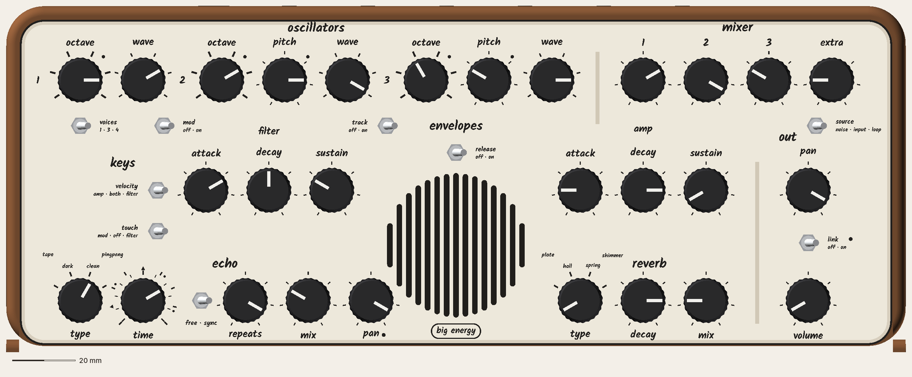
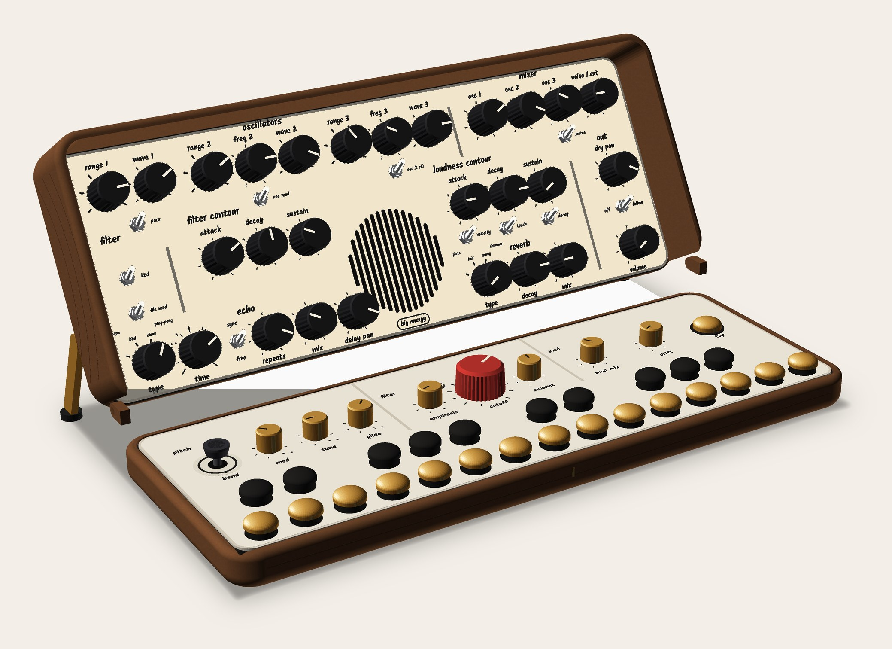
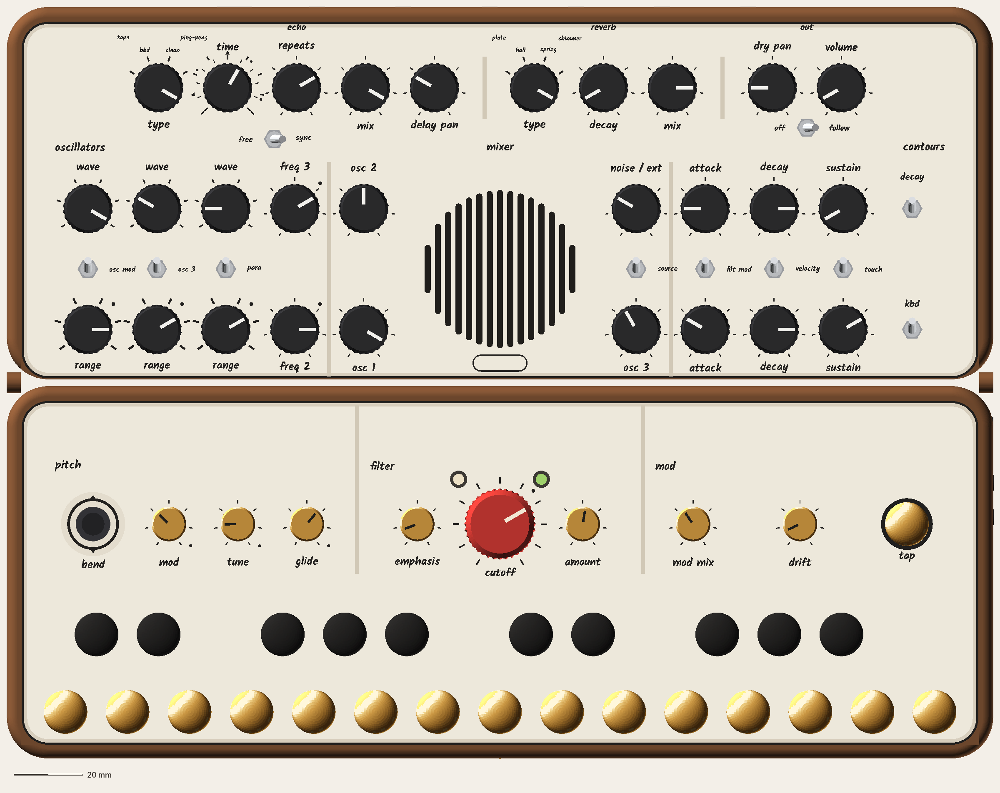
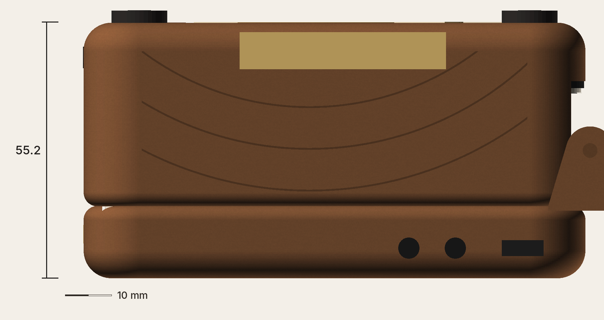

# Waiting on you

Decisions only you can make, newest first. The team keeps working around them; each answer unblocks the part named. When you answer in chat, the orchestrator records it in the owner record and removes it from here.

---

## 1. CATHEDRAL: approve it, or send it back
**Scored 10 by the director** (your bar), after the synth expert's review and a first-time-player walk of every label and switch. Passes every job.

- **Reads in signal order, top to bottom:** oscillators 1 · 2 · 3 → mixer → envelopes (filter · amp, mirrored around the speaker) → echo → reverb → out (pan, link, volume; volume last, above tap).
- **Every switch sits under the group it changes,** throws left/right, and shows its positions in the order the lever moves (e.g. voices: 1 · 3 · 4).
- **One-word labels, plain words:** octave, pitch, voices, track, extra, resonance, envelope, blend, tap (under "tempo"), pan/link with matching dots.
- **Base row:** controllers (bend · mod · blend · glide) · filter (resonance · track · cutoff · mod · envelope) · tuning (tune · drift) · tempo (tap).
- **Speaker:** Ø 46 mm round window on the centre line, ≈ 75 % of the cone open, sealed back box; "big energy" on the plate.
- **Keys:** brass naturals, black-plated brass sharps (lead); all brass (alternate).
- **Closed thickness:** ≈ 55.2 mm with snap-in pots and small (Ø 10 gold) played-row knobs; ≈ 59.7 mm keeping the big knobs.
- **Hinge:** hidden pins; a 4 mm bump at each back corner from the side.
- **Costs:** batteries move to the back of the base (eng check); stand tip force ≈ 6.9 → 8.4 N.

The first-time-player walk of every switch is on the CATHEDRAL page (Physical).

**Also yours within it:** keys A or C; small knobs (55 mm) or big knobs (60 mm).

---

## 2. CATHEDRAL back opening, now there's no spine
Closed, there's a 22 × 266 mm opening along the back where the knobs inside show.

- **Leave it open, inside finished dark,** so the knob tops read as shadow. *Team recommends.*
- **Deal with it later** with a sleeve or case.

---

## 3. Buy-and-test (cheap, before building)
- **T1:** one pack of [Cherry Tree Toys 3/8" plugs](https://cherrytreetoys.com/3-8-mushroom-plugs/): measure head height and tenon on 5.
- **T2:** one hollow cast-brass key head on one switch: 20 presses slow and fast next to a wood plug; pass = no clack, wobble or sticking.

---

## 4. Line-out jacks (from the expert review)
**Unblocks:** the output circuit.
The mono-cable detection on LINE OUT can't work as drawn.

- **Two jacks, L/MONO and R:** the standard synth answer. A mono cable in L/MONO gets the full mix automatically, with no firmware. Adds one hole.
- **Keep one stereo jack and rework the detection circuit:** fewer holes, more parts, and it needs a bench test. A stereo cable into an audio interface can still go quiet.

Two jacks also give back a Daisy pin (pins are now at 30–31 of 31). *Team recommends two jacks.*

**Also:** should plugging into line out turn the speaker off? Most players expect it to, so the speaker doesn't feed back through a PA.

---

## 5. MIDI (see Features → MIDI for the full page)
- Should the dry pan stay on CC 10? DAWs send "pan = centre" on CC 10 every time a project opens, so the pan would jump to centre on its own. The team recommends moving it to an unused number.
- Should a DAW be able to automate the echo and reverb amounts? Those two knobs would get the MIDI dot and the "held by MIDI" light.
- Channel 1, or respond on any channel (omni)?
- Should the knobs ever send MIDI (off by default), or receive only?

---

## 6. Aftertouch switch label
**Unblocks:** the panel legend.
The pressure switch adds modulation amount: vibrato when OSC MOD is on, a filter wobble when FILTER MOD is on, or a brighter filter on FILT.

- **MOD / OFF / FILT:** says what it really does. *Team recommends.*
- **VIB / OFF / FILT:** your earlier word, but it's only vibrato when OSC MOD is on.

---

## 7. Filter keyboard tracking switch (KBD)
**Unblocks:** the KBD legend on the base.
The Model D reaches full tracking (both of its switches on). Ours is one 3-way switch, so it has three settings, not four.

- **off · 1/3 · 2/3:** as specified today. Full tracking isn't available.
- **off · 1/2 · full:** the firmware sets the amounts (the tracking voltage is already digital), so full is there for playing the filter as a tone. *Team recommends; eng to confirm.*

---

## 8. Bend range
**Unblocks:** the bend stick's firmware setting.
How far the stick bends the pitch at full push, up or down.

- **± 2 semitones:** a whole tone each way, the same as the MIDI default. *Team recommends.*
- **Wider (e.g. ± 5 or ± 7):** bigger dives, less fine control near the centre.

## 9. The 4th note in "voices: 4"
**Unblocks:** the voice board (one chip and one pin).
The 4th note comes from the Daisy, and it needs a way into the real filter.

- **A. A 5th small DAC chip (≈ $4):** the 4th note goes through the filter like the others; nothing else changes. *Team recommends.*
- **B. Borrow the effects' right channel:** no new chip, but the effects go mono while "voices: 4" is on, and the mixer's extra source must sit on "input".
- **C. Drop the 4th note for now:** the switch becomes 1 · 3 only.

## 10. Which note the filter follows when playing chords
**Unblocks:** the paraphonic firmware.
With one filter for up to four notes, its tracking follows one of them.

- **Highest note:** chords stay bright on top. *Team recommends (the default already explained to you).*
- **Lowest note:** matches the mono behaviour (lowest-note priority).
- Either way, a key combination switches between them (to be defined in Firmware and gestures).
