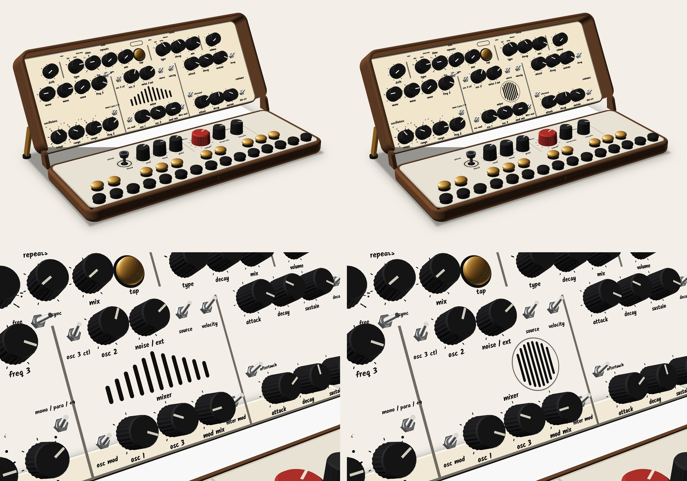
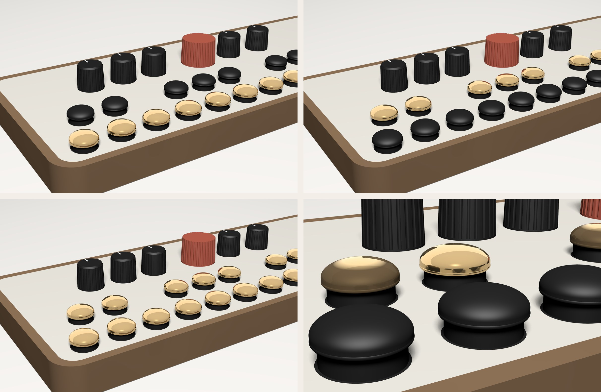

# Waiting on you

Decisions only you can make, newest first. The team keeps working around them; each answer unblocks the part named. When you answer in chat, the orchestrator records it in the owner record and removes it from here.

---

## 1. CATHEDRAL speaker grille: tower or circle
**Unblocks:** the final CATHEDRAL renders and the director's score.
**Context:** you rejected the speaker on the key side and the eye shape, and asked for vertical lines or an off-centre circle. Both sit in the lid band, with the effects together on the lid's top row (layout B).

- **Tower:** vertical slots stepping 8 → 18 → 8 mm, like a row of organ pipes. *Visual designer's pick.*
- **Off-centre circle:** Ø 25 mm, 17 mm right of the axis, vertical slots inside. It only fits in that one spot.

Both clear every label, and both open about the same area (≈ 265–290 mm², about a third less than today; loudness not yet checked).

---

## 2. CATHEDRAL hinges: hidden pins or cables through the hinge
**Unblocks:** the hinge design and the board layout.

- **Hidden pins inside the side walls:** no visible hinge barrels; the ribbon cable stays in the gap. *Team recommends.* (Strength in printed plastic needs one test print; if it fails, today's knuckles stay.)
- **Cables through the hinge:** the ribbon becomes two round cables through hollow pins; the hinge barrels get bigger and more visible, and both boards change.

You can't have both.

---

## 3. CATHEDRAL back opening, now there's no spine
**Unblocks:** the closed-view renders.
Closed, there's a 22 × 266 mm opening along the back where you can see the knobs inside.

- **Leave it open, inside finished dark,** so the knob tops read as shadow. *Team recommends.*
- **Deal with it later** with a sleeve or case.

A rigid lip can't work: open, it would stand up among the knobs.

---

## 4. CATHEDRAL keys
**Unblocks:** the key parts and the final renders. All options fit one swappable mount, so this can change later.

- **B: black naturals, brass sharps** (reversed, like an old organ). *Team recommends.*
- **A: brass naturals, black sharps** (reads like a normal keyboard).
- **C: all brass.**
- **Cheaper:** birch plugs (stock part), or printed pegs in any colour.

Brass can be cast brass from a print service (cold, heavy, stays bright where you touch it) or brass-filled filament you print yourself (lighter, satin).

---

## 5. Line-out jacks (from the expert review)
**Unblocks:** the output circuit.
The mono-cable detection on LINE OUT can't work as drawn.

- **Two jacks, L/MONO and R:** the standard synth answer. A mono cable in L/MONO gets the full mix automatically, with no firmware. Adds one hole.
- **Keep one stereo jack and rework the detection circuit:** fewer holes, more parts, and it needs a bench test.

---

## 6. MIDI (see Docs → MIDI for the full page)
- Should pan stay on CC 10? DAWs send CC 10 on project load, which would silently re-centre the dry pan. The team recommends an unused CC.
- Should ECHO MIX and REVERB MIX be automatable from the DAW?
- Channel 1, or respond on any channel (omni)?
- Should the knobs ever send MIDI (off by default), or receive only?

---

## 7. Site navigation
What lost you on the site: (a) not knowing what the words along the top do, (b) not finding where something lives, or (c) not knowing how to get back?
