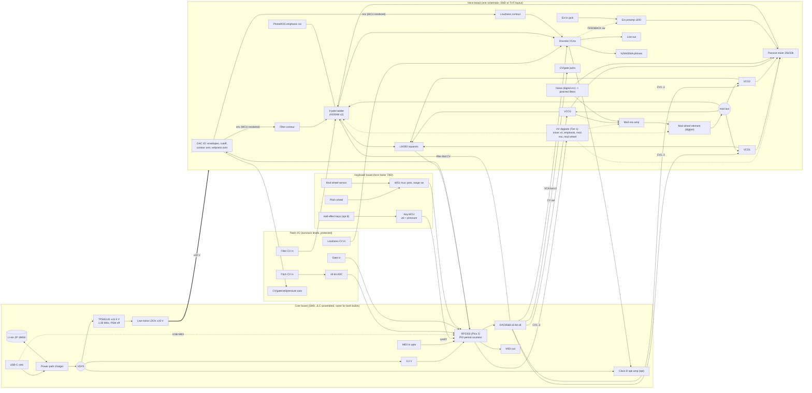

# Portable Model D–style voice: engineering architecture

Status: research and architecture draft, rev 0 (2026-11-12). Author: lead analog engineer (agent).
Scope: everything up to schematic capture. Keyboard and enclosure form factor are designed elsewhere;
this file defines the electrical interface they plug into.

**How to read the citations.** A claim about the original circuit, a part, a price or availability has a
source link next to it. **UNVERIFIED** means I could not confirm it from a primary or reputable source in this
session. **[ENG]** means engineering judgement or my own calculation, not a sourced fact. **[SIM]** means I
ran it in ngspice in this session (method given). In this session I could not open the JLCPCB/LCSC catalogue
search (the proxy blocks it). So every "JLC basic/extended" status below is **UNVERIFIED** until the BOM stage,
apart from the LCSC listings I fetched and name.

**Naming.** The product must not use "Moog" or "Minimoog" on the panel, in silkscreen, files that ship or
marketing (brief). In this document "Model D" and "the original" refer only to the reference instrument.

---

## 0. Executive summary of recommendations

1. **Replicate the "old" oscillator board topology (CA3046-based, serial < 10175), not the later uA726 board.**
   It is the 1972–73 sound the instrument is famous for. It also has a complete, published ngspice transcription
   to verify against: the CA-72 project, see §1.0. The CA3046 is obsolete, but a pin-compatible modern clone
   (Alfa AS3046) exists in **both DIP-14 and SOIC-14**. That lets **one schematic symbol serve both builds**.
2. **No trimmers in the audio or pitch path.** An RP2350 (Raspberry Pi Pico 2 module) drives every pitch-related
   voltage through a 16-bit octal DAC (DAC8568). It measures each VCO and the self-oscillating filter with PIO
   period counters and keeps per-oscillator, per-octave correction tables keyed to temperature (the Sequential
   approach). It also runs a slow **background re-tune while you play** and auto-nulls VCA feedthrough with spare
   DAC channels. Every original trimmer has an entry in the table in §3.
3. **Keep the analog signal path faithful.** That covers the discrete ramp core and waveshapers, the passive
   mixer into the ladder's input pair (where the overdrive happens), the TIS97-class ladder, the contour
   generators (including their envelope overshoot) and the discrete VCAs. Keep the original **±10 V** rails so
   every operating point, and so every saturation behaviour, stays the same.
4. **Split the hardware into a "core board" and a "voice board".** The core board holds USB-C charging, the
   battery, the ±10 V generation, the MCU, the DAC, MIDI and the speaker amp. It is SMD, JLC-assembled, and
   **identical for both builds**. The voice board comes in two layouts from one schematic: (A) SMD, JLC-assembled;
   (B) through-hole, hand-soldered. Reason: the charger, boost/inverter, low-noise LDOs, precision DAC and MCU
   **do not exist in through-hole**, so an "all-THT" build is impossible without a pre-built module. **Owner decision
   (Q1).**
5. **Power:** 1S Li-ion feeds a power-path charger. A TPS65131 (≈1.38 MHz, power-save off) makes ±11.5 V, and
   low-noise LDOs bring that down to ±10 V. Estimated draw from the battery is **≈3.4 W [ENG, partly SIM]**, which
   gives **≈7 h on 2× 18650 in parallel**. That much current is set by the original circuit.

6. **Owner-confirmed additions (2026-11-12):**
   - built-in speaker plus line and phones outputs, with auto-mute on phones insert (§5);
   - eurorack-level patch inputs/outputs: ext audio with a LINE/MOD pad, filter CV, loudness CV, 1 V/oct pitch
     in via a precision ADC, gate in/out, CV/velocity/pressure out (§5b);
   - USB-MIDI plus TRS MIDI (§5c);
   - expressive keys, recommended as Hall-effect per key on a separate keyboard MCU board (§5d);
   - **MIDI-controllable parameters with last-touched-wins / jump-on-move (§5e)**. Recommended **Tier 1**:
     cutoff (DAC), emphasis / mixer / mod mix / mod wheel (**high-voltage digipots placed exactly where the pots
     were**, preserving the passive mixer→ladder overdrive), and **the original analog contour circuit kept intact, with its four time
     rheostats replaced by PWM-chopped resistors** (§5e.8, revised after the owner said "analog wherever I can"). That adds
     about $55–75 per unit.

Biggest risks: switcher and digital noise getting into a ±10 V discrete audio path, VCO thermal behaviour in
a small battery-warmed enclosure, single-source parts (AS3046, DAC8568), and transcription errors. Each has a
mitigation and a virtual test in §6–§7.

---

## 1. The original circuit, block by block

### 1.0 Primary sources

| Source | What it gives us |
|---|---|
| Norlin/Moog *Service Manual for Minimoog Model 204D* (c. 1978–80). Text copy: [manualmachine.com](https://manualmachine.com/moogmusic/minimoogd/4651727-service-manual). Archive copy referenced by CA-72 as archive.org `moog_Moog_Minimoog_Service_Manual` | Circuit descriptions, adjustment procedure, full trimmer list (§3) |
| 300 dpi scans of the service-manual figures 9-3 (osc, S/N < 10175), 9-7 (contour/keyboard), 9-8 (power/noise/mod mix), 9-11 (filter/VCA/preamp/A-440), 9-12, 9-16, 9-17, plus the 1970–71 R. A. Moog drawings. Hosted at fantasyjackpalance.com, as catalogued with hashes in [CA-72 docs/circuit/sources.md](https://github.com/idlefoundry/ca-72) | Schematics to capture from |
| **CA-72** (Idle Foundry, GPL-3.0-or-later, 2026). Repo: [github.com/idlefoundry/ca-72](https://github.com/idlefoundry/ca-72); article: [Dubspot](https://blog.dubspot.com/ca-72-idle-foundry-2026) | **Every board transcribed into ngspice netlists** (`circuits/boards/*.lib`, 16 files) with device models (`circuits/models/mm-devices.lib`). Built to the CA3046 "old" oscillator board, calibrated by Folkman's 1973 procedure, and later matched to a hardware reference. I cloned it and read the netlists: they are real and detailed. **This is our golden reference model.** |
| R. J. Folkman, *Mini-Moog Field Service Manual* (July 1973), and Norlin service bulletins 804C and 832, via CA-72's source list | Period calibration, revision kits |
| Revision history: [Moog forum "Model D differences"](https://forum.moogmusic.com/t/minimoog-model-d-differences/14878) (K. Lightner and others) | Board revisions, part changes |
| 2016 reissue manual [inMusic PDF](https://cdn.inmusicbrands.com/Moog/Model%20D/Minimoog_Model_D_Manual.pdf) | Panel controls and published specs. Note that the reissue adds an LFO and extra jacks that the original lacks |

Licensing note: CA-72's netlists are GPL-3. We use them **only as a verification oracle**, and capture our own
schematic from the service-manual scans. If the owner wants to open-source the design, deriving from CA-72 would
be simpler. **Owner decision (Q5).**

### 1.1 Power (board 3)
- Regulated **+10 V and −10 V** rails, each with remote sensing. The + supply uses a temperature-compensated zener
  reference, and the − supply references the + rail so the two **track**
  ([service manual](https://manualmachine.com/moogmusic/minimoogd/4651727-service-manual)). In the CA-72
  transcription the reference is a 1N821 (6.2 V) and the pass transistors are MPS-U55/MPS-U05, run from ±20 V
  unregulated (`board3-regulator.lib`).
- The overload lamp runs from +15 V (CA-72 `board4-preamp.lib`).
- In the original, tuning depends on the rails ("set ±10 V first") because the keyboard current source and the
  oscillators' −5 V reference derive from them ([service manual](https://manualmachine.com/moogmusic/minimoogd/4651727-service-manual)).
  **In our design pitch depends on the DAC reference instead, not the rails** (§3).

### 1.2 VCOs (board 1)
- Three oscillators with summing amps, exponential current generators and waveshaping, plus a −5 V reference.
  The sawtooth is processed into a triangle and a variable-width rectangle
  ([service manual](https://manualmachine.com/moogmusic/minimoogd/4651727-service-manual)).
- **Three board generations**: discrete (first few hundred units); **CA3046** (most units below S/N 10175);
  **uA726** "stabilized" board (above S/N 10175, and retrofitted to many older units)
  ([forum](https://forum.moogmusic.com/t/minimoog-model-d-differences/14878)).
- Audible differences reported there: the **CA3046 board's ramp "has some curve to it"** while the uA726 ramp is
  linear. The CA3046 square is slightly hotter. Pulse polarity and width differ (the uA726 pulse is narrower).
  On the CA3046 board op-amps do only CV summing and capacitor-reset control, "not in audio path"
  ([forum](https://forum.moogmusic.com/t/minimoog-model-d-differences/14878)). These are user reports, not measurements.
- **CA3046 board, from CA-72's transcription of Fig. 9-3** (`board1-vco.lib`):
  - Control summer IC1 is a **741 powered from GND and −10 V**. Its feedback is **R20 "1K ±3% 1 W temperature
    compensating"**. The manual does not give the TC value; CA-72 assumes 3500 ppm/K (UNVERIFIED).
  - The expo converter is one CA3046 used as reference transistor + expo transistor + a tail transistor (the
    substrate transistor). Op-amp IC3 servoes the reference collector current (4 V/39 k) against a −4 V line.
    That is a Vbe-cancelling reference loop. R42 160 k provides bulk-resistance (HF) compensation.
  - Core: 0.01 µF polystyrene timing cap, reset by a 2N4402. The **ramp buffer is discrete**: an E402 dual JFET
    differential input, a 2N4058 PNP pair and 2N3392 output, gain ≈2. The reset Schmitt trigger is discrete.
  - Triangle: a transistor folder off the sawtooth. Rectangle: a discrete comparator with 910 k hysteresis. The
    width comes from a switch pole (0/−1.5/−2.5 V) set by fixed resistors, which drift with age
    ([forum](https://forum.moogmusic.com/t/minimoog-model-d-differences/14878)).
- The **uA726** was a temperature-controlled (heated) transistor pair. A modern replacer uses an AS3046's spare
  transistors as heater and sensor, regulated to a junction temperature of about 55 °C
  ([MEMS µA726 replacer](https://mail.modularsynthesis.com/mems/ua726/ua726_replacer.htm)).
- Waveforms: osc 1/2 have triangle, tri/saw ("shark tooth"), saw and three rectangles. Osc 3 has **reverse saw**
  in place of shark tooth ([reissue manual](https://cdn.inmusicbrands.com/Moog/Model%20D/Minimoog_Model_D_Manual.pdf);
  CA-72 `front-waveform.lib`, `board1-osc23.lib`).
- **Oscillator 3 as LFO**: wide range, usable for modulation
  ([service manual](https://manualmachine.com/moogmusic/minimoogd/4651727-service-manual)). The OSC 3 CONTROL
  switch disconnects keyboard control. On LO with control off it "clicks every 4.95 s at its minimum", against a
  service-manual spec of 2–5 s (CA-72 `docs/circuit/voice.md`).

### 1.3 Noise (board 3)
- The source is a reverse-broken emitter-base junction (Q15), "selected, burned-in and retested". Q12 amplifies it
  with a NOISE LEVEL trim, then it is filtered to **pink** and further to **red** (red feeds the mod mix)
  (CA-72 `board3-noise.lib`, citing service manual §2.5 and Fig. 9-8). Unit-to-unit variance of the junction is
  why the original needed selection plus a trim.

### 1.4 Mixer and external input / feedback trick
- The **mixer is passive.** Each source goes through a 25 k linear VOLUME pot and **33 k into the filter's input
  bus**; a switched-off channel's resistor still loads the bus (CA-72 `docs/circuit/voice.md`). The bus goes
  through C27 10 µF into the base of the ladder's input differential pair Q29/Q30 (`board4-vcf.lib`).
- The **external input** goes through a 1 M audio-taper pot into a discrete **gain-of-200 preamp**, then through
  33 k onto the bus. A peak detector drives the OVERLOAD lamp (`board4-preamp.lib`, citing service manual §2.12).
- **Feedback trick:** patch the output back into the external input, switch EXT on, and raise it until the overload
  light blinks intermittently. The result is "a much fatter overall sound"
  ([Sweetwater](https://www.sweetwater.com/insync/feedback-loop-trick-for-minimoogs/)). Users report sub-harmonic
  splitting and a sudden runaway threshold ([forum](https://forum.moogmusic.com/t/minimoog-model-d-overdrive-trick/9412)).
- In CA-72's model, with −30 dB into the external input, the overload lamp lights at VOLUME 9.2. At that point the
  output distortion is "the filter's soft overdrive (4.4 %), before the preamplifier clips"
  (CA-72 `docs/circuit/voice.md`). That model says the **overdrive happens in the ladder's input pair**, not in a
  mixer op-amp.

### 1.5 Filter (board 4)
- A Moog-patent transistor ladder (US 3,475,623). It can self-oscillate over a wide range
  ([service manual](https://manualmachine.com/moogmusic/minimoogd/4651727-service-manual); [sdiy wiki](https://sdiy.info/wiki/Moog_ladder_filter)).
  Slope is 24 dB/oct. Cutoff is specified as 10 Hz–20 kHz; the same reissue manual elsewhere says 10 Hz–32 kHz
  ([reissue manual](https://cdn.inmusicbrands.com/Moog/Model%20D/Minimoog_Model_D_Manual.pdf)).
- From CA-72's transcription of Fig. 9-11 (`board4-vcf.lib`):
  - **Input pair Q29/Q30 is a matched TIS97 pair** fed from the mixer bus. **Four ladder pairs (TIS97) with
    0.068 µF** between each pair's emitters. Bias chain 220/150/150/150/150/200 Ω from +10 V, with 220 µF on the
    bottom tap.
  - **The filter's expo converter is a complementary TIS93 (PNP) / TIS92 (NPN) "matched" pair.** RANGE trim R39
    10 k, SCALE trim R49 500 Ω, REGEN CAL R73 1 k. EMPHASIS is a 50 k reverse-audio rheostat.
  - The output is taken across the top cap. It goes through 0.22 µF coupling caps into a discrete differential
    follower/gain-recovery stage.
- Revision notes: ladder caps changed type over production ("tropical fish", then polyester, then box caps).
  **Only the first few hundred units had fully matched ladder pairs.** Early filter boards had no scale trimpot.
  R20 changed from 220 k to 100 k early on ([forum](https://forum.moogmusic.com/t/minimoog-model-d-differences/14878)).
- Analyses for the ladder: Stinchcombe, "Analysis of the Moog Transistor Ladder and Derivative Filters" (2008),
  referenced from the [sdiy wiki](https://sdiy.info/wiki/Moog_ladder_filter); the All About Circuits series
  ([1](https://www.allaboutcircuits.com/technical-articles/analyzing-the-moog-filter/),
  [2](https://www.allaboutcircuits.com/technical-articles/small-signal-open-loop-transfer-function-moog-filter/),
  [3](https://www.allaboutcircuits.com/technical-articles/characterizing-the-moog-filter/)); and Huovilainen
  (DAFx 2004), D'Angelo/Välimäki and others, all listed in CA-72's `docs/circuit/sources.md`.

### 1.6 Contour generators (board 2)
- Two identical ADS generators drive the VCA and VCF ([service manual](https://manualmachine.com/moogmusic/minimoogd/4651727-service-manual)).
  The reissue specifies attack 1 ms–10 s, decay 4 ms–>35 s, sustain 0–100 %
  ([reissue manual](https://cdn.inmusicbrands.com/Moog/Model%20D/Minimoog_Model_D_Manual.pdf)). Those may not
  match the 1970s units exactly (UNVERIFIED for originals).
- **DECAY switch.** On: release follows the DECAY time. Off: the timing cap is **dumped** through CR7/CR4 and
  1.5 k to V-trig on key-up (CA-72 `board2-contour.lib`, `docs/circuit/board2.md`).
- **"Punch" comes from envelope overshoot, according to Kevin Lightner.** The attack exceeds the maximum sustain
  level, which he calls a design error (R13 4.7 k "should be closer to 3.7 k"). He keeps it in the VCA contour
  for the punch, and says the "overdriving the filter" explanation is a misconception
  ([forum](https://forum.moogmusic.com/viewtopic.php?p=82287)). **We must preserve this overshoot.**

### 1.7 VCAs, output, A-440 (board 4)
- Two nearly identical VCAs. Gain is set by the voltage feeding their current-source transistors. A buffer follows
  VCA 2 ([service manual](https://manualmachine.com/moogmusic/minimoogd/4651727-service-manual)).
- Values changed over production: R2 was 47 k (1970), then 160 k (Folkman 1973 kit), then 82 k (Fig. 9-11)
  (CA-72 `board4-vca.lib`; [forum](https://forum.moogmusic.com/t/minimoog-model-d-differences/14878)). **We have
  to pick one (Q6).**
- A-440: a Wien-bridge oscillator with a deliberately imperfect sine, injected into the VCA buffer
  ([service manual](https://manualmachine.com/moogmusic/minimoogd/4651727-service-manual)).
- The headphone amp sits on board 3 ([service manual](https://manualmachine.com/moogmusic/minimoogd/4651727-service-manual)).

### 1.8 Keyboard CV/gate, glide, modulation
- A constant current source (8.33 mA) feeds a 43-resistor string of 10 Ω 1 % resistors, so about 83 mV per key,
  roughly 1 V/oct. A sample-and-hold keeps the voltage between keys
  ([service manual](https://manualmachine.com/moogmusic/minimoogd/4651727-service-manual); CA-72 `board2-keyboard.lib`).
- **Lowest-note priority, single trigger** (legato notes do not retrigger), 44 keys F–C (CA-72 `docs/circuit/voice.md`).
- **Glide is part of the sample-hold.** It is a 5 M audio rheostat ([service manual](https://manualmachine.com/moogmusic/minimoogd/4651727-service-manual);
  CA-72 `docs/circuit/voice.md`). It is **not a simple RC**: "with glide the loop saturates", so it is part slew,
  part exponential (CA-72 `docs/circuit/board2.md`). Glide affects both the oscillators and the filter's keyboard input.
- Modulation: the MODULATION MIX pot crossfades osc 3 and noise into a gain-of-≈2 discrete inverter
  (`board3-modmix.lib`). The mod wheel scales it. OSC MOD and FILTER MOD switches route it onto the oscillators'
  mod bus, and onto the filter control node through 33 k (CA-72 `docs/circuit/voice.md`). Osc 3 at audio rate
  gives **audio-rate FM**, so this path must stay analog.
- Pitch wheel: ±7 semitones per the reissue spec ([reissue manual](https://cdn.inmusicbrands.com/Moog/Model%20D/Minimoog_Model_D_Manual.pdf)).
  The original's range is UNVERIFIED; derive it from the Fig. 9-12 netlist.

### 1.9 Where the sound comes from: what we must preserve
| Character element | Mechanism | Preservation decision |
|---|---|---|
| Overdrive / "fatness" at high mixer levels and with feedback | Passive 33 k mixer into the **ladder input pair Q29/Q30** (tanh soft clipping); gain-of-200 discrete preamp for ext/feedback | Keep the passive mixer and discrete input pair exactly, at ±10 V. Add an internal normalled FEEDBACK option (Q7) |
| Ladder tone and resonance | 4× TIS97 pairs, 0.068 µF, discrete gain recovery, emphasis rheostat law | Keep the topology and values. Use high-β NPNs (§2) and keep the reverse-audio emphasis law |
| "Punch" | Contour overshoot ([Lightner](https://forum.moogmusic.com/viewtopic.php?p=82287)) | Keep the contour circuit verbatim, including the R13/R47 values |
| Old-board waveshapes (curved ramp, hotter square, pulse polarity/width) | Discrete JFET ramp buffer, CA3046 expo, discrete comparator | Keep the discrete core. Replace the E402 with an LSK489 dual JFET (§2); do not substitute an op-amp by default |
| Phasing between free-running VCOs | No sync, independent drift | The background re-tune corrects only slow offsets (>1 s time constant) and must not lock oscillators together [ENG] |
| Single-trigger, low-note priority, saturating glide | Keyboard S/H circuit | Reproduce in firmware, fitted against the CA-72 keyboard netlist |

---

## 2. Modern part substitutions

Principle: wherever we can, choose parts **sold in both a DIP/TO-92 and an SOIC/SOT package with the same
pinout** (or the same symbol pin-mapping), so a single KiCad schematic carries two footprint sets. Each variant's
footprint goes in a per-variant field and gets exported with KiCad 9 variants or a script.

### 2.1 Matched and thermally coupled transistors
| Original | Role | (A) SMD | (B) THT | One-schematic? | Notes |
|---|---|---|---|---|---|
| CA3046 (VCO expo ref/expo/tail; obsolete per [Electric Druid](https://electricdruid.net/?p=440)) | 3 VCO expo converters | **AS3046D, SOIC-14** ([Erica Synths](https://www.ericasynths.lv/shop/ics/as3046d-npn-transistor-array)) | **AS3046, DIP-14** ([listing](https://www.tubesandmore.com/node/45569/ask)) | **Yes**: AS3046 is a pin-compatible CA3046 clone ([Electric Druid](https://electricdruid.net/?p=440)) | Second source for SMD: CoolAudio **V3046M** (SOIC-14 only; VBE match 0.45 mV typ, 5 mV max; θJA 220 °C/W) ([datasheet](https://cdn.mediavalet.com/aunsw/musictribe/GA_qLNoEvEul33yH5BM2ew/7P-f639JCE6H284btnLjdQ/Original/COOLAUDIO_V3046M_DATASHEET.pdf)). AS3046 matching spec UNVERIFIED (datasheet linked from Erica, not read). JLC stock UNVERIFIED |
| uA726 heated pair (late board) | — | **Not used.** Optional heater: the AS3046's 2 spare transistors as heater + sensor (as the [MEMS replacer](https://mail.modularsynthesis.com/mems/ua726/ua726_replacer.htm) does), driven by a DNP footprint and firmware | same | Yes | Default **unpopulated**: heating 3 arrays costs on the order of 0.5–1 W [ENG estimate]. Enable only if the thermal tests (§7.1) fail |
| TIS97 matched pair Q29/Q30 + 8 ladder TIS97 | Filter input pair + ladder | **2× AS3046D** (10 NPN on two dies) or discrete BC850C | **2× AS3046 DIP** or BC550C | Yes with AS3046 | Electric Druid notes the 3046 suits ladder filters ([source](https://electricdruid.net/?p=440)). Open question: the 3046's lower β against the TIS97 (CA-72 models TIS97 with BF=420, `mm-devices.lib`) shifts the bias-chain DC slightly. **Verify by SPICE against the golden model (§7.3) before committing.** Fallback: high-β discretes with matched pairs only at Q29/Q30 |
| TIS93/TIS92 complementary filter expo | Filter cutoff expo | THAT340 SO-14 (2 NPN + 2 PNP) or discrete MMBT3906/3904 | THAT340 DIP-14 or 2N3906/3904, thermally glued | Yes | THAT300/320/340 come in DIP-14 (P) and SO-14 (S); VBE match ±0.5 mV typ, ±3 mV max ([THAT datasheet](https://web.ece.ucsb.edu/Faculty/rodwell/Classes/ECE137B/datasheets/THAT300data.pdf)). Filter scale is autotuned (§3), so discrete is acceptable; THAT340 is the upgrade option |
| VCA current-source pairs | VCA 1/2 | BCM847DS (SOT-457 matched dual; in production per [Nexperia](https://www.nexperia.com/product/BCM847DS)) or AS3046D | AS3046 / THAT300 DIP | Needs per-variant symbol if BCM847DS | Prefer AS3046 in both builds for symbol commonality. Feedthrough is auto-nulled anyway (§3) |
| THAT300 (4 NPN) | general alternative | SO-14 | DIP-14 | Yes | [THAT datasheet](https://web.ece.ucsb.edu/Faculty/rodwell/Classes/ECE137B/datasheets/THAT300data.pdf). The 661.org Minimoog replica project suggests it as the uA726 substitute ([661.org](https://661.org/proj/minimoog/notes/notes03_parts.html)) |

### 2.2 Other discrete semiconductors
| Original | Replacement (A) SMD | (B) THT | Notes |
|---|---|---|---|
| 2N3392, TIS92 (NPN, general) | MMBT3904 | 2N3904 | Same die family, so the same SPICE model in both builds [ENG]. Watch TO-92 pinout (EBC) in the footprint |
| 2N4058, 2N4402, TIS93 (PNP) | MMBT3906 | 2N3906 | as above |
| TIS97 in non-ladder roles (VCA, buffers, preamp) | BC850C | BC550C | High β / low noise. The TO-92 pinout differs from 2N390x (CBE), so it needs its own footprint. Equivalence to TIS97 UNVERIFIED; SPICE check (§7) |
| E402 dual N-JFET (VCO ramp buffer, obsolete) | **LSK489** SOIC-8 or SOT-23-6 | **LSK489** TO-71 | Packages per [Linear Systems](https://www.linearsystems.com/jfet-amplifiers-duals/lsk489-series). TO-71 is a 6-lead metal can: hand-solderable but fiddly. Fallback: JFET-input op-amp (changes ramp "curve"; flag) |
| Q15 noise junction | — | — | Replaced by digital noise (§3, Q4) |
| 1N821 tempco zener | — (rails no longer set pitch) | — | Rails come from LDOs (§4). The −5 V oscillator reference becomes an LM4040-5.0 class shunt reference, which comes in TO-92 and SOT-23 (UNVERIFIED for the specific grade) |

### 2.3 Tempco resistors (VCO R20)
- The original is a 1 kΩ, ±3 %, 1 W "temperature compensating" resistor of unspecified TC (CA-72 `board1-vco.lib`).
  The ideal value for a room-temperature expo is ≈ +3300–3500 ppm/K, depending on where in the network it sits [ENG].
- **SMD:** KOA **LT73** (0805/1206) offers TCR steps including **3300** and 3600 ppm/K, **but not 3500**. Resistance
  ranges up to about 51 kΩ, E-24 values ([KOA LT73 datasheet](https://www.koaspeer.com/pdfs/LT73.pdf)). Whether
  1 k exists at 3300 ppm is UNVERIFIED.
- **THT:** a 2 kΩ +3300 ppm 1/4 W metal-film tempco is sold for synth DIY
  ([Music From Outer Space](https://musicfromouterspace.com/analogsynth_new/ELECTRONIC_PARTS/MFTEMPCO3300.php)).
  1 k/3300 THT availability is UNVERIFIED.
- **Decision [ENG]:** our pitch comes from the DAC, so we are free to rescale the summer/expo divider network.
  **Choose the tempco value that both an LT73 and a THT part offer (probably 2 k at 3300 ppm)** and re-derive the
  divider (original R9/R8/R19). Verify with a SPICE temperature sweep (§7.1). Thermally couple the tempco to the
  AS3046: adjacent placement plus a copper pour, and optional thermal epoxy in the THT build.

### 2.4 Op-amps, references, DAC, misc. ICs
| Function | Original | (A) SMD | (B) THT | Notes |
|---|---|---|---|---|
| VCO CV summer (GND/−10 V supplied!) and reference servo | 741 | OPA2277/OPA277 class (SOIC) | same part, DIP-8 | Precision bipolar, DIP and SOIC (packages UNVERIFIED at BOM stage). Avoid TL07x here: input common-mode near the negative rail risks phase reversal [ENG]. **Simulate the GND/−10 V supply arrangement** (§7.1) |
| Contour / misc. 741 sites | 741 | TL072 / OPA2277 | DIP-8 equivalents | Not in the audio path on the old board ([forum](https://forum.moogmusic.com/t/minimoog-model-d-differences/14878)) |
| Headphone amp | discrete (board 3) | **NJM4556A** (DMP-8/SSOP-8) | **NJM4556A** DIP-8 | Same part in both. ±2 to ±18 V supply, 73 mA output typ., ≥±10.5 V into 150 Ω at ±15 V ([datasheet](https://kyohritsu.com/eclib/OTHER/DATASHEET/JRC/njm4556a.pdf)) |
| Pitch DAC (new) | — | **DAC8568** 16-bit octal, internal 2.5 V ref 2 ppm/°C typ, 5 ppm/°C max, TSSOP-16, active ([TI](https://www.ti.com/product/DAC8568)). LCSC C524819, from **$17.38, 700 in stock** when checked ([LCSC](https://www.lcsc.com/product-detail/C524819.html)) | on core board | TI's own page gives INL as both 4 and 12 LSB ([TI](https://www.ti.com/product/DAC8568)); read the datasheet. Per-octave correction tables absorb INL anyway (§3). Second source with a different footprint: AD5676R or DAC80508 (UNVERIFIED) |
| MCU (new) | — | **Raspberry Pi Pico 2** module: RP2350, 150 MHz, 3 PIO blocks / 12 state machines, 12-bit 500 ksps ADC (3 user channels), surface-mountable castellated module, $5 RRP ([Pico 2 datasheet](https://pip-assets.raspberrypi.com/categories/1005-raspberry-pi-pico-2/documents/RP-008299-DS-3-pico-2-datasheet.pdf)) | on core board | Only 3 ADC pins, so pots go through a 74HC4051/CD4051 mux (DIP and SOIC) |
| Period-measurement comparators (new) | — | LM393 SOIC-8 ×2 | LM393 DIP-8 | Squares up VCO1–3 and the filter output for PIO counting. Same part in both [ENG] |
| Filter-cal switch (new) | — | PhotoMOS relay (e.g. AQY21x/TLP222 class), SMD | same, DIP-4 | Forces maximum emphasis during calibration. Optically isolated, so no MCU ground in the audio path. Off-state capacitance and leakage must be simulated (§7.3). UNVERIFIED part choice |
| MIDI in opto | — | H11L1/6N137 class SMD | DIP-6/8 | On core board |

### 2.5 Capacitors and passives
- VCO timing cap: 0.01 µF **polystyrene ±2 %** in the original (CA-72 `board1-vco.lib`). Modern choice: **C0G/NP0
  1206** (SMD) and **polypropylene film** (THT) [ENG]. Absolute value does not matter (autotune), but dielectric
  absorption and TC do. Target |TC| < 100 ppm/K.
- Ladder caps 0.068 µF: C0G 1206/1210 (SMD; check availability at 68 nF), PPS or PP film (THT). The original used
  several dielectric types over production ([forum](https://forum.moogmusic.com/t/minimoog-model-d-differences/14878)).
- Resistors in the CV paths: 0.1 % thin film where they set scale; 1 % elsewhere.

---

## 3. Zero-calibration strategy

### 3.1 Architecture
- **Pitch is digital until the expo converter.** The MCU computes each VCO's target in octaves, from:
  - the note (keyboard scan or MIDI);
  - glide, emulating the original's saturating S/H curve, fitted to CA-72's `board2-keyboard.lib`;
  - pitch wheel, TUNE, OSC 2/3 FREQUENCY and RANGE, all read via ADC through the mux.

  It maps that through a per-VCO correction table and writes one DAC channel per VCO. The **mod bus (osc 3 /
  noise FM) stays analog** into each VCO summer.
- DAC channel map (8 channels): VCO1, VCO2, VCO3, **filter keyboard CV** (in place of the original keyboard
  feed, through the KEYBOARD CONTROL 1/2 resistors, and also glided), **CV OUT jack**, **VCA1 balance**,
  **VCA2 balance**, spare (for example contour-amount trim or velocity out).
- **Frequency measurement:** each VCO's rectangle or reset pulse goes into an LM393 and then a PIO reciprocal
  counter at 150 MHz ([Pico 2 datasheet](https://pip-assets.raspberrypi.com/categories/1005-raspberry-pi-pico-2/documents/RP-008299-DS-3-pico-2-datasheet.pdf)).
  One period of 1 kHz is resolved to 6.7 ppm, about **0.012 cent**; averaging N periods improves that [ENG].
- **Calibration routine.** It runs at power-on (≈2–4 s), when the board temperature has moved by more than 2 °C
  (NTC beside the AS3046 arrays), or on a button press. For each VCO it steps the DAC across about 10 octaves in
  ½-octave points, measures, and builds a monotonic piecewise-linear (spline) volts→octaves inverse table. Like
  Sequential's instruments, it stores tables **keyed to temperature**
  ([Sequential support](https://support.sequential.com/hc/en-gb/articles/13687984487186-A-Brief-Explanation-on-Calibration)).
  The tables absorb expo scale, offset, HF droop (residual after R42), DAC INL and reference drift.
- **Background re-tune [ENG, new].** While you play, the PIO counters keep running. The firmware knows the
  intended pitch of every VCO, because every pitch input is read digitally. When the mod bus is off (or the mod
  wheel is at zero, read via ADC tap) and a VCO has been steady for 0.5 s or more, it slowly trims that VCO's
  offset term. Time constant over 10 s, step size under 0.1 cent, never scale. This cancels thermal drift between
  calibrations without audible pitch movement, and it keeps natural VCO-to-VCO beating because trims are absolute
  per VCO, not relative. This is a design idea, not something I found documented in a commercial product; mark
  it as a firmware risk (R15).
- **Filter calibration [ENG].** The PhotoMOS forces maximum emphasis, the comparator measures the self-oscillation
  frequency at 4–5 filter-keyboard-DAC points, and the firmware sets the filter keyboard channel's gain so the
  tracking is 1 V/oct at 100 % (KEYBOARD CONTROL 1+2). In the base architecture the CUTOFF pot stays analog;
  under §5e Tier ≥ 1 it becomes a DAC channel and the emphasis a digipot, so the PhotoMOS is no longer needed. Only the *slope* is
  calibrated, so the pot's position during calibration doesn't matter, provided nobody turns it in that second.
  Sequential also calibrates filters
  ([Sequential support](https://support.sequential.com/hc/en-gb/articles/13687984487186-A-Brief-Explanation-on-Calibration)).
- **VCA auto-balance [ENG].** With the mixer muted (MCU-controlled mute FET at the VCA input, or all channel
  switches read as off) the firmware pulses the loudness contour. A spare RP2350 ADC input watches the VCA output
  through a high-impedance divider, and the firmware servoes the VCA balance DAC channel to null the step
  ("thump"). Monte-Carlo sizing decides the needed DAC injection range (§7.5).

### 3.2 Every original trimmer, and how it is handled
Trimmer list from the [service manual adjustment table](https://manualmachine.com/moogmusic/minimoogd/4651727-service-manual).

| # | Original trimmer | What it did | Our handling | Residual risk |
|---|---|---|---|---|
| 1 | +10 V ADJ (board 3) | set +10.00 V | Fixed LDO, 0.1 % feedback resistors. Rails no longer set pitch | Rail ±1 % slightly moves operating points; MC-verified |
| 2 | −10 V ADJ | set −10.00 V | same | same |
| 3 | Noise level | white-noise level | **Digital noise** (RP2350 LFSR → filtered PWM or a spare DAC path → original pink/red filters). Deterministic level. *Owner decision Q4*; option footprint for the analog junction + fixed gain | Character of white noise is essentially identical [ENG] |
| 4–6 | Osc 1/2/3 SCALE | V/oct scale | **Autotune table per VCO** | None if the table converges; R1, R15 |
| 7 | Osc 1 RANGE (high A) | HF tracking | Autotune table (per-octave points) | HF limits of the expo/reset (R1) |
| 8 | Octave range | range-switch octave accuracy | Range switch read by the MCU and applied in the DAC domain; −5 V switch network deleted | None |
| 9 | A-440 | reference frequency | MCU generates 440.00 Hz (crystal), shaped to approximate the Wien bridge's imperfect sine | None |
| 10 | 1st VCA balance | CV feedthrough | **DAC auto-null** + matched array | MC must show the DAC range covers ≥ 6σ |
| 11 | 2nd VCA balance | same | same | same |
| 12 | REGEN CAL | emphasis onset at ≈7.5 | **Not auto-adjusted.** Fixed resistor chosen by Monte Carlo so onset stays within 7.5 ± 1 on the dial. DNP option footprint for a resistor tweak, firmware can't fix it | Unit-to-unit variance of ladder β/Vbe. Verified by MC (§7.3) |
| 13 | Filter RANGE | cutoff zero-beat | Not needed: the user sets the cutoff by ear; the calibration logs the offset for reference | — |
| 14 | Filter SCALE | filter tracking | **Filter autotune** of the keyboard-CV gain | Small PhotoMOS influence |
| 15 | Pitch-wheel pot centre | 15.3 kΩ at detent | Wheel read via ADC; centre captured at power-on, with a deadband | None |
| 16 | Mod-wheel pot alignment | full CCW at stop | Mechanical; analog pot stays in the mod path. Design the mechanics so the pot end-stop equals the wheel end-stop | Mechanical (form-factor team) |

**What can't be eliminated, and why**
- *Regen onset* (#12) and *contour time spread* (pot and capacitor tolerance, ±20 % pots). These are analog
  tolerances with no firmware handle short of making emphasis and contours digitally controlled, which would
  change the circuit's character. We bound them by Monte Carlo and accept the spread. The original had it too.
- *Thermal gradients* across a VCO array faster than the background re-tune. Bounded by thermal layout, the
  tempco, and an optional heater.
- *Ladder offset/thump* from mismatch in the ladder itself (as opposed to the VCA). The original's 0.22 µF
  output coupling blocks DC, but a fast filter-contour thump remains. Matched arrays and MC bound it.

---

## 4. Portable power architecture

### 4.1 Current estimate
**[SIM]** I simulated CA-72's GPL netlists of the original boards (transient, 20–40 ms average) in ngspice-42 with
ideal ±10 V. This is one VCO, VCF, VCA/output, noise, mod-mix amp and preamp. Rail currents:

| Block | +10 V (mA) | −10 V (mA) |
|---|---|---|
| VCO (each) | 9.3 | 22.2 |
| VCF incl. bias chain + output stage | 22.0 | 9.4 |
| VCA + output stage | 28.1 | 0.1 |
| Noise | 2.3 | 2.4 |
| Mod-mix amp | 1.2 | 1.2 |
| Ext preamp | 1.0 | 2.5 |

Caveats: −5 V and −4 V were ideal sources, so their current is not counted. Contours, keyboard, references and
regulators were not simulated; I estimate +10/−10 mA for them [ENG]. A few nodes gave singular-matrix warnings
(floating outputs). Treat this as ±30 %.

| Rail | Original-faithful voice (3 VCOs) | Our additions (DAC buffers, comparators, references, mux, PhotoMOS LED, headphone amp idle) [ENG] | Total |
|---|---|---|---|
| +10 V | ≈ 93 mA | ≈ 15 mA | **≈ 108 mA** |
| −10 V | ≈ 92 mA | ≈ 12 mA | **≈ 104 mA** |

- Analog rail power ≈ 2.1 W. After the LDOs (±11.5 V in) ≈ 2.4 W. After the boost/inverter at an assumed 80 %
  ≈ 3.0 W (efficiency UNVERIFIED; check against the TPS65131 curves).
- Digital: Pico 2 is 47–62 mW typical in examples ([datasheet](https://pip-assets.raspberrypi.com/categories/1005-raspberry-pi-pico-2/documents/RP-008299-DS-3-pico-2-datasheet.pdf)).
  Add the DAC, keyboard scan, LEDs and MIDI for ≈ 0.3 W total [ENG].
- **Total from the battery ≈ 3.3–3.5 W, about 0.9 A at 3.7 V [ENG]**. That is far below the reissue's
  "<12 W nominal" mains consumption ([reissue manual](https://cdn.inmusicbrands.com/Moog/Model%20D/Minimoog_Model_D_Manual.pdf)),
  which isn't comparable but is a sanity bound.

### 4.2 Battery and runtime
Assuming a typical 18650 of 3.0–3.5 Ah (≈ 11–12.5 Wh), with 90 % usable [ENG]:

| Pack | Energy | Runtime @ 3.4 W | Runtime with speaker (avg +0.5 W) |
|---|---|---|---|
| 1× 18650 | ~12 Wh | ~3 h | ~2.7 h |
| **2P 18650 (recommended)** | ~24 Wh | **~6.5–7 h** | ~5.5 h |
| 3P 18650 | ~36 Wh | ~10 h | ~8.5 h |
| 2P 21700 (~5 Ah each) | ~36 Wh | ~10 h | ~8.5 h |

Use protected cells or an on-board protector, an NTC on the pack, and a fuse. Cell sourcing and shipping: the
owner buys cells locally. Most of this current is set by the original circuit (VCA output stage, ladder bias
chain, VCO stages). **Reducing it would change operating points.** Keep the original by default; a "low-power
voice" revision is possible but out of scope.

### 4.3 Chain (core board, SMD)
```
USB-C (sink, CC 5.1k; read CC to detect 1.5/3 A advertisement)
  -> BQ24074-class power-path Li-ion charger (system load sharing; play while charging)
  -> VSYS (3.5–4.4 V)
       ├─ TPS65131: boost +11.5 V and inverting −11.5 V, 1.25–1.5 MHz fixed PWM, power-save OFF
       │    -> pi/LC filters (ferrite + 10 µF C0G/X7R) -> low-noise LDOs (+10.00 V / −10.00 V)
       │       candidates TPS7A47 / TPS7A33 or LT3045 / LT3094 (UNVERIFIED part choice; all SMD)
       ├─ 3.3 V buck/LDO for MCU and DAC (separate digital ground, joined at a star point)
       └─ PAM8302-class class-D speaker amp (optional, Q3)
```
- **TPS65131**: 2.7–5.5 V input (directly from Li-ion), positive output up to 15 V, negative to −15 V; maximum
  currents "in the 200-mA to 500-mA range"; 1.95 A switch limit; **fixed 1250/1380/1500 kHz min/typ/max PWM**;
  VQFN-24. The PSP/PSN pins disable pulse-skipping power-save ([TI datasheet](https://www.ti.com/lit/gpn/TPS65131)).
  **Tie PSP/PSN low:** power-save bursts at light load can land in the audio band [ENG].
- Why ±11.5 V before the LDO rather than ±12–13 V: ≈ 1.5 V of headroom keeps LDO PSRR high at 1.4 MHz while
  wasting only ≈ 13 % [ENG]. Confirm PSRR at 1.4 MHz from the LDO datasheet curves.
- **Charging while playing.** The charger is a TI BQ2407x part with power-path management
  ([TI](https://www.ti.com/lit/gpn/bq24074)); input limit and DPPM details UNVERIFIED. Playing uses ≈ 0.7 A at 5 V,
  so on a plain 500 mA port the battery still drains slowly. The firmware reads CC and sets the charger's input
  limit. Tell the owner: use a USB-C charger.
- **Avoid** classic charge-pump inverters (ICL7660/LT1054 class) that switch around 10 kHz, inside the audio band
  (UNVERIFIED for specific parts; general concern) [ENG].
- **Shielding and layout [ENG]:** switcher in one corner of the core board under a shield-can footprint. The ±10 V
  rails go to the voice board through ferrites. Separate AGND/DGND joined at the voice board's star point. No
  digital lines run under the ladder or the expo arrays. Keyboard scanning clock is fixed and above 20 kHz, or
  scanning is synchronous and slow (1 kHz) with slew-limited lines. Spread spectrum off. Shielded or twisted
  ribbon between the boards.

### 4.4 THT variant
The same core board, pre-assembled by JLC, plugs into the hand-soldered voice board via 2.54 mm headers. It carries
±10 V, 3.3 V, the DAC CVs, the comparator signals and the mux lines. **Nothing on the core board can be THT**
(charger, TPS65131, LDOs, DAC, RP2350 are SMD-only, as above). A fully modular alternative exists: an off-the-shelf
USB-C/Li-ion module, a THT SIP ±12 V isolated DC-DC module, LM317L/LM337L, and a Pico 2 on headers. But the DAC
would still be SMD, and noise and quality would be worse. **Not recommended.** (Q1)

---

## 5. Audio out (owner-confirmed: speaker + line + headphones)

- **Line out:** the original output stage (VCA 2 buffer) through a protection resistor and DC block. Original
  "HIGH/LOW" outputs are on the reissue panel ([reissue manual](https://cdn.inmusicbrands.com/Moog/Model%20D/Minimoog_Model_D_Manual.pdf)).
  Propose 1× 6.35 mm or 3.5 mm mono line out at the original's level, plus an internal LOW tap for the feedback
  normalling.
- **Headphones:** NJM4556A (same part in both builds; spec above) on ±10 V, ≈ 2–5 mA idle [ENG], with a separate
  PHONES volume (as on the reissue). Stereo TRS jack, mono-summed.
- **Built-in speaker (owner confirmed YES, 2026-11-12):** PAM8302-class 2.5 W mono class-D, run from VSYS on the
  core board (part UNVERIFIED). Expect +0.3–1 W average while it plays, so runtime drops by roughly 10–25 %
  (table in §4.2). Class-D switching (a few hundred kHz) is another EMI source, so it stays on the core board,
  with its own ground return to the star point, and speaker leads twisted. A small speaker can't reproduce Model D
  bass. Give it a fixed high-pass at about 150 Hz in front of the amp (or a firmware-switched "speaker EQ") so it
  doesn't distort, and choose the enclosure volume with the form-factor team.
- **Speaker auto-mute (design decision, flagged):** default is that plugging into the **phones jack mutes the
  speaker**, using the jack's switch contact read by the MCU, which drives the class-D shutdown pin. Open choice:
  should plugging into **line out** also mute it? Recommend yes, with a long-press override for "speaker as
  monitor".
- **Feedback trick:** a panel switch **FEEDBACK** that normals LOW out into EXT IN. A forum user reports the
  reissue may already be wired internally that way (UNVERIFIED) ([forum](https://forum.moogmusic.com/t/minimoog-model-d-overdrive-trick/9412)).
  The EXT IN jack's switch contact breaks the normal when a cable is plugged in.

## 5b. Patch inputs/outputs (owner-confirmed: "pass things into the filters and whatnot"; eurorack-compatible)

The owner has a eurorack. Design every jack for **eurorack levels**: audio about 10 Vpp (±5 V); CV ±5 V or
0–10 V, pitch 1 V/oct; gates 0 → +5 V to +10 V. Every input must survive ±12 V (a eurorack rail) indefinitely
[ENG; widely used conventions, not a formal standard]. All jacks are 3.5 mm. Protection on every input: series
resistor (≥ 1 k) plus clamps to the ±10 V rails (or BAT54S), sized by SPICE (R19).

The original already had rear-panel control inputs, and CA-72's transcription includes them. The filter has an
external control input through R51 100 k into the control node (grounded when the jack is empty). There is an
EXT LOUDNESS input into the VCA, and an EXT S-TRIG input, which triggers on a short to ground (CA-72
`docs/circuit/voice.md`, `board2-contour.lib`). So most of what the owner asked for is original behaviour, not
an addition.

| Jack | Path | Level handling | Notes |
|---|---|---|---|
| **EXT AUDIO IN** | Original EXT volume (1 M) → gain-of-200 preamp → 33 k → mixer bus → ladder input pair | Gain 200 is meant for line/instrument level. A 10 Vpp eurorack signal clips the preamp unless the pot is near zero, which squeezes the usable range. **Add a LINE / MOD level switch**: a ÷20 pad in front of the pot (≈ −26 dB) [ENG] | Clipping the preamp *is* part of the character. Verify the curve with the pad in and out (§7.2). The FEEDBACK normal goes into this jack |
| **FILTER CV IN** | Original ext-control input, R51 100 k, into the filter control node | ±5 V eurorack CV; scaling is the original's (V/oct scale of this input UNVERIFIED; measure in SPICE). Optional attenuator pot | Analog, so audio-rate filter FM works. Filter calibration could also calibrate this input (inject from DAC) as an option |
| **LOUDNESS CV IN** | Original EXT LOUDNESS into the VCA | 0–+5 V or 0–10 V; SPICE checks overload (CA-72 notes a high voltage shuts the VCA by about 6.6 V: `voice.md`) | Lets eurorack envelopes drive the VCA |
| **PITCH CV IN (1 V/oct)** | Two options, see below | ±5 V (10 octaves) | Must track as well as the keys |
| **GATE IN** | Comparator (≈ 1.5 V threshold, hysteresis), then the MCU, OR'd with keys/MIDI into the contour gate. A second comparator output emulates S-TRIG | 0 → +5…+10 V V-gate (eurorack). The original's S-trig (short to ground) is not eurorack-compatible, so convert it | MCU in the loop adds < 0.1 ms latency [ENG] |
| **OSC/MOD CV IN** (optional) | Onto the original mod bus (all three VCOs plus filter, routed by the OSC MOD / FILTER MOD switches) | ±5 V; attenuated to the mod-bus scale | Audio-rate FM from eurorack |
| **PITCH CV OUT** | DAC CV-out channel → 0–10 V buffer | 1 V/oct, calibrated in firmware against the DAC (no oscillator involved) | Drives eurorack VCOs from the keys |
| **GATE OUT** | MCU GPIO → transistor → +10 V via 1 k (or +5 V) | V-gate | |
| **VELOCITY / PRESSURE CV OUT** (if the keys sense them) | Extra DAC channels | 0–+5 V or 0–10 V | The reissue has velocity and after-pressure outputs ([reissue manual](https://cdn.inmusicbrands.com/Moog/Model%20D/Minimoog_Model_D_Manual.pdf)) |
| **FILTER / VCA envelope outs** (optional) | Buffered contour outputs | 0–+5 V approx. | Cheap op-amp buffer; useful with the eurorack |

**Pitch CV input, two options:**
- **(a) Digital [ENG].** A precision ADC on the core board (16-bit SAR class, for example ADS8681/ADS8331-type;
  part UNVERIFIED) reads the jack. The firmware adds the value into each VCO's target, so it is tracked by the
  same autotune tables. Each unit self-calibrates its ADC against the DAC's CV-out channel through an internal
  analog switch at power-on, so no user step. Cost: about 0.2–1 ms latency and no audio-rate FM. The RP2350's own
  12-bit ADC is **not good enough**: 10 V/4096 ≈ 2.4 mV ≈ 3 cents per LSB before its noise
  ([Pico 2 datasheet](https://pip-assets.raspberrypi.com/categories/1005-raspberry-pi-pico-2/documents/RP-008299-DS-3-pico-2-datasheet.pdf) for resolution).
- **(b) Analog.** A summer input into each VCO's expo summer (as the original does for its keyboard and mod
  inputs). During calibration the firmware switches the spare DAC channel onto that input with a CD4053 (DIP and
  SOIC) and measures its V/oct scale per VCO. It can't trim an analog scale, but it can **pre-compensate the
  keyboard/DAC path** only for offset, not scale. So scale errors of ±1 % per VCO remain (12 cents/oct): **not good
  enough for 1 V/oct sequencing.**
- **Recommendation: (a)** for the 1 V/oct input, plus the analog OSC/MOD CV input for audio-rate FM. **Design
  decision, flagged.**
- DAC channels now exceed 8: VCO×3, filter kbd, VCA bal×2, pitch out, ADC-cal, velocity out, pressure out. Add a
  **second DAC** for the non-critical outputs (velocity, pressure, mod outs). A 12-bit dual such as MCP4822 is
  enough there and comes in both DIP-8 and SOIC-8 (UNVERIFIED at BOM stage). Keep the DAC8568 for the 8 critical
  channels.

## 5c. MIDI (owner-confirmed: MIDI control)

- **Recommend both USB-MIDI and TRS-A MIDI in/out.** USB-MIDI runs over the same USB-C port as charging, as a
  class-compliant device from the RP2350's native USB (TinyUSB in the Pico SDK [ENG]). Use TRS-A 3.5 mm rather
  than 5-pin DIN to save panel space, with a DIN adapter in the box. DIN is fine if the form factor allows it
  (Q8). MIDI in uses an optocoupler (6N137/H11L1 class, DIP and SMD).
- **Ground-loop risk:** with USB-MIDI to a laptop while also connected to a mixer, the computer's USB ground
  joins the audio ground, and hum or digital whine is likely [ENG]. Mitigations:
  - a DNP footprint for a full-speed USB isolator on the core board (ADuM3160 class; part UNVERIFIED);
  - a "charge-only" path that bypasses the isolator for power;
  - and in any case a ground-lift-free audio design: balanced or impedance-balanced line out is an option.
- **MIDI implementation [ENG]:**
  - notes with lowest-note priority and single trigger (original behaviour) as default, with options for
    last-note priority and retrigger;
  - pitch bend → the same path as the pitch wheel;
  - CC → the few digitally read parameters only (glide time, osc 3 rate when the knob is ignored, tune), because
    the panel pots are analog;
  - velocity and aftertouch → the CV outs, plus optional destinations (below);
  - MIDI clock not needed;
  - MIDI out sends keys, wheels, velocity and aftertouch, so the instrument doubles as a controller for the
    owner's Maschine+ and eurorack.
- **Velocity/aftertouch into the voice?** The Model D voice has no velocity. Option [ENG, owner decision]: route
  the velocity or pressure DAC channel through a panel switch into the filter's control node (like an extra
  FILTER CV IN normalled internally) and/or into the EXT LOUDNESS input. This is a non-invasive addition, off by
  default, so the original sound is unchanged.

## 5d. Playing surface: key sensing options (form factor designed separately; electrical implications here)

Owner requirement: it must **feel like an instrument**: real key travel, not clicky switches; velocity and
aftertouch capable, even though the voice ignores them by default. The interface to the core board is the same
for every option.

**Recommended architecture [ENG]:** a **separate keyboard board with its own small MCU** (RP2040/RP2350 class)
that does the sensing and sends note, velocity and pressure events to the core over a short UART (MIDI-rate or
faster, 3 wires plus power). Benefits:
- the keyboard's scanning currents, LED or magnet-sensor supply currents and mux switching stay physically away
  from the voice board;
- the form-factor team can change key technology without touching the core;
- the core MCU stays deterministic for autotune and PIO counting.

| Option | Feel | Velocity / aftertouch | Electronics and MCU implications | Power (est., 37 keys) [ENG] | No-calibration? | Notes |
|---|---|---|---|---|---|---|
| **A. Off-the-shelf keybed with double contacts** (Fatar-class, full or mini keys) | Best (real weighted/synth action) | Velocity: time between 2 contacts per key. Aftertouch: only with a channel-pressure strip (some keybeds) | Diode matrix, ~2×37 contacts, scan ≥ 2 kHz for velocity resolution; about 16 GPIO | ~5–10 mW | Yes | Bulky and heavy; sets the enclosure size. DIY availability and price UNVERIFIED |
| **B. Hall-effect per key** (magnet in a 3D-printed or moulded key, linear Hall sensor on the PCB) | Real travel; set by our key mechanism + spring | **Continuous position**: velocity, polyphonic aftertouch (with a bottom-out spring zone), adjustable actuation point | 37 analog channels → 3× 16-ch analog mux (CD74HC4067 class) → MCU ADC. 37 keys × 2 kHz = 74 ksps, within the RP2350's 500 ksps ([Pico 2 datasheet](https://pip-assets.raspberrypi.com/categories/1005-raspberry-pi-pico-2/documents/RP-008299-DS-3-pico-2-datasheet.pdf)) | **Significant**: linear Hall ICs draw milliamps each, so ~37 × 3–6 mA ≈ 0.4–1.1 W at 3.3–5 V. **Mitigation: power-gate sensors in groups, synchronously with the mux** (sample ~20 µs per group), giving ~10–20× less | Auto-learns each key's rest/bottom on first use, invisibly | **Recommended** for a 3D-printed portable design: contactless, durable, expressive. Sensor-to-magnet spacing and tolerances must be designed in CAD; magnet stray field must stay away from the speaker and the VCO area |
| **C. Optical reflective per key** (IR LED + phototransistor) | Same as B | Same as B | Same mux/ADC structure; LEDs pulsed per group | Pulsed: low; continuous: high | Auto-learn | Sensitive to ambient light and 3D-print surface finish |
| **D. Inductive per key** (PCB coil + metal target, LDC-class inductance-to-digital ICs) | Same as B | Same as B | No magnets; I²C sensor ICs with several channels each, so ~10 ICs for 37 keys; SMD only | Low–moderate | Auto-learn | Robust, unaffected by magnets or light; more expensive and complex (part family UNVERIFIED) |
| **E. Capacitive/pressure pads (no travel)** (FSR, Velostat, capacitive sense) | No key travel | Pressure: yes; velocity: approximate | Simple | Low | Partly | **Fails "feel like an instrument"** as briefed; listed only for completeness |
| **F. Mechanical (keyboard-style) switches** | Clicky | No | Trivial | ~0 | Yes | **Rejected** by the owner |

Implications for the core board, whichever option (also see §5e: MIDI CC and the knobs): one UART header (TX/RX/GND + 3.3 V/5 V power, about 50–300 mA
budget depending on the option), plus the pitch-wheel ADC and mod-wheel pot wiring if the wheels live on the
keyboard board. **Firmware must reproduce Model D keyboard semantics** whatever the sensor: lowest-note priority,
single trigger, and glide on the held note.

---

## 5e. MIDI-controllable parameters: hybrid "knobs → MCU → CV" architecture

**Owner requirement (2026-11-12, `owner-requirements.md`):**
- parameters controllable by MIDI CC, and the knobs send CC;
- **no preset recall**, **no motorised pots**;
- **last-touched wins with jump-on-move**: a MIDI value holds until the knob is physically moved, then the knob
  takes over.

**Consequences:**
- Any MIDI-controllable knob must be **read by the MCU** and must **not** sit directly in the circuit.
- The MCU then drives the analog stage through a DAC, a digital potentiometer or an analog switch.
- **The audio path stays analog**: oscillators, mixer bus, ladder, VCAs and output are unchanged. Only the
  *control element* changes.
- This section **supersedes** §3's "CUTOFF pot stays analog", §1.9's "keep the contour circuit verbatim", and
  the "mod wheel pot stays analog" lines, to the extent of the tier chosen below.

### 5e.1 Control-element toolbox (and why these)
| Element | Use where the original pot was… | Why | Parts and evidence |
|---|---|---|---|
| **DAC channel → existing CV summing resistor** | already a *control voltage* (cutoff, filter contour amount if the envelope is digital, tune/freq, glide) | No audio-path change at all; the original summing resistors stay | DAC8568 16-bit octal, as §2.4 |
| **High-voltage digital potentiometer in the same position as the pot** | a pot or rheostat *in an audio or audio-rate path* (mixer levels, emphasis, mod mix, mod wheel) | **A digipot *is* a resistor network.** It keeps the original's divider, Thevenin impedance and bus loading, so the **mixer → ladder-input-pair overdrive stays exactly the original mechanism**. A VCA would swap a passive divider for an active stage with its own headroom, noise and distortion | **AD5293**: 1024 positions, 20/50/100 kΩ, **±9 to ±16.5 V dual supply**, production, from $3.91 @1k ([ADI](https://www.analog.com/en/products/ad5293.html)); package TSSOP (inferred from the "RUZ" suffix, UNVERIFIED). **MCP41HV51**: 256 taps, 5/10/50/100 kΩ, 10–36 V analog supply, TSSOP-14, LCSC C637063, $3.31 qty 1, only 21 in stock when checked ([LCSC](https://www.lcsc.com/product-detail/C637063.html)). Wiper resistance, bandwidth and terminal limits: read the datasheets (UNVERIFIED here) |
| **Analog switch / mux** | rotary or toggle switches that route signals (waveform select, pulse width, white/pink, OSC MOD, FILTER MOD, FEEDBACK, mixer on/off) | Same as a mechanical contact, apart from on-resistance (≈100 Ω class, small next to the k-ohm source impedances) and switching charge | ±10 V signals need a part rated for 20 V or more across its supplies. **CD4051/4053B at ±10 V is at its absolute limit, so don't use it there** [ENG]. Use a DG408/DG409/DG419 or ADG1208/ADG1419 class part (packages and ratings UNVERIFIED at BOM stage; DG4xx historically in DIP and SOIC) |
| **VCA (SSI2164 quad)** | fallback only | Current-mode quad VCA, an SSM2164 replacement ([sdiy wiki](https://sdiy.info/wiki/SSI2164)); 16-SOP ([sdiy wiki](https://sdiy.info/wiki/SSI2164)) | Only if digipots fail the THD/noise tests. It changes the overdrive mechanism unless followed by a resistor network that recreates the pot's Thevenin source |
| **MCU-rendered envelope (DAC channel)** | contour generators | Envelope times are 1 M audio rheostats ([service manual](https://manualmachine.com/moogmusic/minimoogd/4651727-service-manual); CA-72 `voice.md`), and 1 MΩ digipots with a 1:10⁴ time range don't exist (the ranges above top out at 100 kΩ). The contour output is a **control voltage, not audio**, so rendering it digitally keeps the audio path analog | Uses DAC channels. Removes the board-2 contour circuit (19 transistors, 9 diodes, 46 R, 7 C per CA-72 `board2-contour.lib`). **No longer the recommendation: see §5e.8** |

### 5e.2 Every original control: how it becomes CV/MIDI-controllable
Tier: **0** = digital already in the base architecture (§3); **1** = core subset; **2** = everything else
recommended; **K** = keep analog, not MIDI-controllable (recommended).

| Control | Original element | CV-controllable implementation | Added parts | Sound-character risk and how we preserve it | Tier |
|---|---|---|---|---|---|
| TUNE, OSC 2 FREQ, OSC 3 FREQ | pots into the VCO summers | Already ADC → firmware → VCO DAC channel | none | None; slew-smoothed (§5e.4) | 0 |
| RANGE ×3 | 6-pos switch + −5 V ladder | Already firmware | none | None | 0 |
| GLIDE time, GLIDE on/off | 5 M rheostat in the S/H | Already firmware (saturating-glide model fitted to golden) | none | Glide curve shape. Verified against golden ±5 cents RMS (§7.6) | 0 |
| KEYBOARD CONTROL 1/2, OSC 3 CONTROL, DECAY sw, A-440 | switches | Firmware (they act on digital CVs/gates) | none | None | 0 |
| Pitch wheel | pot | Already ADC | none | None | 0 |
| **CUTOFF** | 5 k pot across ±10 V → R55 200 k into the control node | DAC channel (16-bit) → R55. Contour × amount and keyboard tracking can be summed digitally into the same channel, or kept on their own resistors | 1 DAC ch | None; it's a DC CV. Audio-rate filter FM stays analog (mod bus R52, FILTER CV IN) | **1** |
| **AMOUNT OF CONTOUR** | 5 k pot from the filter contour → R74 47 k | With digital envelopes: firmware scaling into the cutoff channel or its own DAC ch → R74. With analog envelopes: AD5293 as the 5 k divider (nearest value 20 k: re-derive R74; UNVERIFIED for loading) | 0–1 DAC ch | Filter-contour depth law must match the knob law; fitted against golden | **1** |
| **EMPHASIS** | 50 k reverse-audio **rheostat in the ladder feedback loop (audio path)** | **AD5293-50 as a rheostat** in the same place; firmware applies the reverse-audio law. 1024 steps; coarse+fine pair if onset resolution needs it | 1–2 digipots | Medium. Wiper capacitance, wiper resistance and the terminal-voltage window, at the loop's DC bias of a few volts (UNVERIFIED), could alter self-oscillation amplitude and the HF response. **SPICE: self-oscillation amplitude/THD within ±1 dB and onset within ±0.25 dial of golden.** Bonus: the filter-cal PhotoMOS (§2.4) becomes unnecessary, because firmware can force maximum emphasis | **1** |
| **Filter & loudness ATTACK/DECAY/SUSTAIN** (6 pots) | 1 M audio rheostats + 5 k sustain pots + analog contour circuit | **Recommended (revised): keep the original contour circuit verbatim. Replace each of the 4 time rheostats with a PWM-chopped fixed resistor (R_eff = R/duty, 2–3 switched ranges). The 2 SUSTAIN pot wipers become DAC outputs** (full scale = the original pot-top voltage, R13/R57 kept). Full comparison of 4 approaches in §5e.8 | 2 DAC ch (sustain), 4 MCU PWM lines, 3–5 ICs | Low: the RC curves, timing electrolytic, peak detector and **overshoot (R13 etc.)** are the original parts. Risks are chopping ripple/EMI and charge-injection error at the longest times, both checked in SPICE (§5e.8). Fallback: MCU-rendered contour via 0 Ω jumper options | **1** |
| **Mixer VOLUME ×5** (osc 1/2/3, noise, ext) | 25 k linear pots + 33 k into the bus (Norton sources; off channels still load the bus) | **AD5293-20 (or MCP41HV51-50k/2) as the divider in each pot's place**, keeping the 33 k and the bus exactly. Firmware maps knob → digipot code with the original knob law. Mixer ON/OFF switches become firmware: digipot to 0, which reproduces "off but still loading" | 5 digipots (4 for osc/noise if EXT stays analog) | Low with digipots: same passive divider, so the **overdrive at high mixer settings is the original mechanism**. The 20 k vs 25 k value mismatch changes Thevenin impedance by a few kΩ against 33 k plus the bus; compensate with a series resistor and verify the **THD-vs-level curve ±1 dB vs golden (§7.2)**. 1024 steps with log mapping: no audible stepping. **EXT volume (1 M audio in front of the ×200 preamp): keep analog, K** (no 1 M digipot, and external sources don't need MIDI) | **1** (EXT: K) |
| **MODULATION MIX** | pot crossfading noise ↔ osc 3 through 43 k each into the mod-mix amp | AD5293 (or a dual digipot) as the crossfade divider | 1 digipot | Low; audio-rate path, passive replacement | **1** |
| **MOD WHEEL** (MIDI CC1!) | pot on the mod line after the mod-mix amp | AD5293 in the pot's position; the physical wheel is read by ADC | 1 digipot | Low; audio-rate FM depth law must match. CC1 is the most-used MIDI controller, so worth doing | **1** |
| WAVEFORM ×3 | 6-pos rotary switching saw/tri/shark/rectangles (shark = resistor mix; rectangle width from a switch pole at 0/−1.5/−2.5 V) | Rotary read via resistor ladder → ADC. A DG408-class 8:1 mux per oscillator selects the 6 Thevenin outputs (shark mix network kept before the mux). A second mux or a DAC sets the width voltage | 3–6 mux ICs | Low; on-resistance ≈100 Ω against k-ohm sources. Switching clicks similar to the mechanical switch | 2 |
| NOISE white/pink, OSC MOD, FILTER MOD, FEEDBACK | toggles | Toggles read by MCU → analog switches (DG4xx class) | 1–2 ICs | Low | 2 |
| MAIN VOLUME, PHONES VOLUME | pots | Keep analog. MIDI CC7 could set a digipot, but a level jump on the speaker or headphones is a safety and ear risk | — | — | K |
| EXT input volume | 1 M audio pot | Keep analog (above) | — | — | K |
| Ext audio LINE/MOD pad, power, CAL button | — | — | — | — | K |

### 5e.3 Scope tiers with deltas (rough; prices are single-unit estimates, UNVERIFIED unless cited above)
| Tier | What's MIDI-controllable | Added ICs | Removed | BOM delta (per unit) | Notes |
|---|---|---|---|---|---|
| **0 (base, §3)** | pitch/tune/freq/range/glide, pitch bend, switches that act digitally | — | — | 0 | Panel pots in the circuit; knobs can still *send* CC, but MIDI can't move cutoff, mixer, etc. **Doesn't meet the requirement** |
| **1 (recommended core)** | + cutoff, emphasis, contour amount, both envelopes (A/D/S ×2), 4 mixer levels, mod mix, mod wheel | **7–8 digipots** (4 mixer, emphasis ×1–2, mod mix, mod wheel); **+1 DAC8568** (sustain ×2, cutoff, contour amount, VCA bal ×2 moved here, 2 spare: fallback contour outputs); **+1–2 analog mux** for more pot reads; **envelope option (c): +3–5 ICs** (§5e.8) | PhotoMOS | **≈ +$55–75**: 8 × ~$3.3–4 digipots ([ADI](https://www.analog.com/en/products/ad5293.html), [LCSC](https://www.lcsc.com/product-detail/C637063.html)) + ~$17 DAC ([LCSC](https://www.lcsc.com/product-detail/C524819.html)) + ~$8–14 contour option (c) + passives | Meets the owner's ask for every musically "played" control, with all-analog contours |
| **2 (everything sensible)** | + waveform ×3, pulse width, white/pink, osc mod, filter mod, feedback, mixer on/off | +4–6 DG4xx-class switch/mux ICs | — | **≈ +$15–30 more** (UNVERIFIED part prices) | Complete MIDI control except volumes and ext input |
| K (never) | main/phones volume, ext volume, power, pad | — | — | — | safety and level reasons |

Part-count effect on §8 (Tier 1, with contour option (c)): ICs +12–15, transistors 0 to +4 (range MOSFETs), diodes 0, passives about +40 (digipot series R, sustain buffers, range resistors, decoupling). With contour option (a) instead: ICs +10–11, transistors −19, diodes −9, passives about −40.
Tier 2: a further ICs +4–6.

**Build-variant consequence (owner decision 2026-11-12: SMD only if it arrives pre-assembled; avoid modules he must
solder by their castellations).** Digipots, the second DAC and the ±10 V-rated muxes are **SMD-only**
(TSSOP/SOIC; AD5293 and MCP41HV51 as cited). Approach:

| | Build A (SMD, JLC) | Build B (THT, owner solders) |
|---|---|---|
| Core board (power, MCU, DAC, MIDI) | Same board, plugs in or is wired by harness | **Same pre-assembled board**, plugs into THT female headers |
| Control module (digipots, HV muxes, DAC #2) | Integrated directly on the voice board: same schematic sheet, SMD layout | **Pre-assembled plug-in module on 2.54 mm pin headers** (male on the module, fitted by JLC as THT assembly) into **machined-pin female sockets** the owner solders (pure THT work) |

Castellated vs pin-header for build B [ENG]:
- Pin headers win for this owner: only through-hole joints, and the module is removable and replaceable (a bad
  module is a swap, not a rework).
- Costs: about 10 mm extra height (socket plus header), connector cost under $2, and a little contact
  resistance. Neither matters for the signals involved if machined (turned) gold pins are used.
- Layout rules: place the module **right beside the ladder and mixer**, with every other pin ground between
  sensitive nets. Keep the emphasis-loop pins in the corner nearest the ladder (loop length under 25 mm on the
  voice board side).
- SPICE: add 2 × (10 mΩ + 1 pF + 5 nH) per header crossing to the emphasis and mixer testbenches (§5e.7).
- The Pico 2 stays on the core board, which arrives assembled, so the owner never touches castellations.

### 5e.4 Knob reading, resolution and zipper noise
- **ADC:**
  - Pots go through 74HC4051/4067 muxes into the RP2350's 12-bit, 500 ksps ADC
    ([Pico 2 datasheet](https://pip-assets.raspberrypi.com/categories/1005-raspberry-pi-pico-2/documents/RP-008299-DS-3-pico-2-datasheet.pdf)).
    RP2350 effective resolution is UNVERIFIED; plan for ≈ 9–10 ENOB.
  - With ~25 pots read at 1 kHz each (25 ksps), there is room for 16× oversampling: +2 bits, so ≈ 11–12 effective.
  - Use pots referenced to a clean 3.0 V reference (not the 3.3 V digital rail), with an RC (1 k / 100 nF) at each
    mux input and the mux settle time respected.
  - If the ADC proves too noisy: an external 16-bit SPI ADC on the core board (UNVERIFIED part).
- **Filtering chain per knob [ENG]:** oversample → median-of-3 (spike reject) → adaptive one-pole IIR (fast when
  moving, heavy when still) → hysteresis deadband (~0.1 % FS) → parameter mapping (knob law) → **per-parameter
  slew limiter at the CV output**. Typical time constants: 5–10 ms for cutoff and mixer, 20 ms for emphasis, and
  none for envelope/gate paths.
- **DAC update and reconstruction:** run CV DAC channels at ≥ 4 kHz with linear interpolation between control
  frames, and the envelope channels at ≥ 20 kHz. Put an RC on each DAC output: ~1 ms for static parameters
  (cutoff, contour amount), 2-pole ~4 kHz for envelopes, and **none on the pitch channels beyond ~10 kHz
  anti-glitch** (glide is firmware).
- **Resolution needs:**

| Signal | Needed | Choice | Reasoning [ENG] |
|---|---|---|---|
| VCO pitch ×3, pitch CV out, pitch CV in | ≈ 0.2 cent over ~10 oct | **16-bit + calibration tables** (DAC8568) | 10 V/65536 = 0.15 mV ≈ 0.18 cent at 1 V/oct. 12-bit is 2.4 mV ≈ 3 cents per step: too coarse even with trims |
| Cutoff (incl. digital contour sum) | step < 5 cents of cutoff | 16-bit preferred (shares DAC); 12-bit acceptable | 12-bit over a ±10 V span at ≈ 1 V/oct is ≈ 6 cents per step, inaudible for a filter once slewed. But a digitally summed contour sweep at 12-bit can "stair" on slow, resonant sweeps, so put contour and cutoff on the 16-bit DAC |
| Envelopes ×2 | smooth tails to −60 dB | 16-bit + reconstruction filter | Near the end of a long decay, a 12-bit LSB is a large relative step |
| Mixer, mod mix, mod wheel, emphasis | log-mapped level steps < 0.5 dB | 10-bit digipot (AD5293) | 8-bit (MCP41HV51) is OK for mixer levels but marginal near emphasis onset |
| VCA balance, velocity/pressure out | — | 12-bit fine | |

- **MIDI value resolution:** 7-bit CC on cutoff is 128 steps over ~10 octaves, about 1 semitone per step, which
  zippers. So:
  - always slew incoming CC (time constant ~10–30 ms, adaptive to the message rate);
  - support **14-bit CC pairs** (MSB in CC 0–31, LSB in CC 32–63, per the MIDI 1.0 convention [ENG; standard
    MIDI practice]) for cutoff, emphasis and pitch-related parameters;
  - knobs *send* 14-bit when enabled, 7-bit by default.

### 5e.5 Last-touched-wins with jump-on-move (owner-specified behaviour)
Per parameter: `source ∈ {KNOB, MIDI}`, `value`, `knob_ref` (knob reading when MIDI took over).
- **Power-on:** source = KNOB, value = knob position. (No recall; matches "knob controls it unless MIDI has set
  it".)
- **MIDI CC received:** value = CC (slewed), source = MIDI, `knob_ref` = current knob reading.
- **Knob moved:** while source = MIDI, a move counts only when the filtered reading departs from `knob_ref` by more
  than a threshold (≈ 2 % FS, larger than the noise deadband), so ADC noise or a bump can't steal control. Then
  source = KNOB and the value **jumps** to the knob, as the owner asked ("it should change value once I move the
  knob"). The jump is passed through the parameter's slew limiter (5–20 ms) so it lands musically without a click
  [ENG]. (Optional later: a "pickup/catch" mode setting instead of jump; not the default.)
- **Knob → MIDI out:** send CC on every *real* knob change (after deadband), so the knobs control external gear
  and DAW automation, matching "use the knobs to control the midi". Loop protection: ignore our own echoed CCs if
  MIDI thru is merged.
- **Indicators (optional, owner design):** one "MIDI holds a parameter" LED, or nothing. No motorised pots
  (owner).
- **Switches** (Tier 2) behave the same way: a MIDI-set state holds until the physical switch is flipped.

### 5e.6 MIDI CC map approach
- Use **General MIDI 2 "sound controller" assignments where the meaning matches**, so generic controllers and
  DAWs map sensibly [ENG; GM2 defaults: CC71 resonance/timbre, CC72 release, CC73 attack, CC74 brightness/cutoff,
  CC75 decay]. Use the standard CC1 (mod wheel), CC5 (portamento time), CC65 (portamento on/off) and CC7
  (volume, *not* honoured: K). Put the rest in the undefined ranges (CC 14–31 with LSB 46–63, CC 102–119).
- Draft (finalise in the firmware spec):

| Parameter | CC (MSB/LSB) | | Parameter | CC |
|---|---|---|---|---|
| Cutoff | 74 (+ 14-bit option on 19/51) | | Loud attack / decay / sustain | 73 / 75 / 79 |
| Emphasis | 71 | | Filter attack / decay / sustain | 22 / 23 / 24 |
| Contour amount | 21 | | Osc 1/2/3, noise mix level | 25 / 26 / 27 / 28 |
| Glide time / glide on | 5 / 65 | | Mod mix / mod wheel | 29 / 1 |
| Osc 2 / Osc 3 freq, Tune | 14 / 15 / 16 (14-bit on 46/47/48) | | Osc 1/2/3 range | 102 / 103 / 104 |
| Decay switch | 80 | | Osc 1/2/3 waveform (Tier 2) | 105 / 106 / 107 |
| Osc mod / filter mod / osc3 ctrl / kbd ctrl 1, 2 | 81 / 82 / 83 / 84, 85 | | Noise white/pink, feedback (Tier 2) | 108 / 109 |

- Values map through the *same* knob law as the panel, so CC 64 sounds like the knob at its midpoint. Publish
  the map as a printed panel-back card and as a DAW/controller template file.

### 5e.7 Verification additions (feeds §7)
- Digipot models in SPICE (resistor ladder + wiper R + capacitances from the datasheet) in the mixer, emphasis
  and mod-wheel positions. Pass:
  - mixer THD-vs-level within ±1 dB of golden;
  - self-oscillation onset ±0.25 dial, amplitude ±1 dB;
  - no added noise above −100 dBu in band.
- Contour option (c) vs CA-72 contour netlist (§5e.8 for detail); the same metrics for the fallback digital model: overshoot ±5 %, times ±10 %, waveform RMS error < 1 % FS at
  ≥ 20 knob combinations, including fast retrigger and DECAY-switch dump.
- Firmware zipper test: render a slow 7-bit CC cutoff sweep with resonance 8 through the SPICE filter with the
  firmware slew in the loop. The owner listens for stepping; objective target: no spectral line from the control
  rate above −80 dBFS.
- Jump-on-move logic: unit tests with recorded ADC noise traces (no false takeovers in 10⁶ samples).

### 5e.8 Envelopes: four ways to make the contour times MIDI/CV-controllable (owner: "analog wherever I can")

**What the original does** (CA-72 transcription of Fig. 9-7, `board2-contour.lib`; `docs/circuit/board2.md`):
- A flip-flop turns on PNP **Q5** (Q16), which charges the **10 µF electrolytic** C5 (C2) from a +9.3 V rail
  through R7 86.6 Ω plus the **1 M audio ATTACK rheostat**, as an exponential toward the rail.
- A peak detector (CR3 with divider R29/R33) resets the flip-flop when the output reaches **≈4.49 V (filter) /
  5.28 V (loudness)**. That is roughly halfway to the asymptote, so the original attack uses only ~0.7 τ of its RC
  curve and is fairly straight, ending at about half its starting slope [ENG, from those levels].
- Then **Q7** (Q18) connects the **1 M DECAY rheostat**, and the cap decays toward the SUSTAIN node, held by PNP
  follower Q8 on the divider R13 4.7 k / R17 / R1 from the 5 k SUSTAIN pot.
- The peak sits **≈0.31 V above the held level at SUSTAIN 10**. That is the overshoot, the "punch"
  ([Lightner](https://forum.moogmusic.com/viewtopic.php?p=82287); CA-72 `board2.md` B2-11).
- With DECAY off, the cap is dumped through a 1N4004 on key-up.
- The circuit is **19 transistors, 9 diodes, 46 resistors, 7 capacitors** for both generators (counted from the
  netlist), plus the 4 × 1 M rheostats and 2 × 5 k sustain pots.
- Time range: τ = (86.6 Ω … ~1 MΩ) × 10 µF, about 0.9 ms … 10 s, i.e. **1:10⁴**. The reissue specifies attack
  1 ms–10 s and decay 4 ms–>35 s ([reissue manual](https://cdn.inmusicbrands.com/Moog/Model%20D/Minimoog_Model_D_Manual.pdf)).

All four options read the 6 panel knobs through the ADC mux (needed for MIDI anyway). The deltas below are against
the original contour circuit, for both generators. Prices are estimates (UNVERIFIED) except where cited.

| | (a) MCU-rendered contour | (b) Original topology + OTA "voltage-controlled resistor" | (c) Original topology + **PWM-chopped resistor** | (d) **AS3310** VC-ADSR chips |
|---|---|---|---|---|
| Principle | Firmware model of the circuit at ≥ 20 kHz → 16-bit DAC → 2-pole reconstruction filter into the original output nodes | Each rheostat becomes an LM13700 OTA wired so its output current = gm·k·(V_source − V_cap), which is exactly what a resistor does. Iabc (gm) is set from a DAC | Each rheostat becomes a fixed resistor switched at f_PWM: R_eff = R/D. Two to three ranges reach 1:10⁴ | Dedicated exponential-CV ADSR IC (CEM3310 reissue) replaces the circuit |
| Which original parts remain | None (outputs only) | **All of them**, but the timing cap is cut from 10 µF electrolytic to ~0.1 µF film (see below) | **All of them, including the 10 µF electrolytics** | None |
| Actives added / removed | +1 dual op-amp (reconstruction) / **−19 transistors, −9 diodes** | +2 LM13700, +2 dual op-amps (4 V→I), +1 quad HV switch (Iabc range), +1 12-bit DAC for 4 offset nulls (e.g. 2× MCP4822) = **+6 ICs** / 0 | **Implementation (i)**: +1 quad SPST HV switch (DG413 class; the chopped elements) + 2 dual 4:1 HV mux (DG409 class; range resistors) + 1 GPIO expander (MCP23017 class, DIP-28/SOIC) = **+4 ICs**. Or **(ii)**: PWM gated into the *existing* attack/decay switch transistors Q5/Q7/Q16/Q18 via 1× 74HC08 + 4 small MOSFETs (2N7000/2N7002) for range = **+1 IC, +4 transistors** / 0 | +2 AS3310, +1 quad op-amp (output scaling to 4.49/5.28 V and gate level) = **+3 ICs** / **−19 transistors, −9 diodes** |
| Passives added / removed | +8 R, +4 C / −46 R, −7 C | ≈ +44 R, +10 C (attenuators, diode bias, V→I, range); 2 caps swapped / 0 | (i) ≈ +14 R (range resistors, sustain-buffer series R), +8 C (output ripple RC, decoupling); (ii) ≈ +12 R, +6 C / 0 | ≈ +30 R, +12 C (Cx, Ccomp, REE, CV dividers, decoupling) / −46 R, −7 C |
| DAC channels | 2 (16-bit) | 4 Iabc + 2 sustain (16-bit) + 4 offset trims (12-bit) | **2 (sustain only)** + 4 PWM lines (crystal-timed, RP2350 hardware PWM) | 8 (A, D, S, R × 2; release = decay or minimum per the DECAY switch, in firmware) |
| BOM delta (est.) | **≈ −$1** | ≈ +$12–18 | **≈ +$8–14** (i) / ≈ +$2–4 (ii) | ≈ +$10–16 (AS3310 price UNVERIFIED) |
| THT availability | n/a (core-board DAC) | LM13700: TI datasheet lists PDIP-16, but TI's ordering addendum lists only SOIC ([TI](https://www.ti.com/lit/gpn/lm13700)); DIP sold by synth-parts resellers ([listing](https://www.tubesandmore.com/node/45564/ask)). **Supply risk** | DG4xx DIP and MCP23017 DIP availability UNVERIFIED; 74HC08 and 2N7000 are common THT. If the HV switches are SMD-only they go on the plug-in control module | **AS3310 in PDIP-16 and AS3310D in SOIC-16** ([datasheet](https://www.ericasynths.lv/media/AS3310.pdf)) |
| Time accuracy / temperature drift | Crystal-exact; none | gm ∝ I_abc/V_T, so at fixed current times drift ≈ +0.33 %/K [ENG] (~7 % over 20 K). TI gives min gm 6.7 mS at 25 °C and 5.4 mS over temperature ([TI](https://www.ti.com/lit/gpn/lm13700)). Correctable via NTC in firmware | R (thin film, < 50 ppm/K) and duty (crystal) are drift-free. **The cap's drift is the original 10 µF electrolytic's**, the same as the 1970s unit (UNVERIFIED magnitude) | Control-scale tempco +3000…+3600 ppm/K ([datasheet](https://www.ericasynths.lv/media/AS3310.pdf)), so exponential time drift unless compensated. Firmware NTC compensation as for the VCOs |
| Risk to "punch" / curves | Medium–low. CA-72's real-time contour already matches its ngspice contour **with peaks within 7.4 mV** (CA-72 `board2.md`), so the method is proven. But it is digital | Medium: (1) the cap must shrink to ~0.1 µF because the OTA delivers only ~0.5 mA at I_abc = 500 µA (2 mA abs max) ([TI](https://www.ti.com/lit/gpn/lm13700)). That loses the electrolytic's dielectric-absorption creep that CA-72 models. (2) OTA offset is 0.4 mV typ, **4 mV max** ([TI](https://www.ti.com/lit/gpn/lm13700)); multiplied by the ~1:150–200 input attenuation needed for < 60 mVpp linear range, that is an error of up to ~0.6–0.8 V on the sustain/zero target unless auto-nulled. (3) The 10 s+ times need gm at ≈ 10–100 nA I_abc, below the 5–500 µA range TI specifies | **Lowest**: the overshoot, RC shapes, DECAY dump, retrigger and electrolytic behaviour are the original circuit. Specific risks: ripple at f_PWM on the contour at fast settings (keep D high by range choice; output RC); charge-injection mismatch × f_PWM as an offset current at the slowest decays; switch on-resistance and the 93 mA peak current at minimum attack (fold Ron into R7; implementation (ii) avoids a floating switch) | Medium–high for fidelity: attack is **"true RC" toward ~7 V, cut at the 5 V peak** ([datasheet](https://www.ericasynths.lv/media/AS3310.pdf)), so it uses ~1.25 τ and ends at ~0.29 of its starting slope. The original's ~0.7 τ attack is straighter and "pushier" [ENG]. Not adjustable (internal asymptote). Overshoot must be faked by capping sustain at ≈ 93 % of peak (0.31 V / 4.49 V). Decay/release RC are similar |
| How we verify vs CA-72 golden | Python model vs golden `board2-contour.lib` transients at ≥ 20 knob combinations: peaks ±10 mV, segment τ ±5 %, RMS < 1 % FS | ngspice with an LM13700 macromodel (availability UNVERIFIED), Monte Carlo on offsets (±4 mV) and gm, temperature sweep; same metrics | ngspice: our netlist = golden netlist + PWM switch at **transistor level** (MOSFET switch with gate capacitances, so charge injection appears) + PWM source; sweep D and range; metrics as (a) plus ripple at f_PWM < 5 mVpp on the contour output and slow-decay asymptote error < 20 mV | No vendor SPICE model known (UNVERIFIED); build a behavioural model from the datasheet. **Weakest verification** of the four |
| Owner's "analog wherever I can" | ✗ (contour is digital CV; audio still analog) | ✓ analog, original topology | ✓✓ **original circuit, unchanged parts** | ✓ analog, but not the original topology |

Vactrols (LED + LDR) as the time element were considered for (b) and rejected [ENG]:
- they are slow and hysteretic, with large unit-to-unit and temperature variation (which calls for closed-loop
  auto-calibration);
- CdS cells face RoHS restrictions and limited stock;
- they are THT-only (UNVERIFIED specifics).

A JFET as a voltage-controlled resistor is linear only for tens of mV across it, against the volts here [ENG].
Expo current sources alone give linear ramps, not RC curves, so they don't preserve the shape.

**How far off would (a) sound?** Measured against CA-72's evidence, a well-fitted digital contour can sit within
millivolts of the circuit's transients (peaks within 7.4 mV in CA-72's own test). Through the VCA and filter that
is below any plausible audibility threshold [ENG]. **So (a) is defensible on sound. It is not what the owner asked
for philosophically, and it removes 19 transistors of "real" circuit.**

**Recommendation (revised): option (c), implementation decided by SPICE.**
- Prefer **(ii) "chop the original switch transistors"** if Q5/Q7-class switching (storage time) allows f_PWM
  ≥ 40–50 kHz with < 1 % duty error. Otherwise use **(i) external HV analog switches**, with a discrete MOSFET
  for the fast (low-R) range because of the 93 mA peak.
- **Built-in insurance:** route two DAC #2 channels to the contour output nodes through **0 Ω jumper options
  (DNP)**. If (c) disappoints on the bench, firmware switches to option (a) with two jumper changes. No rev 2.
- (b) is rejected (offset, nA-range operation, cap change, DIP supply). (d) is rejected for fidelity (different
  attack curvature and synthetic overshoot), although it's the simplest proven analog chip.

## 6. Risk register ("no rev 2")

L = likelihood (H/M/L) for this project; I = impact. Verification refers to §7.

| ID | Risk | L | I | Design-out | Virtual verification |
|---|---|---|---|---|---|
| R1 | VCO HF tracking / reset-time droop exceeds what the tables can fix at 4'/top octave | M | H | Keep R42 bulk comp; DAC span with ±1 oct margin; 10-octave tables | §7.1 SPICE frequency vs CV to 10 kHz, MC 200 runs |
| R2 | Thermal drift between calibrations (battery charging heat, hands, sun) | M | H | Tempco co-located with AS3046; NTC-triggered re-cal; background re-tune; **heater DNP footprint**; charger far from VCOs | §7.1 `.temp` sweep 0–40 °C on the full VCO; firmware simulation of re-tune with logged drift profiles |
| R3 | Switcher (1.38 MHz), PSM bursts, MCU or keyboard-scan noise audible | M | H | PSM off, LC + LDO, shield can, star ground, separate boards, scan clock choice; option footprints for extra ferrites/caps | §7.8 PSRR/ripple sims with TPS65131 and LDO vendor models; spectrum of the full voice with injected rail ripple; layout review checklist |
| R4 | Single-source / stock risk: AS3046, DAC8568 (700 at LCSC), LSK489, THAT340 | M | H | Pin-compatible alternates (V3046M SMD); second DAC footprint on the core board (DNP); order critical parts first | BOM script checks stock at order time; alternates in the BOM |
| R5 | Transcription error from the service-manual scans | M | H | Capture from the scans, then **automatically compare our netlist against CA-72's** (graph-isomorphism / component-value diff per block) | §7.0 netlist cross-check |
| R6 | KiCad schematic → layout → SPICE divergence (wrong footprint pin map, TO-92 EBC vs CBE, SOT-457 pin order, DIP vs SOIC pin-1) | M | H | Same symbol for both variants with verified pin maps; a footprint pin-map review script | `kicad-cli` ERC/DRC; export the KiCad netlist to SPICE and re-run every testbench (so the schematic *is* what we simulated); per-variant 3D render review |
| R7 | AS3046 in the ladder sounds different from TIS97 (β, rbb', capacitances) | M | M | Fallback to discrete high-β pairs; dual footprints if board space permits | §7.3 A/B against the golden model (AC, THD vs level, self-osc) |
| R8 | VCA feedthrough beyond the auto-null range | L | M | MC-sized injection range; DNP trimmer footprint | §7.5 MC 500 runs |
| R9 | Regen onset spread across units; filter self-oscillation fails or squeals | M | M | MC-chosen fixed resistor; DNP option resistor | §7.3 MC + temperature |
| R10 | Device models inaccurate (AS3046, LSK489, BC550C) | M | M | Use datasheet-fitted models; keep design margins; cross-check against CA-72's calibrated device models | Sensitivity sweeps of model params (±30 % IS/BF/VAF) |
| R11 | Through-hole build impossible without SMD | H (certain) | M | Core-board split (§4.4) | — (decision) |
| R12 | Battery runtime below expectation | M | M | 2P pack; measured budget | §7.8 full-board current sim from the KiCad netlist |
| R13 | USB charging can't keep up while playing | M | L | CC-based input limit; owner guidance | Power-budget calc |
| R14 | Li-ion safety (enclosure heat, shorts) | L | H | Protected cells, NTC, fuse, PTC; charger thermal limits | Thermal estimate; DRC clearances |
| R15 | Firmware single point of failure: no pitch without the MCU; autotune or background re-tune bugs | M | H | UF2 USB bootloader for updates; watchdog; safe default tables; calibration sanity limits; background re-tune can be disabled | Firmware unit tests against a **behavioural VCO model** (exported from SPICE data); hardware-in-loop later |
| R16 | Mechanical fit: pots, jacks, keys, battery, 3D-printed tolerances | M | H | STEP export → CadQuery fit check; keep-outs | 3D interference check in CI |
| R17 | JLC assembly: parts out of stock at order time, CPL rotations, extended-part fees | M | M | Basic parts where possible; alternates; check rotations in JLC preview | BOM/CPL lint script |
| R18 | Op-amp phase reversal / latch-up at power-up; rail sequencing (−10 V before +10 V) | L | M | Choose op-amps without phase reversal; soft-start; LDO enable sequencing | §7.8 start-up transient with real regulator models |
| R19 | ESD/overvoltage on jacks into the ±10 V discrete stages | L | M | Series R + clamp diodes on every jack | SPICE ±15 V / ESD-pulse injection |
| R20 | Legal: trademark; GPL-derived files | L | M | No marks; own capture; owner decides on licence | — |
| R21 | Digital noise source judged "wrong" by the owner | L | L | Analog option footprint | A/B WAV renders |
| R22 | Key-scan / MIDI latency or jitter versus the original's analog keyboard feel | L | M | 1 kHz scan, DAC update < 1 ms | Firmware timing test |
| R23 | Contour time control (option (c) PWM-chopped resistors) adds ripple/EMI at the PWM frequency or charge-injection error at long times; or fails outright | M | H | 2–3 ranges keep the duty high; output RC; low-charge switches; PWM ≥ 50 kHz; **0 Ω-jumper fallback to MCU-rendered contour (option a)** on DAC #2 spare channels | §5e.8 SPICE with transistor-level switches; vs CA-72 golden; A/B WAVs |
| R24 | Digipots in the emphasis/mixer paths alter tone or noise (wiper C/R, terminal-voltage window, 8-bit steps) | M | M | AD5293 10-bit; series-R compensation; DNP footprint for an analog pot in the emphasis position; SSI2164 fallback | §5e.7 SPICE with datasheet digipot models |
| R25 | Zipper noise from 7-bit CC / ADC noise / DAC steps | M | M | 14-bit CC, adaptive smoothing, slew, DAC reconstruction RC | §5e.7 zipper render |
| R26 | Jump-on-move falsely triggers (noisy pots), or knobs fight MIDI | L | M | Threshold > deadband; clean 3.0 V pot reference; RC per mux input | Unit tests on recorded noise |
| R27 | Eurorack-level inputs clip or damage stages (10 Vpp into the ×200 preamp; ±12 V faults) | M | M | LINE/MOD pad; series-R + clamps on every jack | SPICE ±12 V fault and level sweeps |
| R28 | Hall-effect key sensors' supply current (~0.4–1.1 W) kills runtime; magnet fields near speaker/VCOs | M | M | Group power-gating; magnet placement keep-outs; separate keyboard board | Power budget; magnet field estimate in CAD |
| R29 | USB-MIDI ground loop to a computer causes hum/whine | M | M | DNP USB isolator footprint; star grounding | Layout review; PSU/ground SPICE where possible |

---

## 7. Verification plan per block

General method:
- ngspice-42 is installed (`ngspice -v`). Golden = CA-72 netlists (§1.0), held in a separate untrusted directory
  and included read-only. DUT = our netlist, exported from KiCad (`kicad-cli sch export netlist --format spice`),
  so the schematic *is* what we test.
- Monte Carlo: ngspice `.control` loops with `agauss`/`sgauss`, as in the ngspice examples
  ([MC_ring.sp](https://sources.debian.org/src/ngspice/26-1/examples/Monte_Carlo/MC_ring.sp);
  [ngspice manual](https://ngspice.sourceforge.io/docs/ngspice-html-manual/manual.xhtml)).
  Tolerances: R ±1 % (0.1 % where specified), C ±5 % (C0G) / ±10 %, pots ±20 %, Vbe mismatch per datasheet
  (AS3046/V3046 5 mV max → σ ≈ 1.7 mV), β ±30 %.
- Temperature: `.temp` / `set temp` sweeps, with resistor `tc1` on the tempco. Caveat: SPICE is isothermal, so
  gradients are covered by R2's firmware mitigation and by bench data later.
- Audio: `wrdata` → `/home/claude/model-d/eng/sim/to_wav.py` (already present: resamples to 48 kHz WAV).
  Use `.options method=gear`, `maxstep ≤ 5 µs` for audio renders. Every testbench writes a WAV for the owner plus a
  JSON of pass/fail metrics. A proof-of-concept ladder → WAV already exists in `eng/sim/poc/`.

### 7.0 Netlist cross-check (before any block test)
- Parse our KiCad SPICE export and CA-72's `.lib` files and normalise reference designators via a mapping table.
  Diff components, values and connectivity per block. **Pass:** every difference is in an explicit "intentional
  deviations" list (part substitutions, removed trimmers, DAC injection).

### 7.1 VCO (per oscillator, then all three)
| Test | Sweep | Pass/fail |
|---|---|---|
| Expo law, raw | DAC CV over 10 oct, 25 °C | Monotonic; within ±1 oct of nominal at both ends with MC 200 (table-fit range OK) |
| **Tracking after autotune** | Run the firmware's table-fit algorithm (Python port) on SPICE-measured points, then evaluate at 1/12-oct steps | **< ±1 cent over 6 octaves (32' A0 to ~A6), < ±3 cents up to 10 kHz**, at the cal temperature |
| **Thermal** | Calibrate at 25 °C, evaluate at 0/10/40 °C without re-cal | **< ±5 cents over 6 oct for ±10 °C from cal** (tempco working). After simulated re-cal or background offset trim, back to < ±1 cent |
| Tempco value | Sweep tc1 2800–3800 ppm | Pick the value that minimises the thermal error; confirm the purchasable value is within 0.5 cent/°C of optimum |
| Waveshape fidelity | Transient at 110/440/1760 Hz; compare saw curvature, triangle symmetry, pulse widths and polarity against the golden model | Harmonic amplitudes h1–h20 within ±1 dB of golden; pulse duty within ±2 % abs |
| Supply arrangement | IC1 on GND/−10 V, start-up transient | No latch-up or phase reversal; settles < 50 ms |
| Mod-bus FM | Osc 3 at audio rate into the mod bus | Sideband levels within ±1 dB of golden |
| WAV | 3-VCO chord, slow detune sweep, 32'→2' range steps | owner listens |

### 7.2 Mixer + external preamp + feedback
- THD vs each mixer VOLUME position (0–10) with all three VCOs on, measured at the filter output with cutoff fully
  open. **Pass:** THD curve within ±1 dB of golden at every point, and onset knee within ±0.5 dial units.
- Feedback loop: close the loop LOW out → EXT IN, step the EXT volume. **Pass:** the overload-lamp threshold and the
  onset of runaway/sub-harmonics occur within ±0.5 dial units of golden. The golden lamp lights at VOLUME 9.2 with
  −30 dB into EXT (CA-72 `voice.md`).
- WAV: bass patch with feedback swept.

### 7.3 Filter
| Test | Pass/fail |
|---|---|
| AC response, emphasis 0, several CVs | **−24 dB/oct ±1 dB** measured 1–3 oct above fc; within ±0.5 dB of golden |
| Cutoff range | ≤ 10 Hz to ≥ 20 kHz across the CUTOFF + contour + keyboard range (reissue spec) |
| **Self-oscillation onset** | Onset at EMPHASIS **7.5 ± 1** dial (service manual target) at 20/200/2000 Hz, across MC 200 and 0–40 °C |
| Tracking after filter cal | Self-osc pitch vs filter-keyboard CV: **< ±10 cents over 3 oct, < ±25 cents over 5 oct** [ENG target] |
| Overdrive | THD vs input level matches golden ±1 dB (input pair), with AS3046 vs discrete A/B |
| PhotoMOS in circuit | Off-state: response change < 0.1 dB, noise unchanged; on-state: oscillation reliably forced |
| Contour thump | Fast filter contour, no audio in: output step < −50 dBFS re full output (MC 95th percentile) |
| WAV | Resonant saw sweep, self-osc "whistle" melody, bass pluck |

### 7.4 Contour generators
- Attack/decay range at the knob extremes: within ±15 % of golden (and roughly 1 ms–10 s / 4 ms–35 s).
- **Overshoot ratio** (attack peak ÷ sustain at 10): within ±5 % of golden.
- DECAY switch off: release time < 10 ms; on: release equals the decay curve ±10 %.
- Gate timing: legato behaviour matches the single-trigger rule.

### 7.5 VCAs and output
- CV feedthrough before null: MC distribution. **Pass:** the balance-DAC injection range covers ≥ 6σ. After null:
  feedthrough < −70 dB re full output [ENG target].
- Output noise floor (20 Hz–20 kHz, A-weighted) within 3 dB of golden plus our added stages.
- Headphone amp into 32 Ω at full volume: no clipping before the line-out stage clips; THD < 0.1 % at 1 kHz.

### 7.6 Noise, modulation, glide, keyboard (largely firmware + small analog)
- Noise: digital source level and pink/red spectral tilt. Golden pink tilts 15.1 dB over five octaves; white
  −6.39 dB and pink −6.02 dB relative to osc-1 triangle at VOLUME 4 (CA-72 `voice.md`). **Pass:** ±1 dB.
- Glide: the firmware curve fitted to golden `board2-keyboard.lib` transients at 5 GLIDE settings. **Pass:** pitch
  trajectory error < 5 cents RMS over the glide.
- Mod-mix amp gain ≈ 2 (golden), mod wheel law.

### 7.7 Whole-voice renders
- Stitch the blocks (golden and DUT) and render about 10 canonical patches to WAV:
  - bass with feedback;
  - lead with glide;
  - osc 3 LFO vibrato and filter wobble;
  - resonant sweep;
  - noise snare;
  - detuned 3-osc pad;
  - and others.

  Pass: log-spectral distance and envelope RMS against golden within thresholds set from golden-vs-golden MC spread.
- **Reference recordings:** the CA-72 plug-in itself (GPL, Linux build available) is a reference renderer; its
  authors calibrated it to a hardware recreation ([CA-72 calibration notes](https://github.com/idlefoundry/ca-72), `docs/calibration/README.md`),
  and there is a demo video ([YouTube](https://youtu.be/QLfwGqYg4wU)). Whether it can render offline headless is
  UNVERIFIED. **Recordings of an original Model D with known settings would be the best external reference.** I
  have none yet; the owner may know a source.

### 7.8 Power
- TPS65131 + LDO vendor models (TI PSpice models may need conversion; UNVERIFIED that ngspice runs them unmodified).
  If not, use an averaged-switch model plus a 1.38 MHz ripple source.
  - **Pass:** ±10 V ripple and noise < 50 µVrms (20 Hz–20 kHz) and < 1 mVpp at 1.38 MHz on the voice board.
  - Sequencing: no rail reversal > 0.3 V.
  - Load-step (VCA thump current) droop < 5 mV.
- Full-board current from the KiCad netlist sim, against the §4.1 budget ±20 %.

### 7.9 Non-SPICE checks
- KiCad ERC/DRC (`kicad-cli`); JLC DFM rules (min trace/space/drill per JLC's published capabilities, check at
  layout time); BOM/CPL lint; footprint pin-map audit; STEP → CadQuery interference with the enclosure model;
  silkscreen trademark scan.

### 7.10 Open-source models to validate against
- **CA-72 board netlists and device models** (GPL-3): [repo](https://github.com/idlefoundry/ca-72), `circuits/boards`, `circuits/models`. The primary oracle.
- Ladder theory: Stinchcombe 2008 (cited via [sdiy wiki](https://sdiy.info/wiki/Moog_ladder_filter)); All About
  Circuits analyses (links in §1.5); Huovilainen DAFx 2004 and the others listed in CA-72 `docs/circuit/sources.md`.
- Our POC: `eng/sim/poc/ladder_poc.cir` (generic transistor ladder, not Model-D-accurate).

---

## 8. Block diagram and rough part count



### Rough part count (feeds the cost estimate; ±15 %) [ENG]
Panel controls follow the original layout (counts from the reissue manual, minus the reissue-only LFO,
OSC3/FILTER-EG and NOISE/LFO controls): [reissue manual](https://cdn.inmusicbrands.com/Moog/Model%20D/Minimoog_Model_D_Manual.pdf).

| Category | Count | Detail |
|---|---|---|
| Pots | **21** | Tune, Glide, Mod Mix; Osc2 Freq, Osc3 Freq; 5 mixer volumes; Cutoff, Emphasis, Contour Amount; 2× A/D/S; Main Volume; Phones Volume |
| Wheels / controllers | 2 | pitch (to ADC), mod (analog pot). Form factor TBD |
| Rotary switches | 6 | Range ×3 (to MCU via resistor ladder), Waveform ×3 (6-pos, analog switching) |
| Toggle / slide switches | ~16 | 5 mixer on/off, white/pink, osc mod, filter mod, kbd ctrl 1, kbd ctrl 2, osc 3 control, glide, decay, main out, A-440, feedback (new) |
| Other UI | 3–5 | power switch, TUNE/CAL button, overload LED, charge LED, optional battery gauge LEDs |
| Jacks | 14–16 | line out, phones, ext audio in, filter CV in, loudness CV in, pitch CV in, gate in, osc/mod CV in (opt), pitch CV out, gate out, velocity out, pressure out, env outs (opt), MIDI in, MIDI out (TRS-A), USB-C (power + USB-MIDI) (§5b, §5c) |
| §5e Tier 1 additions | +9–10 ICs | 7–8 HV digipots (AD5293/MCP41HV51), 2nd DAC8568, 1–2 extra muxes; contour option (c) adds 3–5 ICs (switches, range selection, GPIO expander); PhotoMOS removed |
| §5e Tier 2 additions | +4–6 ICs | DG4xx-class switches/muxes for waveform, pulse width, noise colour, mod routing, feedback |
| Pitch CV in | +1 IC | precision 16-bit ADC + CD4053-class cal switch (§5b) |
| Keyboard board (separate) | 1 MCU + ~3 mux + 37 Hall sensors + magnets (option B, §5d) | form factor TBD |
| ICs, voice board | ~16 | 3× AS3046 (VCO), 2× AS3046 (ladder), 1× AS3046 or THAT (VCA), THAT340 (opt filter expo), ~5 op-amps (OPA2277/TL072), NJM4556A, 2× LM393, 4051 mux, LM4040 ref, LSK489 ×3 |
| ICs, core board | ~10 | RP2350 (Pico 2), DAC8568, charger, TPS65131, 2 LDOs, 3.3 V reg, MIDI opto, class-D (opt), battery protector |
| Discrete transistors | **~70–85** | Per VCO ≈ 11 (ramp buffer, Schmitt, reset, folder, comparator, buffers) ×3 ≈ 33; filter gain recovery + bias ≈ 6; VCAs + output ≈ 10; contours ≈ 2×5 = 10; preamp + lamp ≈ 6; mod-mix ≈ 3; misc. switching ≈ 5 (from CA-72 netlist transcription counts, approximate) |
| Diodes | ~25 | contours, clamps, protection |
| Resistors / capacitors (voice) | ~350 / ~120 | estimate |
| Connectors | 4–6 | board-to-board, battery, speaker, key matrix |

---

## 9. Open questions only the owner can answer
- **Q1** Through-hole build: accept a pre-assembled SMD **core board** (power, MCU, DAC) plugged into the
  hand-soldered voice board? **Resolved (2026-11-12): YES, pre-assembled SMD is fine; the owner solders THT only.** The core
  board and the §5e control module plug in on pin headers into THT sockets (§5e.3).
- **Q2** Runtime versus size and weight: 2P 18650 (~7 h), 3P, or 21700?
- **Q3** ~~Built-in speaker~~ **Resolved: YES** plus outs. Remaining: should line-out insertion also mute the
  speaker? (default: phones mutes; recommend line mutes too)
- **Q10** MIDI-control scope: **Tier 1** (recommended), Tier 2 (everything except volumes and ext), or Tier 0?
  Envelopes: **partly resolved**. The owner prefers analog, so the recommendation is now option (c): the original
  contour circuit with PWM-chopped time resistors, with digital option (a) as a jumper fallback (§5e.8). Confirm.
- **Q11** Key sensing: Hall-effect custom keys (recommended), an off-the-shelf keybed (heavier, sets the size),
  or optical/inductive? Do you want velocity/pressure routable into the voice (off by default), or only on CV/MIDI out?
- **Q12** Pitch CV input: digital (precision ADC, tracks perfectly, no audio-rate FM; recommended) plus an analog
  OSC/MOD input for FM: OK?
- **Q4** Digital noise source (zero-cal) acceptable, or analog junction noise?
- **Q5** Licence: open-source (GPL-compatible) or closed? This decides whether we may derive from the CA-72 netlists.
- **Q6** Fidelity target: 1972–73 CA3046 "old board" sound (recommended), and which VCA revision: 1970 47 k,
  1973 Folkman kit 160 k, or late 82 k?
- **Q7** Add a FEEDBACK switch (internal normalling) and a CV/gate input set, beyond the original's I/O?
- **Q8** MIDI connector: TRS-A 3.5 mm (compact) or 5-pin DIN?
- **Q9** OK for firmware to nudge VCO tuning invisibly while playing (background re-tune), with a menu option to disable?
