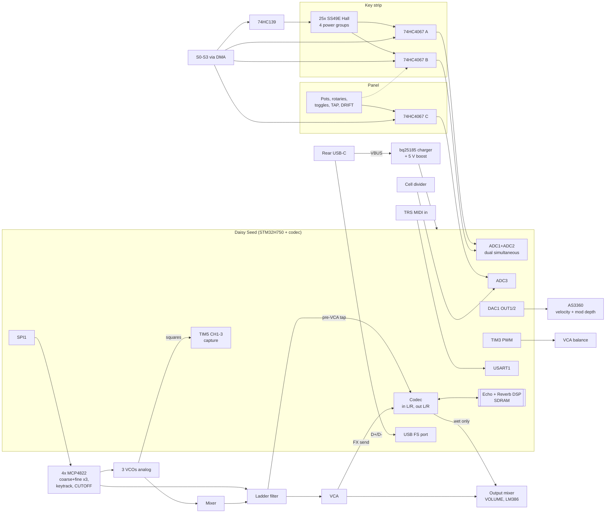

# Daisy Seed, from first principles: every subsystem it touches

Status: rev 0, 2026-11-13. Answers the owner (`design/little-d/owner.md`, after "Switch to Daisy Seed"): "Also the key thing you need to port - go back to first principles and see if there's a better way with Daisy seed. Do this with all the things Daisy seed affects".

**Scope.** For each subsystem the Seed touches, this doc works through four steps:
1. what the job fundamentally needs;
2. the best Daisy-native way to do it;
3. how that compares with the Pico-era design (`budget-variant.md` rev 12, `velocity-and-keys-v2.md`, `single-chip-research.md`) and with the straight port (`daisy-pin-and-audio-check.md` §1.4);
4. a recommendation.

**What doesn't change.** The voice stays analog, as the owner decided: VCOs, ladder, contours, VCA, noise, and osc 3 as the LFO.

**Conventions** as in `budget-variant.md`:
- A link means I read the source this session.
- **UNVERIFIED** = a source exists but I couldn't confirm the figure.
- **ESTIMATE** = my number.
- [ENG] = engineering judgement. [CALC] = arithmetic.

**Sources read this session:**
- **Seed datasheet:** [Daisy Seed datasheet v1.0.5](https://www.electrokit.com/upload/product/41020/41020659/Daisy_Seed_datasheet_v1.0.5.pdf), cited as "Seed DS".
- **H750 datasheet:** [STM32H750 datasheet DS12556](https://cdn.sparkfun.com/assets/b/6/0/6/b/stm32h750ib.pdf), cited as "H750 DS". Its rev Y tables were the ones I could read.
- **ADC app note:** [ST AN5354, 16-bit ADC on STM32H7](https://www.st.com/resource/en/application_note/an5354-getting-started-with-16bit-adc-on-stm32h7-mcus-stmicroelectronics.pdf).
- **DAC datasheet:** [MCP4822 datasheet](https://people.ece.cornell.edu/land/courses/ece4760/PIC32/Microchip_stuff/MCP4822_DAC.pdf).
- **Hall sensor datasheet:** [Honeywell SS49E](https://atom.ubbcluj.ro/alpar/datasheets/sensors_actuators/Honeywell%20SS49E.pdf).
- **libDaisy USB:** [libDaisy UsbHandle](https://electro-smith.github.io/libDaisy/class_usb_handle.html).

---

## 0. Bottom line

| # | Subsystem | Straight port (`daisy-pin-and-audio-check.md`) | **Daisy-native recommendation** | Why it's better |
|---|---|---|---|---|
| 1 | Keys + velocity | 3× CD4067, a timer + DMA scan at 4 kHz per key | **3× CD74HC4067 on 3 separate ADCs: ADC1 + ADC2 simultaneous for the keys, ADC3 for controls. Hardware-paced at ≈ 8–10 kHz per key with 4× hardware oversampling.** Optional Hall **group power-gating**, decoded from the mux selects (0 extra pins) | Velocity error ≈ 1.0 → ≈ 0.35 MIDI steps at ff (ESTIMATE). Gating could save **≈ 0.45–0.95 W**, more than the Daisy costs (bench-gated) |
| 2 | Autotune / pitch | TIM5 ×4 (3 VCOs + filter comparator) | **TIM5 CH1–3 for the VCOs, unchanged, now also closing the loop on held notes. The filter-scale cal moves to the codec's free right input channel.** Codec L (the FX send) doubles as the VCA auto-null monitor | Timer capture beats the codec for VCOs on every axis. The codec beats the comparator for the filter. Frees D16 and a comparator |
| 3 | Pots / switches | Muxes on the key scan | Same 3 muxes. The controls get their own ADC (ADC3). 10 kHz raw → 1 kHz control rate, with oversampling + 1-pole + deadband. Jump-on-move with a "not in control" LED | 46 of 48 channels used. Noise is far below 1 step of any MIDI CC |
| 4 | CVs | 2× MCP4822 (pitch ×3 + keytrack) + 3 PWM | **4× MCP4822: coarse + fine for each VCO (fine at 1/64), plus keytrack and CUTOFF. The Seed's 2 internal DACs drive velocity and mod depth. One PWM is left, for the static VCA balance** | Pitch steps go from **2.3 cents → ≈ 0.04 cent**. **DRIFT needs this**: slow wander in 2.3-cent steps would audibly staircase. No PWM ripple on any audible CV. Fixes a gap: **CUTOFF had no CV channel** in the Pico-era list. ≈ +$8 |
| 5 | MIDI / USB | Seed's internal USB, plus USART1 | **One rear USB-C:** VBUS goes to the charger; D± go to the **Seed's own USB port** through a cut cable (Seed VBUS not connected). Gives USB-MIDI and ROM DFU firmware updates on the same port. TRS in on USART1 RX (PB7 is 5 V-tolerant); TRS out optional | Matches E3 ("one port for everything") with 0 header pins, and keeps D29/D30 free |
| 6 | Effects path | VCA out → codec → wet sum | Same topology. **The wet return carries no dry copy** (otherwise 1–2 ms comb filtering against the analog dry path). Mix in DSP; one fixed analog summing resistor. Gate-aware input mute | Dry path is analog and never switched. Latency only touches the wet signal |
| 7 | Power | — | Seed ≈ **+0.3–1.0 W** over the Pico (ESTIMATE; measure). Run at 400 MHz with WFI idle. Cell voltage on a direct ADC3 pin for a battery gauge and a low-battery warning; optional charger STAT and VBUS-detect pins | Runtime ≈ −10 to −30 % without gating. With Hall gating it's ≈ break-even |
| 8 | Other | — | Store the autotune and key tables in the Seed's QSPI flash, so boot is fast and verified in the background. DRIFT added on the fine DACs inside the closed loop. Mod-VCA feedthrough nulled by measuring pitch on TIM5 (optional) | No new parts |

**Pins: 27 required of 31.** Up to 3 more are optional (MIDI out, charger STAT, VBUS detect), and D16 is spare (§9).

**Parts delta against the straight Daisy port:**
- +2 MCP4822;
- CD4067 → CD74HC4067;
- a USB cable to cut;
- optional 74HC139 + 4 PNP for Hall gating;
- −2 PWM RC networks;
- −1 filter comparator.

**Net ≈ +$11–15** (ESTIMATE).

**Risk:** low–medium. All of it is firmware on known peripherals, except three bench unknowns:
- SS49E power-on time (only matters for gating);
- Seed current draw;
- the Seed input's AC-coupling corner.

**Gate:** the breadboard spike in §10 (≈ 2 evenings). Pass before layout.

---

## 1. Key sensing + velocity

### 1.1 What the job needs
- **25 position sensors.** Hall + magnet under Choc V2 silent switches; the physical keys are locked (`velocity-and-keys-v2.md` §2).
- **Velocity:** a least-squares slope of linearised depth against time, over 15–75 % of a 2.8 mm stroke.
  - The fastest strike crosses the window in ≈ 1.4 ms at 1 m/s (`keys-answers.md` §3).
  - Accuracy is set by **samples per stroke × noise per sample**.
- **Note on/off:** hysteresis at 0.70 / 0.40 depth, with partial re-strikes (`keys-answers.md` §4).
- **Latency:** < 1 ms from crossing to gate, and < 2 ms for the CV to settle.
- **Hall-strip power: 150–250 mA (0.6–1.25 W at 5 V via the LDO).** This is the largest load in the digital domain (`round4-answers.md` §3.1).

### 1.2 What the H750 offers
- **Three 16-bit ADCs.** ADC1 and ADC2 can run in **dual simultaneous mode**. Three-ADC operation reaches 10.5 Msps total on BGA packages (AN5354 pp. 16–17).
- **Rates:** 3.6 Msps per ADC on fast channels with BOOST, 2.0 Msps without, 1.0 Msps on slow channels (H750 DS Table 85). The figure is package-dependent (AN5354 p. 15). The Seed's MCU package is UNVERIFIED, but even 1 Msps is ≈ 10× what's needed.
- **Hardware oversampling 2×–1024×.** Measured ENOB is 13.7 bits at 1×, 14.5 at 4× and 15.1 at 16× (differential; AN5354 p. 6). Single-ended at 16-bit: **ENOB 11.6–12 bits, SNR 72–74 dB** (H750 DS Table 85).
- **ADC3 is reachable on two Seed header pins:**
  - PC0 = ADC123_INP10 = Seed A0/D15;
  - PC1 = ADC123_INP11 = Seed A5/D20 (H750 DS Table 7).

  Every other Seed analog pin is ADC1/ADC2-only. So **three truly parallel conversion paths exist on the header.**
- **Sample capacitor 4 pF; external source impedance up to 50 kΩ** (H750 DS Table 85).

### 1.3 Options from first principles

| Option | Pins | Per-key rate | Verdict |
|---|---|---|---|
| **No muxes** | 25 ADC pins needed; only 9 are free after TIM5 | — | Impossible on the Seed header |
| External SPI ADCs (4× MCP3208-class DIP, 32 channels) | 4 CS + SPI shared | ≈ 3 kHz (100 ksps parts, ESTIMATE) | Worse: 12-bit, slower, ≈ $16 (ESTIMATE). Out |
| 8:1 muxes (74HC4051): 4 for keys + 3 for controls | 7 ADC + 3 selects = **10** | ≈ 20 kHz | ADC speed isn't the bottleneck, so it costs 3 pins for nothing. Out |
| **3× 16:1 (74HC4067), one per ADC (pick)** | 3 ADC + 4 selects = **7** | **≈ 10–20 kHz** raw | Same pins as the Pico plan; settle time dominates; the rate is far beyond need |

**Scan timing [CALC]:**
- **Per step:**
  - mux settle ≈ 1 µs (CD74HC4067 Ron ≈ 70–100 Ω, `keys-answers.md` §3);
  - then **all three ADCs convert at once**: 4× oversampled at ≈ 0.3–0.5 µs per conversion ≈ 1.5–2 µs.
  - ≈ 3 µs per step in total.
- **Per frame:** 16 steps ≈ 50 µs, so ≈ 20 kHz possible.
- **Design point: a timer-paced 8–10 kHz frame.** That's 2× the Pico design's samples per stroke, each 2× quieter (4× oversampling).
- **ADC3 slow channel:** ADC3 on PC0 is a slow channel (1 Msps; the fast/slow class of INP10 is per AN5354 pp. 7–8, UNVERIFIED for this pin). At 1 Msps it still finishes inside the step without oversampling. Controls get averaged across frames instead (§3).

**Velocity accuracy [CALC, scaled from `keys-answers.md` §3 Monte Carlo]:**
- The LS slope error scales as σ/√N:
  - 2× the samples → ÷1.41;
  - 4× oversampling halves σ → ÷2.
- Choc at 1.5 m/s: **1.0 → ≈ 0.35 MIDI steps RMS**; at 1.0 m/s, 0.7 → ≈ 0.25.
- Full 7-bit velocity with margin, and enough for 14-bit high-resolution velocity on USB.
- **Caveat:** the SS49E publishes no noise figure (datasheet p. 1: "low noise output", no number). If sensor noise exceeds ADC noise, oversampling buys less. The spike measures it (§10).

**Hardware pacing (no CPU in the timing loop) [ENG]:**
- One advanced timer, two compare events:
  - CC1 fires a DMA write of the next select code to **GPIOC→BSRR**. S0–S3 stay on PC9–PC12, all on port C, as in `daisy-pin-and-audio-check.md` §1.4.
  - CC2, ≈ 1 µs later, triggers ADC1+2 (dual mode) and ADC3.
- **DMA:** ADC1+2 use one stream (packed 32-bit); ADC3 its own.
- **Firmware traps:**
  - On the H750, ADC3 lives in the D3 domain. Its DMA may need BDMA with buffers in SRAM4. Whether DMAMUX1 also serves ADC3 is UNVERIFIED (check RM0433).
  - Put all DMA buffers in non-cacheable D2 SRAM (libDaisy's DMA section), or the M7 D-cache serves stale samples.
- **Sample times:** each sample carries the timestamp of its slot (step index × step time). The LS fit uses true times, so skew within a frame costs nothing.

### 1.4 Different sensing, now that there's CPU?

| Idea | Verdict |
|---|---|
| Continuous position for aftertouch | **No.** The Halls already track position continuously, but the Choc hits a hard bottom at 2.8 mm. The only "pressure" is the silent damper's squish, maybe ≈ 0.1–0.3 mm (UNVERIFIED), which isn't repeatable enough to play. Try it on the bench (§10) as an experimental "squeeze"; don't promise it |
| Release velocity | **Yes, free.** The same slope fit on the up-stroke, sent as MIDI note-off velocity. It can also optionally shorten the contour release (firmware only, no analog change). Owner's call; default off |
| Per-key calibration | **Yes, already planned**, now better: per-key rest/bottom learning **plus a per-key field-curve LUT and a supply-ratio correction**. The Hall LDO rail is read on one mux channel, so the SS49E's supply-proportional output (datasheet p. 1) is divided out against the Seed's ADC reference |
| Adjustable actuation depth / velocity curve | Free firmware settings (via a hold-TAP combination or MIDI) |
| Optical (TCRT5000-class) or capacitive sensing | Out. Optical draws similar or higher LED current, and capacitive sensing gives worse velocity resolution. No gain |

### 1.5 Hall group power-gating (the biggest power win, bench-gated)
- **Idea:**
  - Split the strip into **4 groups** by mux step: (S3, S2) = 00/01/10/11, so each group is 4 steps × 2 key muxes ≤ 8 sensors.
  - A **74HC139** decodes S3/S2 directly into 4 active-low outputs. Each drives a **2N3906 PNP high-side switch** (base resistor) feeding its group.
  - **Zero GPIO.** Only the group being scanned is powered.
- **Timing [CALC]:**
  - frame = 4 × (T_on + 4 steps × 3 µs);
  - T_on = 25 µs → 148 µs → **6.8 kHz per key** (still above the 4 kHz design number);
  - T_on = 50 µs → 4.3 kHz.
- **Saving:** sensor duty 25 %, so **≈ 75 % of 0.6–1.25 W ≈ 0.45–0.95 W** [CALC]. The LD1117 also runs cool, and the boost-stall risk at power-up shrinks.
- **Unknown:** the SS49E power-on (start-up) time is **not specified**. The datasheet gives only a 3 µs response time (p. 2). **Measure it** on the spike: power-step a sensor and scope the output settling to 0.1 %.
  - If it settles in ≤ 50 µs, adopt gating.
  - If not, leave the decoder and PNPs unfitted, with their footprints on the strip.
- **PNP drop (≈ 0.1–0.2 V):** the ratio correction (§1.4) absorbs it.
- **Cost ≈ +$0.70** (74HC139 ≈ $0.50 + 4 × 2N3906 + resistors; ESTIMATE).

### 1.6 Recommendation
- **Muxes:** 3× **CD74HC4067** on ADC1 (PC4 / A6), ADC2 (PB1 / A2) and ADC3 (PC0 / A0).
- **Scan:** hardware-paced at an 8–10 kHz frame, 4× oversampling, LS-slope velocity.
- **Gating:** footprints for Hall group gating, fitted if the SS49E power-on test passes.
- **Against the Pico era:**
  - same 7 pins;
  - 2× rate and ½ noise;
  - a parallel controls ADC;
  - possibly −0.45 to −0.95 W.
- **Parts:** CD4067 → CD74HC4067, +$0.6–1.2 (ESTIMATE); gating +$0.70 optional.
- **Risk:** L. The DMA plumbing (BDMA for ADC3, cache) is the main firmware trap.

---

## 2. Autotune and pitch measurement

### 2.1 What the job needs
- **Measure each VCO's frequency** across ≈ 8 octaves. Error ≪ 1 cent: target < ±1 cent tracking (`architecture.md` §7 targets).
  - **Fast at boot.**
  - **Continuous while playing**, for drift and background re-tune.
  - **All 3 VCOs**, because the mixer levels are analog pots and the firmware **cannot mute** an oscillator.
- **Filter scale:** self-oscillation frequency against the keytrack/cutoff CV, ±10 cents over 3 octaves (`architecture.md` §7).
- **VCA balance:** the CV feedthrough step at the VCA output.

### 2.2 TIM5 input capture vs codec input

| | **TIM5 input capture** (straight-port plan) | **Codec input + DSP pitch detection** |
|---|---|---|
| Pins | 1 per VCO (D25/D24/D28) + 100 k + clamp each | 0 GPIO **if** one signal. For 3 VCOs: a 4:1 analog mux (CD4052) + 2 select GPIO, because a single summed input can't separate 3 unmuteable VCOs reliably |
| Resolution | Timer clock ≈ 200–240 MHz. At 4 kHz, ≈ 50–60 k counts per period ≈ **0.03 cent per single period**. Averaging N periods is better [CALC; clock UNVERIFIED, `daisy-pin-and-audio-check.md` §1.3] | Band-limited to < 24 kHz at 48 kHz fs. Sub-sample zero-crossing interpolation: σ_t ≈ noise/slew. At 80 dB SNR that's ≈ 0.03 cent per cycle on a sine [CALC]. Comparable on a clean sine, worse on a square through the decimation filter (ringing) [ENG] |
| Simultaneity | **All 3 at once**, continuously | One at a time through the mux |
| Range | 0.1 Hz (32-bit wraps at ≈ 18 s) up to ≫ 20 kHz | ≥ the AC-coupling corner (UNVERIFIED, Seed input 30 kΩ, cap unknown) up to ≈ 20 kHz |
| Latency | One period, plus averaging | One audio block plus a window (≈ 10–50 ms) |
| CPU | ≈ 0 (DMA logs edges) | Small, but on the audio core |
| Interaction with FX | None | Uses the codec's only free input channel. L carries the synth FX send; R is free (stereo in, Seed DS p. 3) |
| Extra parts | Clamp per VCO (already planned) | CD4052 + buffer |

**Verdict:**
- **VCOs → TIM5 CH1–3.** It wins on simultaneity, continuity, pins, CPU and range. The codec route is a step backwards for VCOs.
- **Filter → codec R input.** The filter's self-oscillation is a sine, so it needs no comparator. And because **TIM5 already knows all 3 VCO frequencies**, the DSP can find the self-oscillation peak *even with oscillators audible in the mix* (the Pico plan's comparator couldn't).
  - It also measures amplitude, so it can detect resonance onset automatically.
  - Precision ≈ 0.004 cent over 50 cycles [CALC] against a ±10-cent need.
  - Cal points ≥ 100 Hz stay clear of the unknown AC-coupling corner.
- **VCA auto-null → codec L.** L is the post-VCA FX send. The feedthrough "thump" is a transient, which an AC-coupled input passes. The servo minimises thump energy below ≈ 50 Hz at 24-bit resolution [ENG; method UNVERIFIED].
  - Fallback: a DC sense on the spare ADC3 pin (D20 is taken by the battery; use mux channel 47 or D16).

### 2.3 Closed-loop pitch on held notes (new; needs §4's fine DAC)
- **Loop:** while a note is held, TIM5 averages ≥ 50 ms of periods per VCO and trims that VCO's **fine** DAC toward target + DRIFT offset.
  - τ ≈ 2 s, step < 0.1 cent: inaudible, and it never locks the VCOs together, because each tracks its own target.
- **What it corrects:**
  - coarse-DAC DNL (±0.75 LSB max, MCP4822 DS p. 3);
  - reference tempco (45 ppm/°C typ, 160 max over 0–85 °C, p. 4);
  - thermal drift.
- **Freeze rule:** freeze the loop when period variance shows FM. OSC MOD on, or glide/bend moving, is visible as variance. The firmware can't read the analog OSC MOD toggle, so detect by variance [ENG].
- **Boot:** store per-VCO tables in QSPI flash. At power-on, run a 3-point verify (≈ 0.3 s) instead of a full sweep. Run a full re-sweep only if the verify fails or on request (hold TAP at power-on).

### 2.4 Recommendation, pins, parts, risk
- **Pins:**
  - TIM5 CH1–3 on D25, D24, D28.
  - **D16 is freed** (TIM5 CH4 reserved as the comparator fallback).
  - Codec R in = ladder output (pre-VCA) through a TL072 half at −6 dBFS.
  - Codec L = FX send (§6).
- **Parts:** −1 comparator/clamp, +1 buffer half: **≈ $0**.
- **Risk:** L for the VCOs. L–M for codec-based filter cal and the thump servo (new firmware), with the comparator/DC-sense fallbacks kept as footprints.
- **Against the Pico era:** PIO counters ≈ TIM5. The codec adds a better filter cal and a better VCA null for free.

---

## 3. Pot and switch scanning

### 3.1 What the job needs
**22 control channels:**
- RANGE ×3;
- FREQ 2 and FREQ 3;
- TUNE;
- GLIDE;
- CUTOFF;
- MOD dial;
- bend X;
- VELOCITY toggle;
- 8 FX controls: 5 pots, 2 four-way rotaries, TAP;
- DRIFT;
- Hall-rail monitor.

Battery goes direct (§7). With 25 keys that's **46 of 48 mux channels, 2 spare**.

**Requirements:**
- no audible zipper on CUTOFF;
- no jitter-driven MIDI CC spam;
- jump-on-move for MIDI-controllable parameters;
- ≤ 5 ms response.

### 3.2 Daisy-native design [ENG]
- **Mux layout:**
  - **Mux C (ADC3) carries 16 controls.**
  - The other 6 controls, plus the Hall-rail monitor, ride mux B (ADC2) channels 9–15, after keys 17–25.
  - Every control is sampled every frame (8–10 kHz).
- **Signal chain per control:**
  1. average 8–10 frames → 1 kHz;
  2. 1-pole smoother (τ ≈ 5–10 ms; ≈ 2 ms for CUTOFF and bend);
  3. a **deadband of ≈ 0.1 % FS** for change detection and MIDI CC output.
- **Effective resolution:** ≈ 12 ENOB single-ended (H750 DS Table 85) plus averaging → ≈ 14 bits [CALC]. That's 100× finer than 7-bit CC and supports 14-bit CC.
- **Hardware:**
  - 10–100 nF at each pot wiper. With a 10 k pot (≤ 2.5 kΩ source) it's ≤ 250 µs: an HF filter, and a charge reservoir for the 4 pF sample cap.
  - **No cap on the Hall channels** (velocity bandwidth).
  - Lay out pot wiring away from the key-mux outputs.
- **Rotary TYPE switches and the VELOCITY toggle:** resistor ladders with ±⅓-step windows, 20 ms debounce, and hysteresis.
- **TAP:** a mux channel with a pull-up and 5 ms debounce. Also the boot gesture (full autotune / DFU) and the filter-cal gesture (EMPHASIS full + hold TAP).
- **Jump-on-move:**
  - When MIDI (or a stored state) sets a parameter, its pot goes "not in control" and the LED lights.
  - It retakes control once it moves > 1.5 % from where it was when control was lost, then jumps to the pot's position. This is the owner's "jump-on-move".
  - Knob-only controls send no MIDI; MIDI never flips switches (owner rules).
- **Against the Pico era:** same 3 muxes and same pins. The controls now get their own converter, so key timing and control reads never contend.
- **Risk:** L. **Cost:** caps ≈ $0.30.

---

## 4. CV generation

### 4.1 What the job needs

| CV | Accuracy needed | Notes |
|---|---|---|
| VCO 1–3 pitch | ≈ 0.2 cent steps over ≈ 8 octaves for smooth glide, bend and **DRIFT**; ±1 cent absolute after autotune | 1 mV at the expo ≈ 1.2 cents (`answers-E1-E10.md`). DRIFT is a slow wander of a few cents, so steps of 2.3 cents would be audible stairs |
| Filter keytrack | 12-bit is fine (≈ 6 cents per step on a filter, `architecture-v2.md`) | Through the KEYBOARD CONTROL toggle |
| **CUTOFF** (pot / MIDI CC + velocity offset) | 12-bit with slew | **Gap found:** the Pico-era channel list had no CV for CUTOFF (`velocity-and-keys-v2.md` §1.1 flagged it UNVERIFIED; `daisy-pin-and-audio-check.md` lists only 3 PWMs) |
| Velocity (AS3360 B) | 10-bit, settles < 1 ms, no ripple | Audible as gain |
| Mod depth (AS3360 A) | 10-bit, low noise | Audible as modulation depth |
| VCA balance | Static DC trim | Set at autotune |

### 4.2 Options

| Source | Facts | Fit |
|---|---|---|
| **MCP4822** (12-bit, SPI) | DNL ±0.2 typ / ±0.75 max LSB, **monotonic**; INL ±2 typ / ±12 max; ref 2.048 V, 45 ppm/°C typ; 1.2 µV/√Hz; 4.5 µs settling; 20 MHz SPI (DS pp. 3–4) | Pitch: 2.3 cents per step over 8 octaves, so it needs coarse + fine |
| **Seed internal DAC** (2 ch, PA4/PA5) | DNL **±2 LSB typ**, INL ±4 typ; SNR 67.8 dB / ENOB 10.9; 1.7 µs settling; buffer-off range 0–VREF+ at ≤ 50 pF (H750 DS Tables 87–88). Reference = the Seed's 3V3A | **Not for pitch:** non-monotonic risk, and the reference is a supply. **Good for velocity and mod depth:** no ripple, instant, 0 parts |
| PWM (TIM3) + 2-pole RC | Amplitude = the MCU's digital 3.3 V (noisy); ripple vs settling trade (`velocity-and-keys-v2.md` §1.1) | Fine for a static DC trim (VCA balance). Avoid it on audible CVs now that better is free |
| Dithered 12-bit + RC + TIM5 loop | Sub-LSB on average, but **continuous 48 kHz SPI traffic** next to analog CV lines, plus a pitch-CV RC lag | Rejected: it trades a known noise source for resolution [ENG] |
| 16-bit through-hole DAC (LTC1655 DIP-8 class) | 1 channel per chip; price UNVERIFIED (≈ $10–15 ESTIMATE) | 3 chips ≈ $30–45. Coarse + fine with the TIM5 loop gets equal results for ≈ $8 |

### 4.3 Recommendation [ENG]

**Allocation:**

| Chip / source | Ch A | Ch B |
|---|---|---|
| MCP4822 #1 | VCO 1 coarse | VCO 1 fine |
| MCP4822 #2 | VCO 2 coarse | VCO 2 fine |
| MCP4822 #3 | VCO 3 coarse | VCO 3 fine |
| MCP4822 #4 | Filter keytrack | **CUTOFF** (+ velocity offset in firmware) |
| Seed DAC1_OUT1 (D23, PA4) | Velocity → AS3360 B (buffer off → TL072 scale/RC) | — |
| Seed DAC1_OUT2 (D22, PA5) | Mod depth → AS3360 A | — |
| TIM3_CH3 PWM (D4, PC8) | VCA balance (static; heavy RC, ≈ 10 Hz) | — |

**Fine channel:**
- It sums into each VCO's CV summer through a resistor **64×** the coarse one (e.g. 100 k : 6.8 M, any value, calibrated).
- Fine span ≈ 64 coarse LSB ≈ 150 cents, so **fine LSB ≈ 0.036 cent** [CALC].
- TIM5 measures the fine scale at autotune. Coarse DNL and reference drift are trimmed out by the held-note loop (§2.3).
- **DRIFT = a firmware random walk on the fine channel**, inside the loop, so 0 really is rock steady.

**Updates:**
- at control rate (1–2 kHz) and only when values change: glide, bend and drift tick at ≤ 2 kHz;
- LDAC tied low;
- one SPI bus, 4 CS.

**Supply check:** the MCP4822's logic-high threshold scales with VDD (0.7 × VDD typical for this family, UNVERIFIED this session). Run the DACs at **3.3 V with G = 1 (2.048 V FS) and TL072 gain**, or the Seed's 3.3 V logic may not drive them at 5 V. This applied to the Pico design too, so check it at schematic capture.

**Summary:**
- **Pins:** SPI SCK + MOSI + 4 CS = 6, plus 2 DAC pins and 1 PWM.
- **Against the Pico era:** 4 + 3 PWM → 8 MCP + 2 DAC + 1 PWM.
- **Parts:** +2 MCP4822 (≈ $7.98 at the TME $3.99 basis, `budget-variant.md` §v1.3), +6 resistors, −2 PWM RC networks. **≈ +$8.**
- **Risk:** L. Coarse + fine summing is standard, and calibration is automatic via TIM5.

---

## 5. MIDI and USB

### 5.1 What the job needs
- USB-MIDI device and TRS MIDI in (locked spec).
- **One rear USB-C for charging + MIDI + firmware** (E3, `answers-E1-E10.md`).
- MIDI clock for FX sync.
- No ground-loop surprises.

### 5.2 Daisy facts
- The Seed has **two USB peripherals**:
  - the on-board port (OTG FS);
  - "external USB pins": D29/D30 = PB14/PB15, USB_HS D−/D+ (Seed DS p. 3).
- libDaisy can transmit on either ("TransmitInternal … on board USB FS port", "TransmitExternal … external USB Pins", [UsbHandle](https://electro-smith.github.io/libDaisy/class_usb_handle.html)).
- **Firmware updates by DFU** run on the on-board port. That the STM32 ROM DFU is on OTG FS only is UNVERIFIED; check AN2606.
- The Seed may be powered from VIN and USB at once (Seed DS p. 2).

### 5.3 Options

| | U1: rear USB-C → **Seed's own port** (pick) | U2: rear USB-C → D29/D30 |
|---|---|---|
| Wiring | Adafruit #4090 breakout ($3.45, `answers-E1-E10.md` E3). VBUS → bq25185 charger. **D+/D−/GND twisted pair → a cut USB cable plugged into the Seed** (micro-B on Rev 7 / Seed2 DFM, C on Seed3). **Seed VBUS wire not connected**: the Seed runs from VIN | Same breakout; D± to header pins 36/37 |
| USB-MIDI | Yes | Yes |
| Firmware update via the rear port | **Yes** (libDaisy reset-to-bootloader, triggered by a TAP-at-power-on gesture) | No: the update needs the internal port (open the back) |
| Header pins | **0**; D29/D30 freed | 2 |
| Risk | Enumeration without VBUS on the Seed's connector (VBUS-sense setting UNVERIFIED). Bench check; if needed, feed Seed VBUS from the breakout through a Schottky | Low |

### 5.4 TRS MIDI
- **In:** 6N138 → **D14 PB7 USART1_RX**. PB7 is 5 V-tolerant (Seed DS p. 2: only header pins 24, 25, 28, 29 and 30 are 3.3 V-only), so the opto can pull up to 3.3 or 5 V.
- **Out (optional):** **D13 PB6 USART1_TX**, with 2 series resistors to a TRS-A jack.
  - ≈ +$0.30.
  - **Owner decision:** it's an extra jack, and the owner said "no extra patch points beyond pitch CV/gate out + filter CV in". USB-MIDI already sends.
- **Clock / sync:** both transports are parsed on the control path and feed the FX tempo. 0 pins.

**Recommendation:** U1. **Cost:** ≈ $3.45 + a $2–3 cable (ESTIMATE). **Against the Pico era:** the same E3 idea (Pico test pads ↔ Seed port), and no BOOTSEL pinhole needed: the Seed's own BOOT/RESET buttons are inside for recovery. **Risk:** L–M (VBUS sense, ESD as E3).

---

## 6. Effects architecture

### 6.1 What the job needs
- Echo (4 types) and reverb (4 types) of "great models".
- **The dry path analog and never switched.**
- Wet noise inaudible (`daisy-pin-and-audio-check.md` §3.2).
- Tails ring after the VCA closes.
- Speaker, phones and line all get the effects.

### 6.2 Signal path [ENG]

```
VCA out ─┬─────────────── dry (analog, never switched) ─────────────► OUTPUT MIXER ─► VOLUME ─► LM386 / phones / line
         ├► TL072: gain to −6 dBFS peak, diode soft-clip, RC AA ─► codec IN L ─┐
ladder ──┴► (pre-VCA tap) TL072 buffer ───────────────────────────► codec IN R ─┤ (filter cal only)
                                                                               ▼
                                           DSP: input mute (gate-aware) → ECHO → REVERB → wet L/R (no dry copy)
                                                                               ▼
                                    codec OUT L/R ─► RC ─► fixed summing R ─► OUTPUT MIXER (mono sum to speaker/line;
                                                                                 stereo to phones optional)
```

**Rules:**
- **The wet return contains only effect signal.** If the DSP passed any dry, its ≈ 1–2 ms converter + block latency would comb-filter against the analog dry. ECHO MIX and REVERB MIX are wet levels in DSP.
- **With both mixes at 0 the codec outputs digital silence**, and the instrument is electrically the analog-only voice.
- **Levels:**
  - The Seed's input is AC-coupled, 3.6 Vpp (≈ 1 Vrms) full scale, 30 kΩ; its output is 0 dBFS = 1 Vrms from 100 Ω (Seed DS pp. 2–3, 6, 8). That's pre-Seed3 data; TAC5242 levels are per `daisy-pin-and-audio-check.md` §3.1.
  - Scale the hottest patch to −6 dBFS.
  - The output summing resistor sets the wet ceiling at ≈ dry level.
- **Latency:** wet only. Irrelevant for echo and reverb.
- **Mix in DSP vs analog pots:** DSP mixing wins. It needs no extra pots in the audio path, allows equal-power mixing, click-free type crossfades and MIDI-synced repeats, and lets the gate-aware input mute (noise only enters while notes sound).
- **Grounding:** the Seed's AGND (pin 20) goes to the analog star. "AGND must be connected to DGND" (Seed DS p. 6), so make that one join under the Seed.

**DSP budget and memory:** unchanged from `daisy-pin-and-audio-check.md` §3.4: echo + CloudSeed-class reverb ≈ 40–60 % at 400 MHz, with long buffers in SDRAM and dense taps in SRAM.

**Risk:** L. **Cost:** as `single-chip-research.md` §5.3 (TL072s, passives), plus 1 TL072 half for R.

---

## 7. Power and battery

### 7.1 Daisy draw [ESTIMATE; measure on the spike]
- **H750 core:** run mode at 400 MHz from flash with cache on is **105 mA typ with peripherals off, 160 mA with all on**. Sleep is 31 mA; Stop is 1.4–2.85 mA (H750 DS Tables 29, 33, 34, rev Y).
- **SDRAM + codec + regulator:** ≈ 30–80 mA (ESTIMATE; no Seed figure published, Seed DS p. 2 lists none).
- **Seed total ≈ 110–220 mA at 3.3 V.**
  - If the Seed's regulator is linear from VIN (UNVERIFIED), that's **0.55–1.1 W at 5 V**; if it's a switcher, ≈ 0.4–0.8 W.
  - Against the Pico's 0.1–0.15 W: **Δ ≈ +0.3–1.0 W.**
- **Runtime** on the 22.2 Wh pack (`battery.md`), [CALC, ∝ 1/P]:
  - 9.0 h → 6.0–7.8 h at the 2.0 W end;
  - 4.7 h → 3.7–4.3 h at the 3.6 W end.

### 7.2 Daisy-native savings
1. **Stay at 400 MHz** (no 480 "boost"). The DSP estimates fit with headroom.
2. **WFI between audio blocks.** Sleep draws 31 mA against ≈ 105 mA running. At ≈ 50 % DSP load, ≈ −30 mA (ESTIMATE).
3. **48 kHz, not 96.**
4. **Hall group gating (§1.5): −0.45 to −0.95 W.** That alone offsets the Seed.
5. Not Daisy-specific, but cheap: a ready-made 3.3 V buck for the Hall rail instead of the LD1117 saves ≈ 0.2–0.4 W (`round4-answers.md` §3.1).

**Sleep modes:** the instrument has a hard power switch, so true standby would need a soft-latch power circuit. Not worth it for one unit [ENG]. Idle behaviour = WFI, plus LEDs dimmed after a few minutes.

### 7.3 Battery gauge and charge state
- **Cell voltage:** 100 k / 100 k + 100 nF divider → **D20 (PC1, ADC3 direct)**, oversampled ×256.
  - The firmware compensates for load: it knows its own state (sensors gated, audio level).
  - It shows % on the status LED (hold-TAP query), warns at ≈ 3.5 V, and at ≈ 3.3 V mutes the FX and flashes before the boost's undervoltage cutoff.
  - **≈ $0.05.**
- **Optional:**
  - **charger STAT → D29** (Adafruit #6106 STAT pad availability UNVERIFIED);
  - **VBUS-present → D30** via a divider.

  That gives "charging / charged / on USB" indication. The charger itself stays autonomous (bq25185 settings are fixed by resistors).
- **The Seed can't manage charging, and shouldn't:** the bq25185 board does it safely in hardware. The Seed's job is monitoring and power sequencing:
  - sensor-LDO enable on D18, last;
  - LM386 enable on D12.

**Risk:** M (the Seed's draw is the biggest unknown left). **Gate:** measure it on the spike before freezing the battery choice.

---

## 8. What else gets better or simpler

| Item | Change | Cost |
|---|---|---|
| Boot time | Autotune + key tables in QSPI flash (8 MB on module): boot in ≈ 0.5 s, with a 3-point verify in the background | $0 |
| DRIFT | Random walk on the fine DACs inside the TIM5 loop. Per-VCO independent; DRIFT = 0 is truly locked | $0 (needs §4) |
| Mod-VCA (AS3360 A) feedthrough null | Step the mod-depth CV with OSC MOD on and read the VCO pitch shift on TIM5. Optional, replaces an ADC-sense path | $0 |
| 74HC595 / expander | Not needed (as in the straight port) | $0 |
| Glide | Firmware saturating curve, now at fine-DAC resolution: no stepping | $0 |
| Firmware LFO, noise, envelopes | **Stay analog** (owner). Not proposed | — |
| 14-bit MIDI CC and high-res velocity | Free with §1/§3 resolution | $0 |
| Seed internal op-amps/comparators (OPAMP1 on PC4/PA7, COMP1 on PB1/PC4, H750 DS Table 7) | Not used: those pins are mux inputs | — |

---

## 9. Revised pin allocation (Daisy Seed, header pin in brackets)

| Seed pin | MCU | Function | Use | Note |
|---|---|---|---|---|
| D0 [1] | PB12 | GPIO | MCP4822 #2 CS | |
| D1 [2] | PC11 | GPIO | Mux S2 | Port C: one BSRR write |
| D2 [3] | PC10 | GPIO | Mux S1 | " |
| D3 [4] | PC9 | GPIO | Mux S0 | " |
| D4 [5] | PC8 | TIM3_CH3 | PWM: VCA balance (static) | |
| D5 [6] | PD2 | GPIO | Status LED green | |
| D6 [7] | PC12 | GPIO | Mux S3 | Port C; S2/S3 also drive the 74HC139 Hall-gating decoder |
| D7 [8] | PG10 | SPI1_NSS / GPIO | MCP4822 #1 CS | |
| D8 [9] | PG11 | SPI1_SCK | DAC SPI SCK | |
| D9 [10] | PB4 | GPIO | MCP4822 #3 CS | Was mod-depth PWM |
| D10 [11] | PB5 | SPI1_MOSI | DAC SPI MOSI | |
| D11 [12] | PB8 | GPIO | MCP4822 #4 CS | |
| D12 [13] | PB9 | GPIO | LM386 enable | |
| D13 [14] | PB6 | USART1_TX | TRS MIDI out (**optional**) | Owner decision (extra jack) |
| D14 [15] | PB7 | USART1_RX | TRS MIDI in (6N138) | 5 V-tolerant |
| D15 [22] | PC0 | **ADC3** (INP10) | Mux C: 16 controls | Own converter |
| D16 [23] | PA3 | TIM5_CH4 / ADC12 | **Spare** (filter-comparator fallback, or VCA DC-sense fallback) | |
| D17 [24] | PB1 | **ADC2** (INP5) | Mux B: keys 17–25 + 7 controls/monitor | 3.3 V-only pin; mux at 3.3 V |
| D18 [25] | PA7 | GPIO | Sensor-LDO P-FET enable (pull-down = off at reset) | 3.3 V-only pin, output |
| D19 [26] | PA6 | GPIO | "Not in control" LED | |
| D20 [27] | PC1 | **ADC3** (INP11) | Battery voltage (direct) | |
| D21 [28] | PC4 | **ADC1** (INP4) | Mux A: keys 1–16 | Dual-simultaneous with ADC2 |
| D22 [29] | PA5 | **DAC1_OUT2** | Mod-depth CV → AS3360 A | 3.3 V-only pin, output |
| D23 [30] | PA4 | **DAC1_OUT1** | Velocity CV → AS3360 B | 3.3 V-only pin, output |
| D24 [31] | PA1 | TIM5_CH2 | VCO 2 count | 100 k + clamp to 3.3 V |
| D25 [32] | PA0 | TIM5_CH1 | VCO 1 count | " |
| D26 [33] | PD11 | GPIO | Gate out (and internal gate) | |
| D27 [34] | PG9 | GPIO | Status LED red | |
| D28 [35] | PA2 | TIM5_CH3 | VCO 3 count | " |
| D29 [36] | PB14 | GPIO | Charger STAT (**optional**) | Freed by USB plan U1 |
| D30 [37] | PB15 | GPIO | VBUS present (**optional**) | " |
| Audio in L/R [16/17] | codec | — | L = FX send (post-VCA); R = ladder tap (filter cal) | |
| Audio out L/R [18/19] | codec | — | Wet L/R → output mixer | |
| AGND [20] | — | — | Analog star | Join DGND once under the Seed |
| Seed USB port | OTG FS | — | Rear USB-C D± via a cut cable (no VBUS) | USB-MIDI + DFU |

**Tally:**
- **27 required.**
- **3 optional:** D13 MIDI out, D29 STAT, D30 VBUS detect.
- **1 spare:** D16.
- Mux channels: **46 of 48.**

---

## 10. Breadboard spike (re-aimed; ≈ 2 evenings, parts reused in the build)
Parts: Seed, 3× CD74HC4067, 4 SS49E + 4 D31 magnets + 2 Choc V2, 2× MCP4822, a 74HC139 + 2N3906, a function generator, the scope.

| # | Test | Pass |
|---|---|---|
| 1 | Timer-paced scan: CC1 → DMA → GPIOC BSRR, CC2 → ADC1+2 dual + ADC3, 4× oversampling, 10 kHz frame | Scope S0: jitter < 0.5 µs. Zero DMA overruns while the DSP runs echo + plate at 48 kHz |
| 2 | Hall noise: SS49E at rest and at mid travel, 1× vs 4× vs 16× oversampling | Noise ≤ 3 LSB12 RMS at 4× (confirms the velocity estimate) |
| 3 | **SS49E power-on time:** step its supply through a 2N3906 | Settles to 0.1 % in ≤ 50 µs → fit the gating |
| 4 | Velocity: Choc + D31, LS-slope fit, 20 soft-to-hard strikes | Monotonic, repeatable ±1 step at a fixed press |
| 5 | Damper "squeeze" travel at bottom-out | Report counts (aftertouch decision) |
| 6 | TIM5 ×3 on the function generator, 0.1 Hz – 15 kHz, with audio running | Error < 0.05 cent after 50 ms averaging |
| 7 | Coarse + fine MCP4822 into a summer; TIM5 measures a test VCO (or the generator's VCO input) | Fine step ≈ 0.04 cent; the loop holds ±0.1 cent for 10 min |
| 8 | Codec R: a sine plus two square "VCOs" summed; the DSP finds the sine frequency | Error < 1 cent at 100 Hz – 5 kHz |
| 9 | Codec L thump servo against a stepped DC offset | Residual step < 0.5 mV equivalent |
| 10 | USB U1: Seed port fed by a cut cable without VBUS; enumerate on macOS, Windows, Linux; DFU via the TAP gesture | Enumerates; flashes |
| 11 | **Seed current** at 5 V VIN: idle, echo + plate, echo + CloudSeed; 400 vs 480 MHz; WFI on/off | Record it. Feeds the battery choice |
| 12 | Codec noise with the TL072 level stage (from `daisy-pin-and-audio-check.md` §4) | Wet floor ≤ −95 dB re −6 dBFS peak (PCM3060) |

**Pass all → lock this design for schematic capture.** If test 3 fails, drop the gating (leave the footprints).

---

## 11. Simplified block diagram



---

## 12. Changes to make elsewhere
- **`daisy-pin-and-audio-check.md` §1.4:** superseded by §9 here. The filter counter moves to codec R; the CV plan moves to §4; USB moves to U1.
- **`budget-variant.md` §v1.2 Digital row:**
  - 4× MCP4822 (coarse/fine);
  - CD74HC4067 ×3;
  - Seed DACs for velocity and mod depth;
  - CUTOFF on MCP #4.
- **BOM:** ≈ +$11–15.
- **`velocity-and-keys-v2.md` §1:** VEL CV moves from PWM to Seed DAC1_OUT1 (same RC/TL072 stage, lower corner allowed). The CUTOFF channel is resolved.
- **Power (`round4-answers.md` §3.1, `battery.md`):**
  - add the Seed's measured draw;
  - gating credit if test 3 passes.
- **Design team:**
  - no panel change, except an optional MIDI OUT jack (owner decision);
  - the rear USB-C stays a single port.
